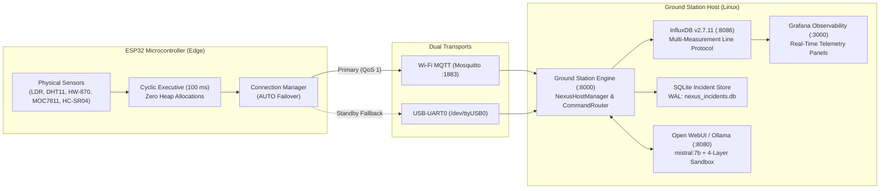

# NEXUS — Networked Environmental eXecutive with Unified Sensing

**NEXUS** (EDU_ROBO V14) is a production-grade, aerospace-grade embedded telemetry platform and distributed ground station. It bridges a native ESP32 dual-core microcontroller running a deterministic FreeRTOS cyclic executive with a high-throughput Python Ground Station, InfluxDB time-series persistence, Grafana telemetry observability, and a local conversational AI copilot.

NEXUS was engineered as an educational laboratory platform and rigorous qualification testbed, demonstrating real-time systems engineering, zero-leak memory invariants, failover networking, and defensible evidence attribution.



---

## 1. Quick Start & Operator Workflow

The complete NEXUS demonstration environment is managed using three idempotent shell scripts in [`scripts/`](scripts/):

```bash
# 1. Start all infrastructure containers, Ground Station server, and UI:
./scripts/nexus-demo-start.sh

# 2. Inspect runtime health, container states, and telemetry freshness:
./scripts/nexus-demo-status.sh

# 3. Stop all demo processes and containers cleanly (preserves databases):
./scripts/nexus-demo-stop.sh
```

### Demonstration Modes
- **Hardware Mode (Default):** Plug the ESP32 into USB (`/dev/ttyUSB0`) and run `./scripts/nexus-demo-start.sh`. Real-time sensor readings stream via MQTT and Serial.
- **Simulated Stream Mode:** Run `./scripts/nexus-demo-start.sh --mock-stream` to evaluate the complete Mission Control UI, InfluxDB persistence, and AI copilot without physical hardware.

### Service Ports & Direct Links
- **Mission Control Web Panel:** [http://127.0.0.1:8000](http://127.0.0.1:8000) (Dashboard, Command Builder, Telemetry Inspector, Incident Manager, Reference Manual)
- **Grafana Observability:** [http://127.0.0.1:3000](http://127.0.0.1:3000) (Login: `admin` / `nexus_grafana_password`)
- **Open WebUI AI Copilot:** [http://127.0.0.1:8080](http://127.0.0.1:8080) (Grounded natural-language telemetry assistant)
- **InfluxDB Data Engine:** [http://127.0.0.1:8086](http://127.0.0.1:8086) (Bucket: `nexus_telemetry`, Org: `nexus_org`)

---

## 2. Complete Engineering Documentation Sitemap

The NEXUS engineering documentation set is grounded in executable source code, hardware schematics, and measured physical qualification logs:

| Documentation Area | File Link | Scope & Purpose |
| :--- | :--- | :--- |
| **System Architecture** | [`docs/SYSTEM_ARCHITECTURE.md`](docs/SYSTEM_ARCHITECTURE.md) | High-level distributed architecture, 6 subsystem data flows, ports, and invariants. |
| **Firmware Architecture** | [`docs/FIRMWARE_ARCHITECTURE.md`](docs/FIRMWARE_ARCHITECTURE.md) | FreeRTOS task model, 100 ms cyclic executive, 4 bounded static data structures, and deadline accounting. |
| **Architecture Decisions (ADRs)** | [`docs/ARCHITECTURE_DECISIONS.md`](docs/ARCHITECTURE_DECISIONS.md) | 9 formal ADRs recording historical architectural choices vs recommended future patterns. |
| **Hardware & Pinouts** | [`docs/HARDWARE.md`](docs/HARDWARE.md) | Complete EDU_ROBO V14 pin map, CD4051 truth table, HC-SR04 3.32V safety, and Sensor Support Matrix. |
| **Protocol & Telemetry** | [`docs/PROTOCOL_AND_TELEMETRY.md`](docs/PROTOCOL_AND_TELEMETRY.md) | Protocol v1 JSON framing schemas, 256-byte ceiling, MQTT topic topology, and AUTO failover. |
| **Command & Data Reference** | [`docs/COMMAND_REFERENCE.md`](docs/COMMAND_REFERENCE.md) | Authoritative catalog of all 115 commands (23 verbs), 27 parameters, status codes 0–9, and handler tiers. |
| **Development & Environment Setup** | [`docs/DEVELOPMENT_SETUP.md`](docs/DEVELOPMENT_SETUP.md) | Clean-machine Linux setup, `.env` configuration, container health, native C compilation, and ESP-IDF flashing. |
| **Operations & Troubleshooting** | [`docs/OPERATIONS_AND_TROUBLESHOOTING.md`](docs/OPERATIONS_AND_TROUBLESHOOTING.md) | Startup/shutdown sequencing, port conflict playbooks, DTR/RTS reset avoidance, and recovery steps. |
| **Database & Schema Architecture** | [`docs/DATABASE_SCHEMA.md`](docs/DATABASE_SCHEMA.md) | InfluxDB v2 multi-measurement schema, low-cardinality tags, Flux queries, and SQLite incident schema. |
| **Conversational AI Integration** | [`docs/AI_INTEGRATION.md`](docs/AI_INTEGRATION.md) | Ollama `mistral:7b` + 4-layer sandbox (15-regex refusal, negative prompt constraints, 9 read-only tools, fallback). |
| **Security & Threat Model** | [`docs/SECURITY.md`](docs/SECURITY.md) | Threat boundaries, network exposure (`0.0.0.0:8000`), cleartext MQTT, and asymmetric confirmation gating. |
| **Testing & Validation** | [`docs/TESTING_AND_VALIDATION.md`](docs/TESTING_AND_VALIDATION.md) | 5-tier testing pyramid: 45 native C tests, 233 offline pytests, 19 soak harness tests, and reproduction steps. |
| **System Reliability Results** | [`docs/RELIABILITY_RESULTS.md`](docs/RELIABILITY_RESULTS.md) | 30-min soak qualifications (Run 1 FAIL vs Run 2 PASS: 7/7 firm criteria met), M10 excitation logs, and zero-leak proof. |
| **Known Limitations & Gaps** | [`docs/KNOWN_LIMITATIONS.md`](docs/KNOWN_LIMITATIONS.md) | Prioritized register of hardware constraints (HC-SR04 cap, unpopulated IC2 Hall, TSOP1838 pin conflict). |
| **Requirements Traceability Matrix**| [`docs/REQUIREMENTS_TRACEABILITY.md`](docs/REQUIREMENTS_TRACEABILITY.md) | Master traceability matrix mapping REQ-01 through REQ-25 to code, tests, and qualification evidence. |
| **Release & Recovery Playbook** | [`docs/RELEASE_AND_RECOVERY.md`](docs/RELEASE_AND_RECOVERY.md) | Release gating baselines (`v0.9.0-rc1`, `v0.9.0-rc2`), unified binary packaging, and disaster recovery playbooks. |
| **Evaluator Demonstration Guide** | [`docs/DEMO_GUIDE.md`](docs/DEMO_GUIDE.md) | Step-by-step evaluator demonstration script touring Mission Control tabs, commands, and observability. |
| **Validation Evidence Archive** | [`docs/validation/README.md`](docs/validation/README.md) | Complete catalog indexing all raw `.log`, `.jsonl`, `.json`, and Playwright screenshot evidence files. |

---

## 3. Core System Verification Status

NEXUS maintains strict transparency between verified physical capabilities, software scaffolding, and blocked hardware:

| System Capability | Implementation Evidence | Verification Status | Operational Notes |
| :--- | :--- | :---: | :--- |
| **Deterministic Cyclic Executive** | `nexus_executive.c` | **Verified** | 100 ms tick; peak callback 29.85 ms (< 50 ms budget); 0 deadline misses across 30 min. |
| **Zero Heap Drift Invariant** | `nexus_conn_mgr.c` | **Verified** | Linear heap slope $+199.4\text{ B/hr}$ ($R^2=0.00$), net drift $-52\text{ B}$ over 30 min. |
| **LDR Light Sensor** | `nexus_ldr.c` (`GPIO35`) | **Verified** | Physical excitation verified ($12\%\rightarrow 98\%$ light). |
| **DHT11 Temperature & Humidity** | `nexus_dht11.c` (`GPIO19`)| **Verified** | Physical breath excitation verified ($26.0^\circ\text{C}\rightarrow 31.4^\circ\text{C}$). 89.09% valid. |
| **HW-870 Flame / IR Sensor** | `nexus_cd4051.c` (Chan X0) | **Verified** | Physical IR flame transductance verified (3,850 ambient down to 120 counts). |
| **MOC7811 Optical Slot** | `nexus_moc7811.c` (`GPIO34`) | **Verified** | Card insertion beam-break verified (`slot_state: 0 \rightarrow 1`). |
| **HC-SR04 Ultrasonic Distance** | `nexus_hcsr04.c` (`GPIO25/26`)| **Verified (Capped)**| Physical reflection verified ($10\text{--}100\text{ cm}$); capped at 137 cm to protect tick deadlines. |
| **IC2 Linear Hall Sensor** | CD4051 Chan X1 (`GPIO36`) | **Blocked** | Footprint `IC2` is unpopulated on EDU_ROBO V14 PCB; reads floating ADC noise. |
| **TSOP1838 Infrared Demodulator**| Schematic `GPIO1` | **Blocked** | Hardware conflict with UART0 TX serial console; driver disabled in firmware. |
| **Multi-Transport & Failover** | `nexus_conn_mgr.c` | **Verified** | Auto failover from Wi-Fi MQTT to Serial UART0 under simulated and physical drops. |
| **115-Command Catalog** | `command_registry.py` | **Verified** | 100% mechanical parity with C dispatcher and Mission Control UI (`validate_reference_manual.py`). |
| **Safety Confirmation Gating** | `router.py` (lines 595–605) | **Partially Verified** | Host Python router enforces confirmation (`code=7`); firmware dispatcher is lean. |
| **Conversational AI Assistant** | `ground_station/ai/` | **Verified** | Local `mistral:7b` with 15-regex refusal filter and 9 read-only tools; zero actuation capability. |
| **Cactus-Compute Edge ML** | None | **Planned** | Roadmap concept formally deferred; zero code exists in repository. |

---

## 4. Academic Evaluation and Verification Commands

To reproduce the verification results on a Linux workstation:

```bash
# 1. Activate Python virtual environment:
source .venv/bin/activate

# 2. Run reference manual mechanical parity audit (7 suites):
python scripts/validate_reference_manual.py

# 3. Run all 233 offline unit & mocked integration tests:
pytest ground_station/tests \
  --ignore=ground_station/tests/test_analysis_live.py \
  --ignore=ground_station/tests/test_live_persistence_integration.py \
  --ignore=ground_station/tests/test_monitoring_live.py \
  -q

# 4. Run soak test harness unit tests (19 tests):
pytest tests/soak/test_soak_harness.py -q

# 5. Run native C host unit tests:
./tests/test_milestone2_host
./tests/test_milestone3_host
./tests/test_milestone8_host
./tests/test_milestone9_host
```

---

## 5. Repository License & Attributions
NEXUS is distributed for academic, educational, and research evaluation. Hardware designs conform to the EDU_ROBO V14 specification.
