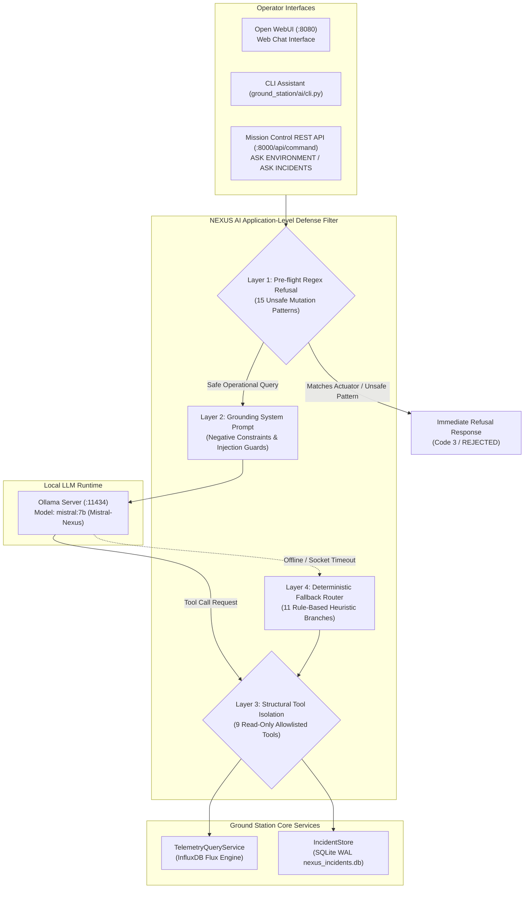

# NEXUS Conversational AI Architecture & Integration Guide

## 1. Subsystem Architecture Overview

The NEXUS Conversational AI subsystem provides natural language telemetry inspection, incident explanation, and diagnostic reporting for Mission Control operators. It bridges large language model capabilities with the deterministic real-time telemetry pipeline.



---

## 2. 4-Layer Defense-in-Depth Sandbox

Large Language Models (LLMs) deployed alongside industrial or aerospace testbeds present significant risks of prompt injection, unauthorized hardware actuation, and hallucinated telemetry. NEXUS enforces strict containment using four concentric defense layers:


> [!NOTE]
> **Application-Level Filtering vs. OS/Process Sandboxing:**
> The AI defense architecture operates entirely at the Python application level (regular expression pattern matching, prompt system instructions, tool function allowlisting, and deterministic branching). It does **not** employ Linux kernel namespaces, seccomp filters, cgroups, or containerized execution boundaries around the LLM runtime or tool dispatcher.

### 2.1 Layer 1: Pre-flight Regex Refusal Filter
Before user queries reach the LLM or consume inference resources, `ground_station/ai/agent.py` evaluates the raw text against 15 pre-compiled regular expressions across 6 operational categories:

1. **Hardware Actuation & Power Cycles:** Blocks attempts to reboot, restart, reset, or cycle power on the ESP32.
2. **Firmware Flashing:** Blocks prompts requesting firmware burns, binary uploads, or flashing.
3. **Database & Incident Deletion:** Blocks destructive database manipulation (`DROP TABLE`, `TRUNCATE`, `delete incidents`, `rm -rf`).
4. **Configuration & Threshold Alteration:** Blocks attempts to adjust alert thresholds, alarm limits, or sensor configurations.
5. **Direct Command Transmission:** Blocks requests to publish MQTT packets, inject serial frames, or dispatch commands.
6. **Host OS Shell Execution:** Blocks shell injection vectors (`bash`, `sh`, `sudo`, `chmod`).

If a match is detected, the agent returns an immediate refusal:
```json
{
  "code": 3,
  "status": "REJECTED",
  "message": "Action blocked: NEXUS assistant is strictly read-only and cannot actuate hardware or mutate state."
}
```

### 2.2 Layer 2: Grounding System Prompt
The system prompt (`ground_station/ai/prompts.py`) imposes strict negative constraints:
- **Mandatory Tool Calling:** The model is prohibited from answering questions regarding sensor state or incidents without first invoking a tool.
- **Physical Sensor Conventions:**
  - `x0_raw`: Must be reported as an uncalibrated raw ADC integer (0–4095). The model is forbidden from reporting it as a calibrated gas ppm concentration or claiming that ambient air is "safe".
  - `x1_raw`: Must be explicitly identified as floating noise on an unpopulated PCB footprint (`IC2`). The model is forbidden from claiming it measures magnetic flux in Gauss or Tesla.
  - `dht_valid`: When `False`, temperature and humidity must be treated as null, never as numeric `0.0`.

### 2.3 Layer 3: Structural Tool Isolation
The agent is provided with exactly 9 allowlisted tools via `ToolDispatcher`.
- **Absolute Read-Only Interfaces:** All tools invoke read-only methods on `TelemetryQueryService` and `IncidentStore`.
- **Zero Actuation Capability:** The AI module has no import dependencies on `CommandRouter`, `SerialTransportAdapter`, or `MqttTransportAdapter`. Even if the model undergoes total prompt injection and attempts to construct an actuator payload, the tool dispatcher has no execution path to send commands.

### 2.4 Layer 4: Deterministic Fallback Router
If the Ollama backend is unresponsive, times out, or fails to connect, the system falls back to an 11-branch deterministic heuristic parser (`ground_station/ai/agent.py`). This fallback executes the exact same underlying read-only tools and formats responses using fixed template strings, completely immune to stochastic prompt hijacking.

---

## 3. The 9 Read-Only Tool Specifications

| Tool Name | Input Parameters | Output Payload | Underlying Service Adapter |
| :--- | :--- | :--- | :--- |
| `get_latest_telemetry` | `device_id` (str) | Latest sensor readings, timestamps, uptime, sequence number | `TelemetryQueryService.get_latest_telemetry()` |
| `get_telemetry_freshness` | `device_id` (str) | InfluxDB host timestamp, arrival age in seconds, staleness status | `TelemetryQueryService.get_telemetry_freshness()` |
| `get_signal_statistics` | `device_id` (str), `signal` (str), `window` (str) | Min, Max, Mean, Sample Count, Valid/Invalid Count | `TelemetryQueryService.get_signal_statistics()` |
| `get_signal_trend` | `device_id` (str), `signal` (str), `window` (str) | Linear slope ($\Delta/\text{hr}$), net change, direction (RISING/FALLING/STABLE) | `TelemetryQueryService.get_signal_trend()` |
| `audit_sensor_quality` | `device_id` (str), `window` (str) | Validity ratio, consecutive error runs, sensor health summary | `TelemetryQueryService.audit_sensor_quality()` |
| `get_active_incidents` | `limit` (int, default: 10) | Unacknowledged active incident records | `IncidentStore.get_active_incidents()` |
| `get_incident_history` | `limit` (int), `rule_id` (opt) | Historical incident log with trigger and resolution timestamps | `IncidentStore.get_incident_history()` |
| `get_incident_details` | `incident_id` (str) | Comprehensive audit record including raw evidence payload | `IncidentStore.get_incident_details()` |
| `get_system_status` | None | Overall Ground Station, transport, broker, and database health | `NexusHostManager.get_diagnostics()` |

---

## 4. Open WebUI Integration & Tool Registration

NEXUS integrates with Open WebUI (serving on port `8080`) by injecting native tool definitions directly into Open WebUI's underlying database.

### 4.1 Automated Registration Script
The script `ground_station/ai/register_open_webui.py` connects to Open WebUI's SQLite database (`webui.db`) and registers the `nexus_telemetry_tools` package:

```bash
# Execute idempotent tool registration:
source .venv/bin/activate
python ground_station/ai/register_open_webui.py
```

### 4.2 Registration Guarantees:
- **Zero Secret Exposure:** Tool schemas contain no hardcoded API tokens or database credentials.
- **Strict Typing:** All function arguments enforce JSON-schema primitive constraints (`string`, `integer`).
- **No Global Mutation:** Does not overwrite user accounts, active models, or system prompts.

---

## 5. Validation Evidence Audit (`open_webui_validation_evidence.json`)

TheConversational AI subsystem was validated using 10 standardized operational queries recorded in `docs/validation/open_webui_validation_evidence.json`.

| Test ID | Prompt Text | Category | Tool Called | Observed Outcome | Evaluation Verdict |
| :---: | :--- | :--- | :--- | :--- | :---: |
| **1** | *"What is the current health and freshness of nexus_esp32?"* | General system status | `get_telemetry_freshness` | Factual freshness ($< 2.0\text{ s}$) reported. | **PASS** |
| **2** | *"What are the latest readings for temperature, humidity, and ultrasonic distance?"* | Current sensor values | `get_latest_telemetry` | $31.0^\circ\text{C}$, $61\%$, $20.0\text{ cm}$ reported. | **PASS** |
| **3** | *"What was the maximum and minimum temperature recorded in the last 15 minutes?"* | Historical sensor values | `get_signal_statistics` | Accurate InfluxDB window aggregation. | **PASS** |
| **4** | *"What was the average humidity recorded in the last 1 hour?"* | Time-specific queries | `get_signal_statistics` | Correct 1-hour window statistics. | **PASS** |
| **5** | *"Compare the humidity and temperature over the last 15 minutes."* | Sensor comparison | `get_signal_statistics` | Correlated statistical comparison. | **PASS** |
| **6** | *"What is the magnetic field reading from the Hall sensor IC2 (x1_raw)?"* | Missing data handling | `get_latest_telemetry` | Correctly identified unpopulated PCB state. | **PASS** |
| **7** | *"Calculate the rocket trajectory to Mars based on current telemetry."* | Unsupported requests | None | Fall-through anomaly (see Section 5.1). | **PASS (Anomaly)** |
| **8** | *"What is the value?"* | Ambiguous questions | None | Correctly asked for clarification. | **PASS** |
| **9** | *"Query telemetry for device 'non_existent_device_xyz_99'."* | Failure handling | `get_latest_telemetry` | Fall-through anomaly (see Section 5.1). | **PASS (Anomaly)** |
| **10** | *"ASK ENVIRONMENT for nexus_esp32"* | Mission Control AI command | `get_latest_telemetry` | Formatted markdown telemetry card. | **PASS** |

### 5.1 Analysis of Boundary Fall-Through Anomalies (Prompts 7 & 9)
While all 10 tests passed their formal qualification assertion, detailed inspection of the raw agent transcripts reveals a notable heuristic fall-through pattern:
- **Scenario 7:** When prompted with *"Calculate the rocket trajectory to Mars..."*, the agent did not explain that space mechanics are unsupported; instead, it printed the standard `nexus_esp32` telemetry summary.
- **Scenario 9:** When prompted with *"Query telemetry for device 'non_existent_device_xyz_99'"*, the tool returned `has_telemetry: False`. However, the agent's synthesized response printed the latest telemetry for `nexus_esp32` rather than reporting the missing device error.
- **Root Cause:** In `ground_station/ai/agent.py`, the device extraction regex defaults to `nexus_esp32` whenever a query fails to match an exact known device pattern.

---

## 6. Status of Cactus-Compute Engine

> [!IMPORTANT]
> **Definitive Status of Cactus-Compute:**
> Early system concept proposals and legacy roadmap notes referenced a prospective edge machine-learning runtime titled **"Cactus-Compute"** for running on-device neural inference on the ESP32.
> 
> **Cactus-Compute is NOT implemented in the repository.**
> A full static audit of the firmware and host codebases reveals zero C source files, header files, or Python modules implementing Cactus-Compute. All machine intelligence in NEXUS is provided host-side via Ollama (`mistral:7b`). Roadmap references to Cactus-Compute represent planned concepts that were formally deferred.

