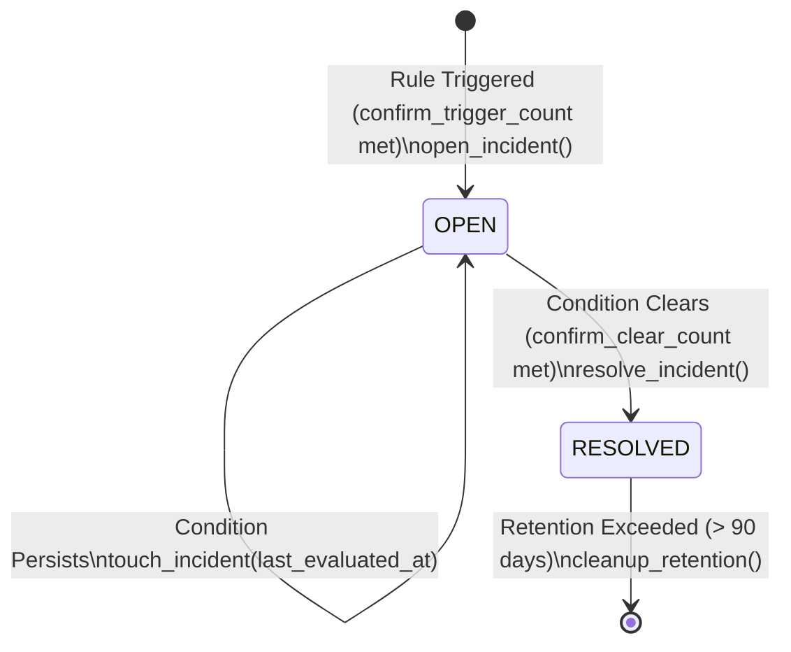

# NEXUS — Database Schema & Data Modeling Specification

> **Document Status:** Authoritative Storage Schema Specification  
> **Persistence Engines:** **InfluxDB v2.7.11** (Time-Series Telemetry) & **SQLite 3.x WAL** (Durable Incident Store)  
> **Primary Source Files:** `ground_station/persistence/point_mapper.py`, `ground_station/persistence/influxdb_writer.py`, `ground_station/analysis/telemetry_query.py`, `ground_station/monitoring/store.py`

---

## 1. Storage Architecture Overview

NEXUS employs a **bifurcated storage model** optimized for operational telemetry workloads:

```
                      [Validated Envelope from NexusHostManager]
                                         │
                    ┌────────────────────┴────────────────────┐
                    ▼                                         ▼
         [InfluxDBWriter (Async)]                 [MonitoringService (Periodic)]
                    │                                         │
                    ▼                                         ▼
     ┌─────────────────────────────┐           ┌─────────────────────────────┐
     │        InfluxDB 2.x         │           │        SQLite 3 WAL         │
     │   (nexus_telemetry bucket)  │           │    (nexus_incidents.db)     │
     ├─────────────────────────────┤           ├─────────────────────────────┤
     │ • Append-only time-series   │           │ • Transactional ACID state  │
     │ • Host UTC ns timestamps    │           │ • Deduplicated active alerts│
     │ • Low-cardinality tags      │           │ • Full transition history   │
     │ • Honest null gaps          │           │ • 90-day bounded retention  │
     │ • Multi-measurement mode    │           │ • Never deletes OPEN alerts │
     └─────────────────────────────┘           └─────────────────────────────┘
                    ▲                                         ▲
                    │ Flux Queries                            │ SQL Queries
     ┌──────────────┴──────────────┐           ┌──────────────┴──────────────┐
     │ Grafana Panels & AI Tools   │           │ Conversational AI Tools     │
     └─────────────────────────────┘           └─────────────────────────────┘
```

---

## 2. InfluxDB 2.x Time-Series Persistence Engine

### 2.1 Engine Configuration & Deployment
- **Docker Image:** `influxdb:2.7.11` (`docker-compose.yml:29-56`)
- **Container Name:** `nexus_influxdb`
- **Default Port & Bind:** `127.0.0.1:8086` (loopback only)
- **Organization:** `nexus` (`INFLUXDB_INIT_ORG`)
- **Bucket:** `nexus_telemetry` (`INFLUXDB_INIT_BUCKET`)
- **Default Retention:** Infinite (`INFLUXDB_INIT_RETENTION=0`; configurable via `.env`)
- **Authentication:** InfluxDB v2 Token-based authentication (`INFLUXDB_TOKEN` / `INFLUXDB_INIT_ADMIN_TOKEN`)

### 2.2 Low-Cardinality Tag Schema
To prevent high-cardinality TSI index explosion, NEXUS strictly restricts InfluxDB tags to **three low-cardinality indexed strings** (`point_mapper.py:60-64`):

| Tag Key | Indexed | Allowed Values | Semantics |
| :--- | :---: | :--- | :--- |
| **`dev`** | Yes | `"nexus_esp32"`, `"esp32_01"`, bounded string | Target device identifier (pattern `^[a-zA-Z0-9_-]{1,32}$`) |
| **`type`** | Yes | `"hb"`, `"telem"`, `"status"`, `"event"`, `"cmd"`, `"resp"` | Protocol message discriminator |
| **`transport`** | Yes | `"serial"`, `"mqtt"`, `"unknown"` | Ingress transport provenance |

### 2.3 Timestamping Authority
- **Time Dimension (`_time`):** Stamped with **Host UTC wall-clock arrival nanoseconds** (`int(envelope.received_at * 1e9)` with `WritePrecision.NS`, `point_mapper.py:126-130`).
- **Device Monotonic Uptime (`uptime_ms`):** Device-reported monotonic milliseconds (`uptime`) is persisted strictly as an **integer field** (`uptime_ms`). This guarantees that device reboots (`uptime_ms` jumping from `500,000` to `100`) never corrupt time-series ordering.

---

### 2.4 Multi-Measurement Schema & Field Inventory

NEXUS defaults to multi-measurement mode (`measurement_prefix = "nexus"`).

#### 1. Measurement `nexus_hb` (Heartbeat, 1 Hz)
Generated from `HeartbeatPayload` (`point_mapper.py:73-77`):

| Field Key | InfluxDB Type | Units | Source & Physical Meaning |
| :--- | :--- | :--- | :--- |
| `free_heap` | Integer | bytes | `esp_get_free_heap_size()` dynamic heap watermark |
| `exec_ticks` | Integer | count | Cumulative `100 ms` cyclic executive dispatch ticks |
| `seq` | Integer | count | Monotonic sequence number (`next_seq++`) |
| `uptime_ms` | Integer | ms | Device monotonic uptime since boot |

#### 2. Measurement `nexus_telem` (Sensor Telemetry, 0.5 Hz)
Generated from `TelemetryPayload` (`point_mapper.py:79-94`):

| Field Key | InfluxDB Type | Presence Rule | Units | Source & Physical Meaning |
| :--- | :--- | :--- | :--- | :--- |
| `ldr_raw` | Integer | Always | counts | Raw 12-bit ADC on `GPIO 35` (`0..4095`) |
| `x0_raw` | Integer | Always | counts | Raw 12-bit ADC on `CD4051 X0` (`GPIO 36`, HW-870 IR reflection) |
| `dht_valid` | Boolean | Always | bool | `true` iff DHT11 sample passed checksum and timing verification |
| `temp` | Float | **Omitted if `!dht_valid`** | `°C` | Ambient temperature (`0..50 °C`) |
| `hum` | Float | **Omitted if `!dht_valid`** | `%RH` | Relative humidity (`20..90 %`) |
| `x1_raw` | Integer | If present (`>= 0`) | counts | Raw 12-bit ADC on `CD4051 X1` (**unpopulated `IC2` Hall footprint**) |
| `slot_state`| Integer | If present (`>= 0`) | state | `MOC7811` optical beam state on `GPIO 34` (`0`=clear, `1`=blocked) |
| `dist_cm` | Float | If present (`>= 0`) | `cm` | `HC-SR04` ultrasonic distance (`2..137 cm` physical) |
| `seq` | Integer | Always | count | Monotonic sequence number |
| `uptime_ms` | Integer | Always | ms | Device monotonic uptime |

> [!IMPORTANT]
> **Zero-Fabrication Missing Data Rule:**  
> When `dht_valid is False`, `temp` and `hum` are **completely omitted from the InfluxDB point** (`point_mapper.py:81-85`). They are never written as `0.0`. In Grafana, queries configure `createEmpty: false` and `spanNulls: false` so sensor read failures appear as truthful visual line breaks.

#### 3. Measurement `nexus_status` (Executive Metrics, 0.2 Hz)
Generated from `StatusPayload` (`point_mapper.py:96-103`):

| Field Key | InfluxDB Type | Units | Source & Physical Meaning |
| :--- | :--- | :--- | :--- |
| `dispatched` | Integer | count | Cumulative executive jobs dispatched (`disp == comp + fail + 1`) |
| `completed` | Integer | count | Cumulative executive jobs returning success (`true`) |
| `failed` | Integer | count | Cumulative executive jobs returning failure (`false`) |
| `max_lat_us` | Integer | `µs` | Peak dispatch grid latency since boot |
| `max_dur_us` | Integer | `µs` | Peak single-callback execution duration since boot |
| `seq` | Integer | count | Monotonic sequence number |
| `uptime_ms` | Integer | ms | Device monotonic uptime |

#### 4. Measurement `nexus_event` (Diagnostic Events)
Generated from `EventPayload` (`point_mapper.py:105-112`):

| Field Key | InfluxDB Type | Units | Source & Physical Meaning |
| :--- | :--- | :--- | :--- |
| `event_type` | Integer | enum | Firmware event identifier (`1`..`11`) |
| `severity` | Integer | enum | Severity level (`0`=DEBUG .. `4`=FATAL) |
| `source_id` | Integer | id | Subsystem or job identifier generating event |
| `payload_val`| Integer | int32 | Event-specific diagnostic payload value |
| `seq` | Integer | count | Monotonic sequence number |
| `uptime_ms` | Integer | ms | Device monotonic uptime |

#### 5. Measurements `nexus_cmd` & `nexus_resp` (Command & Response Records)
Generated from `CommandPayload` and `ResponsePayload` (`point_mapper.py:114-124`):
- Dynamic fields: Each key in the payload dictionary is written as `field_<key>` (supporting `int`, `float`, `bool`, and `str` types).

---

### 2.5 Single-Measurement Alternative
If `INFLUXDB_USE_SINGLE_MEASUREMENT=true` is set in `.env` (`influxdb_writer.py:98`, `point_mapper.py:53`), all points are written to a single measurement named **`nexus`**, and queries filter by the `type` tag (`r._measurement == "nexus" and r.type == "telem"`).

---

### 2.6 Canonical Flux Query Patterns (`analysis/telemetry_query.py`)

#### 1. Full-Window Statistics (Without Truncation)
```flux
base = from(bucket: "nexus_telemetry")
  |> range(start: -15m, stop: now())
  |> filter(fn: (r) => r._measurement == "nexus_telem" and r.dev == "nexus_esp32" and r._field == "temp")
  |> group()

c = base |> count() |> yield(name: "count")
min_val = base |> min() |> yield(name: "min")
max_val = base |> max() |> yield(name: "max")
mean_val = base |> mean() |> yield(name: "mean")
```

#### 2. Cross-Transport Twin Deduplication Query
When querying raw envelopes across both Serial and MQTT, `TelemetryQueryService.get_raw_envelopes(deduplicate=True)` pivots fields and deduplicates in Python:
```flux
from(bucket: "nexus_telemetry")
  |> range(start: -1h, stop: now())
  |> filter(fn: (r) => r._measurement == "nexus_telem" and r.dev == "nexus_esp32")
  |> pivot(rowKey: ["_time", "dev", "transport"], columnKey: ["_field"], valueColumn: "_value")
  |> group()
  |> sort(columns: ["_time"], desc: true)
  |> limit(n: 100)
```

---

## 3. SQLite Incident & History Store (`nexus_incidents.db`)

### 3.1 Engine & PRAGMA Settings (`monitoring/store.py:58–101`)
- **File Location:** `nexus_incidents.db` at workspace root (`NEXUS_INCIDENT_DB`)
- **Concurrency Mode:** Multi-threaded reader/writer guarded by reentrant lock (`threading.RLock`)
- **Connection Configuration:**
  ```sql
  PRAGMA foreign_keys = ON;
  PRAGMA journal_mode = WAL;
  ```
  *(WAL mode provides concurrent reader throughput without blocking background rule evaluations).*

---

### 3.2 SQL Schema & Indexes (`monitoring/store.py:102–175`)

```sql
-- 1. Primary Incidents Table
CREATE TABLE IF NOT EXISTS incidents (
    incident_id         TEXT PRIMARY KEY,
    device_id           TEXT NOT NULL,
    rule_id             TEXT NOT NULL,
    severity            TEXT NOT NULL,      -- 'INFO', 'WARNING', 'CRITICAL'
    state               TEXT NOT NULL,      -- 'OPEN', 'RESOLVED'
    summary             TEXT NOT NULL,
    opened_at           TEXT NOT NULL,      -- ISO-8601 UTC string
    resolved_at         TEXT,               -- ISO-8601 UTC string (NULL while OPEN)
    last_evaluated_at   TEXT NOT NULL,      -- ISO-8601 UTC string
    open_evidence       TEXT NOT NULL,      -- JSON-encoded dictionary
    resolve_evidence    TEXT                -- JSON-encoded dictionary (NULL while OPEN)
);

-- 2. Durable State Transition Audit History
CREATE TABLE IF NOT EXISTS incident_transitions (
    transition_id       INTEGER PRIMARY KEY AUTOINCREMENT,
    incident_id         TEXT NOT NULL,
    from_state          TEXT,               -- NULL on initial OPEN
    to_state            TEXT NOT NULL,      -- 'OPEN', 'RESOLVED'
    timestamp           TEXT NOT NULL,      -- ISO-8601 UTC string
    reason              TEXT NOT NULL,
    evidence            TEXT NOT NULL,      -- JSON-encoded dictionary
    FOREIGN KEY (incident_id) REFERENCES incidents(incident_id) ON DELETE CASCADE
);

-- 3. Partial Unique Index: Strictly prevents duplicate active incidents
CREATE UNIQUE INDEX IF NOT EXISTS idx_active_incidents
ON incidents(device_id, rule_id)
WHERE state = 'OPEN';

-- 4. Query & Retention Performance Indexes
CREATE INDEX IF NOT EXISTS idx_incidents_lookup
ON incidents(device_id, rule_id, state);

CREATE INDEX IF NOT EXISTS idx_incidents_retention
ON incidents(state, resolved_at);

CREATE INDEX IF NOT EXISTS idx_transitions_incident
ON incident_transitions(incident_id, timestamp);
```

---

### 3.3 Incident Lifecycle & Retention Policy



- **Active Incident Uniqueness:** The partial index `idx_active_incidents` guarantees that at most **one** active (`OPEN`) incident can exist per `(device_id, rule_id)`. Ongoing rule triggers call `touch_incident()` to refresh `last_evaluated_at` without duplicating rows.
- **Bounded Retention Cleanup (`store.py:523-579`):**  
  Every 24 hours (`retention_interval_sec = 86400.0`), `MonitoringService` calls `cleanup_retention(older_than_days=90)`.  
  - Deletes in bounded batches of 500 rows (`LIMIT 500`).
  - Prunes **only** rows where `state = 'RESOLVED'` and `resolved_at < cutoff`.
  - **`OPEN` incidents are never deleted**, regardless of age.

---

## 4. Cross-Cutting Database Truths & Architectural Discrepancies

1. **Dual Incident Store Discrepancy (`Implemented`):**
   - **`MonitoringService` (`monitoring/service.py`)** writes durable state and transitions into `nexus_incidents.db`. It is used by `run_*_ingestion.py --enable-monitoring` and conversational AI tools (`get_active_incidents`, `get_incident_history`, `get_incident_details`).
   - **Mission Control Server (`server.py:613-698`)** handles `GET /api/incidents` by synthesizing transient in-memory alerts from `TelemetryCache.get_latest()`. It does **not** read or write `nexus_incidents.db`.
2. **Deterministic Outage Isolation:**
   - If InfluxDB is down (`DataSourceStatus.UNAVAILABLE`), `MonitoringService` skips all rule evaluations, preventing false `stale_telemetry` or `dht_sensor_invalid` incidents during database maintenance.

