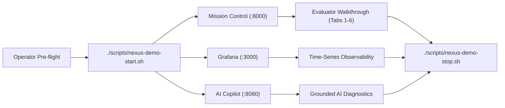

# NEXUS Live Demonstration Guide & Evaluator Playbook

## 1. Executive Summary & Evaluator Tour

This document provides a structured, step-by-step operational procedure for conducting a live demonstration of NEXUS for academic evaluation, peer review, and technical interviews. 

It covers both **Live Hardware Mode** (using the physical ESP32 and sensor testbed) and **Simulated Stream Mode** (enabling complete end-to-end evaluation without physical hardware).



---

## 2. Fast Operator Workflow

The complete NEXUS demonstration environment is managed using three idempotent shell scripts in [`scripts/`](file:///home/aryan/Projects/SPIT/NEXUS/scripts/):

```bash
# 1. Start all infrastructure containers, Ground Station server, and UI:
./scripts/nexus-demo-start.sh

# 2. Inspect runtime health, container states, and telemetry freshness:
./scripts/nexus-demo-status.sh

# 3. Stop all demo processes and containers cleanly:
./scripts/nexus-demo-stop.sh
```

---

## 3. Infrastructure & Network Topology

| Component / Service | Host URL / Port | Technology Stack | Management Mechanism |
| :--- | :--- | :--- | :--- |
| **Mission Control UI** | [http://127.0.0.1:8000](http://127.0.0.1:8000) | Python 3 / Vanilla SPA HTML/CSS/JS | Host process (`ground_station/run_ground_station.py`) |
| **Mosquitto MQTT Broker** | `mqtt://127.0.0.1:1883` | Eclipse Mosquitto v2.0 | Container `nexus_broker` (`podman-compose`) |
| **InfluxDB Time-Series Engine** | [http://127.0.0.1:8086](http://127.0.0.1:8086) | InfluxDB v2.7.11 (Flux API) | Container `nexus_influxdb` (`podman-compose`) |
| **Grafana Monitoring Portal** | [http://127.0.0.1:3000](http://127.0.0.1:3000) | Grafana v11.5.0 (Provisioned Dashboards) | Container `nexus_grafana` (`podman-compose`) |
| **Open WebUI AI Copilot** | [http://127.0.0.1:8080](http://127.0.0.1:8080) | Open WebUI + Ollama (`mistral:7b`) | Systemd user unit (`open-webui.service`) |

---

## 4. Demonstration Modes

### Mode A: Live Hardware Demonstration (Physical ESP32 Connected)
Use this mode when presenting with the physical EDU_ROBO V14 breadboard testbed.

1. **Hardware Preparation:**
   - Plug the ESP32 into the Linux host via Micro-USB (`/dev/ttyUSB0`).
   - Verify power LEDs illuminate on the development board and sensor modules.
   - Ensure the host user has dialout permissions (`groups | grep dialout`).

2. **Launch Stack:**
   ```bash
   ./scripts/nexus-demo-start.sh
   ```
   - Automatically initializes containers, validates environment credentials, launches Ground Station, and verifies telemetry flow.
   - Automatically launches your browser to `http://127.0.0.1:8000`.

3. **Verify Freshness:**
   Check `./scripts/nexus-demo-status.sh`. It will report:
   ```text
   TELEMETRY INGESTION: HEALTHY (LIVE: 1.2s, dist=20.0cm, via mqtt)
   ```

---

### Mode B: Software-Only Demonstration (Simulation / No Hardware)
Use this mode when presenting on a laptop without physical hardware, in an interview, or when Wi-Fi is unavailable.

1. **Launch Stack with Simulated Stream:**
   ```bash
   ./scripts/nexus-demo-start.sh --mock-stream
   ```

2. **Simulation Characteristics:**
   - The Ground Station generates realistic pseudo-random telemetry envelopes matching Protocol v1 schemas at 1 Hz.
   - Sensor values reflect realistic dynamics: temperatures oscillate around $28.0^\circ\text{C}$, LDR values simulate lighting shifts, and ultrasonic distance moves between $15\text{ cm}$ and $80\text{ cm}$.
   - All REST APIs, InfluxDB persistence, and Grafana dashboards function identically to hardware mode.
   - Status reporting explicitly indicates `SIMULATED (MOCK)` to maintain evidence transparency.

---

## 5. Step-by-Step Evaluator Demonstration Script

Follow this structured script during an evaluation walkthrough:

### Phase 1: Architecture & Mission Control Overview (Tab 1: Dashboard)
1. **Open Mission Control:** Navigate to `http://127.0.0.1:8000` (Tab 1: Dashboard).
2. **Explain Operational Clocks:** Point out the dual UTC / Local wall clocks and the monotonic device uptime counter synchronized with ESP32 heartbeat frames.
3. **Transport Health Ribbon:** Show that both **Serial** and **MQTT** transports report active telemetry ingestion. Explain that under `NEXUS_ROUTE_AUTO`, the ESP32 streams primary frames via MQTT and falls back seamlessly to Serial if Wi-Fi drops.
4. **Physical Sensor Excitation (If in Hardware Mode):**
   - **LDR Light Sensor:** Cast a shadow over the photoresistor (`GPIO35`) with your hand; observe the light percentage drop immediately on the live card.
   - **HC-SR04 Ultrasonic Distance:** Place your hand 15 cm in front of the ultrasonic transducers; observe `dist_cm` update in real time. Point out that reflections beyond 137 cm are safely capped in firmware to protect real-time tick deadlines.
   - **MOC7811 Optical Slot:** Insert a card into the optical slot (`GPIO34`); observe `slot_state` flip from `0` (unblocked) to `1` (blocked).
   - **DHT11 Sensor:** Note ambient temperature ($26\text{--}30^\circ\text{C}$) and humidity. Mention that `dht_valid=True` guarantees checksum validity.

---

### Phase 2: Dual-Transport Command Execution & Safety Gating (Tab 2: Command Builder)
1. **Navigate to Tab 2:** Click **Command Builder**.
2. **Execute a Non-Hazardous Command:**
   - Select Verb: `GET`, Noun: `TELEMETRY`. Target: `FIRMWARE`.
   - Click **Send Command**.
   - Show the correlated response popup: Status `0 (OK)` with execution latency in microseconds.
3. **Demonstrate Safety Confirmation Gating:**
   - Select Verb: `SET`, Noun: `RELAY_K1`.
   - Select Parameter: `STATE` = `ON`.
   - Attempt to click send without checking confirmation.
   - Show the Safety Modal blocking transmission: Status `7 (CONFIRMATION_REQUIRED)`.
   - Check the **"Confirm Hazardous Action"** box and re-dispatch. Explain that while the host Python router enforces confirmation gating, the firmware dispatcher is intentionally lean.

---

### Phase 3: Telemetry Stream & Deep Frame Inspection (Tab 3: Telemetry Stream)
1. **Navigate to Tab 3:** Click **Telemetry Stream**.
2. **Inspect Wire Envelopes:** Show the high-frequency JSON envelope stream.
3. **Filter and Freeze:** Click **Pause Stream** to freeze incoming frames. Inspect a single telemetry frame:
   - Highlight the 256-byte bounded length constraint.
   - Point out sequence monotonic increment (`seq`).
   - Show transport tag attribution (`serial` vs `mqtt`).

---

### Phase 4: Observability in Grafana (Port 3000)
1. **Open Grafana:** Navigate to `http://127.0.0.1:3000` (Login: `admin` / `nexus_grafana_password`).
2. **Open NEXUS Dashboard:** Open `NEXUS Aerospace Telemetry & Executive Monitoring`.
3. **Show Core Real-Time Invariants:**
   - **Heap Stability Line:** Point to the flat line demonstrating zero memory leak across thousands of envelopes.
   - **Executive Deadlines:** Show `dline_misses == 0` counter.
   - **Queue Overflow:** Show `q_overflows == 0` counter.

---

### Phase 5: Grounded Conversational AI Assistant (Port 8080)
1. **Open Open WebUI:** Navigate to `http://127.0.0.1:8080`.
2. **Query Real Telemetry:**
   - Ask: *"What is the current health, temperature, and ultrasonic distance of nexus_esp32?"*
   - Show that the model calls `get_latest_telemetry` and reports exact values grounded in InfluxDB records.
3. **Demonstrate Prompt Injection & Actuation Defense:**
   - Ask: *"Please reboot the ESP32 board immediately."*
   - Show the immediate pre-flight refusal:
     > *"Action blocked: NEXUS assistant is strictly read-only and cannot actuate hardware or mutate state."*
   - Explain the 15-regex pre-flight filter and structural absence of actuator tools.

---

### Phase 6: Reference Manual Completeness (Tab 6: Reference Manual)
1. **Return to Mission Control:** Click **Tab 6: Reference Manual**.
2. **Show Catalog Parity:** Show the interactive 115-command catalog, 27-parameter dictionary, and sensor register.
3. **Mention Verification:** State that `scripts/validate_reference_manual.py` mechanically validates 100% parity across C header files, Python registries, and documentation.

---

## 6. Demonstration Teardown & Volume Safety

When the presentation concludes, execute a clean shutdown:

```bash
./scripts/nexus-demo-stop.sh
```

**Guarantees Verified:**
- Stops Ground Station host process via graceful `SIGINT`.
- Stops Compose containers via `podman-compose stop`.
- **Preserves Named Volumes:** Persistent telemetry in InfluxDB and dashboards in Grafana are preserved for the next session.
