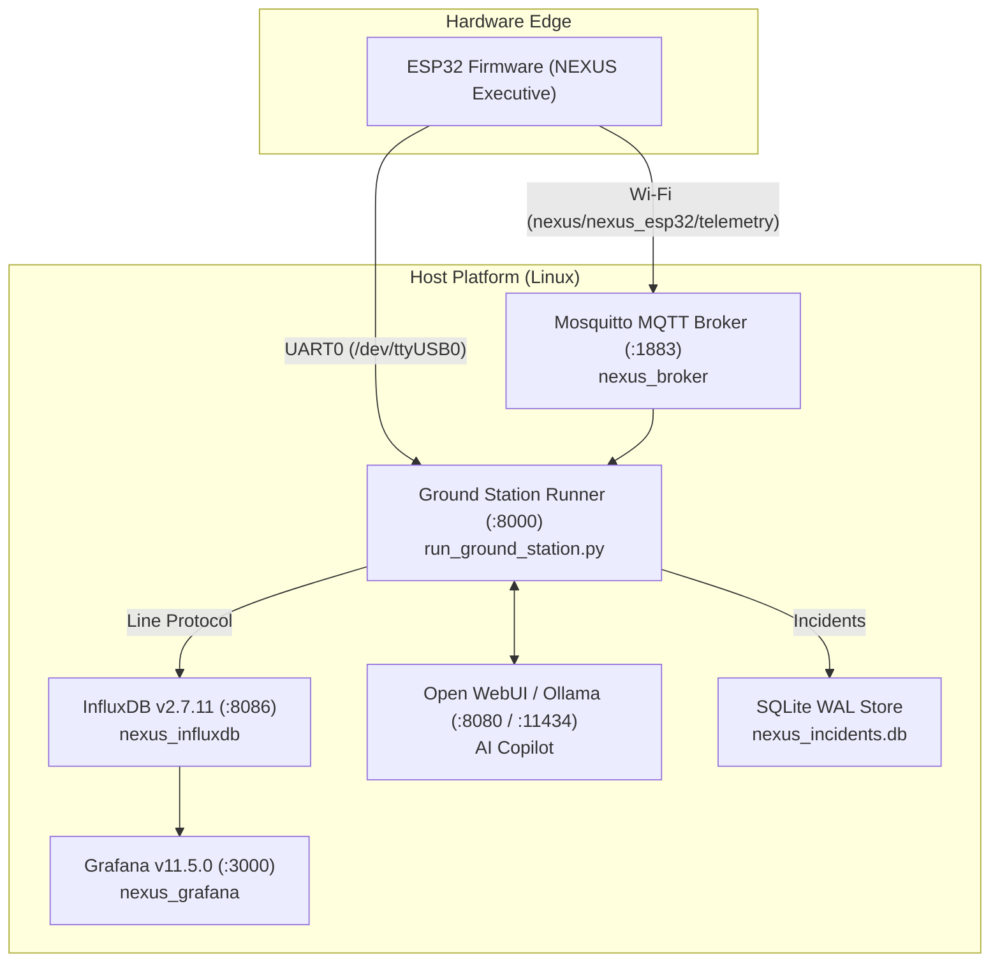
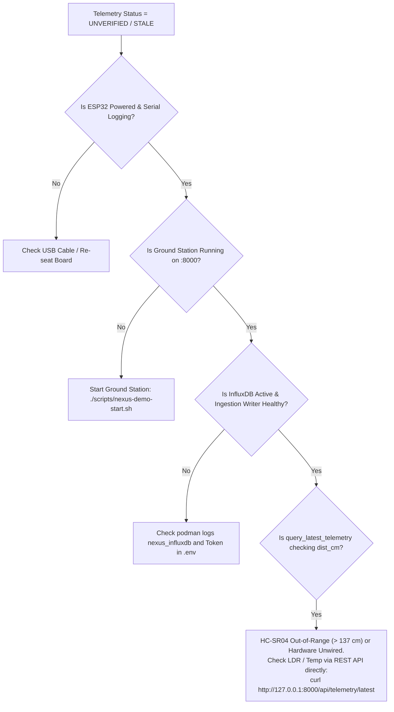

# NEXUS Operations and Troubleshooting Guide

## 1. System Operational Architecture

NEXUS integrates an embedded ESP32 edge device, a multi-transport Ground Station, time-series persistence, observability dashboards, and an AI copilot. Operating the system reliably requires understanding the dependencies between services, startup sequencing, port allocations, and fault isolation points.



---

## 2. Standard Service Operations

### 2.1 Service Ports and Resource Matrix

| Service | Container / Process Name | Default Host Port | Bind Address | Transport / Protocol | Health Check / Probe Endpoint |
| :--- | :--- | :--- | :--- | :--- | :--- |
| **Ground Station** | Host Process (`run_ground_station.py`) | `8000` | `0.0.0.0` | HTTP / REST & Static Web | `http://127.0.0.1:8000/api/status` |
| **Mosquitto** | `nexus_broker` | `1883` | `127.0.0.1`, LAN `${MQTT_BIND_IP}` | MQTT v3.1.1 (TCP cleartext) | TCP socket connect `127.0.0.1:1883` |
| **InfluxDB** | `nexus_influxdb` | `8086` | `127.0.0.1` | HTTP Line Protocol / Flux API | `http://127.0.0.1:8086/health` |
| **Grafana** | `nexus_grafana` | `3000` | `127.0.0.1` | HTTP Web / Provisioned Panels | `http://127.0.0.1:3000/api/health` |
| **Open WebUI** | Systemd unit or Host Process | `8080` | `0.0.0.0` or `127.0.0.1` | HTTP Web UI | `http://127.0.0.1:8080` |
| **Ollama** | Systemd service | `11434` | `127.0.0.1` | HTTP REST API | `http://127.0.0.1:11434/api/tags` |
| **ESP32 Edge** | Hardware / USB-UART | `/dev/ttyUSB0` | N/A | Serial (115200 8N1) | JSON heartbeat `seq`, `uptime_ms` |

### 2.2 Cold Startup Sequencing

To ensure all ingestion pipelines and socket connections establish cleanly without retry cascades, adhere to this strict startup order:

1. **Step 1: Container Infrastructure**
   Launch Mosquitto, InfluxDB, and Grafana containers:
   ```bash
   podman-compose -f docker-compose.yml up -d
   # Or using Docker:
   # docker compose -f docker-compose.yml up -d
   ```
   *Verification:* Verify containers report healthy status:
   ```bash
   podman ps --filter "name=nexus"
   curl -s http://127.0.0.1:8086/health | grep '"status":"pass"'
   curl -s http://127.0.0.1:3000/api/health | grep '"database":"ok"'
   ```

2. **Step 2: AI Runtime (Optional / Copilot Only)**
   Ensure Ollama has `mistral:7b` loaded and Open WebUI is serving:
   ```bash
   curl -s http://127.0.0.1:11434/api/tags | grep 'mistral:7b'
   systemctl --user status open-webui.service
   ```

3. **Step 3: Ground Station Host Ingestion**
   Start the Mission Control web server and ingestion adapters:
   ```bash
   source .venv/bin/activate
   python -m ground_station.run_ground_station --port 8000 --serial-port /dev/ttyUSB0
   ```
   *Alternative:* Use the idempotent demo manager:
   ```bash
   ./scripts/nexus-demo-start.sh
   ```

4. **Step 4: ESP32 Edge Device Power-On**
   Connect the ESP32 via Micro-USB to the host Linux machine. The firmware will boot, calibrate sensors, initialize the cyclic executive (`nexus_exec`), and attempt Wi-Fi association to the configured AP.

### 2.3 Clean Shutdown Sequencing

To prevent database corruption and preserve historical telemetry:

1. **Terminate Ground Station:** Issue `SIGINT` (`Ctrl+C`) or run `./scripts/nexus-demo-stop.sh`. The orchestrator will flush in-flight telemetry and disconnect adapters cleanly.
2. **Stop Containers Gracefully:**
   ```bash
   podman-compose -f docker-compose.yml stop
   ```
   > [!CAUTION]
   > **NEVER run `podman-compose down -v` or `docker compose down -v`.** The `-v` flag deletes all persistent named volumes (`nexus_influxdb_data`, `nexus_influxdb_config`, `nexus_mosquitto_data`, `nexus_grafana_data`), permanently erasing all historical telemetry and dashboard state.

---

## 3. Log Locations and Diagnostic Inspection

| Subsystem | Log Path / Inspection Command | Key Search Keywords |
| :--- | :--- | :--- |
| **Ground Station Host** | `ground_station/logs/nexus_ground_station.log` | `ERROR`, `WARNING`, `CORRUPT_ENVELOPE`, `QUEUE_FULL` |
| **MQTT Ingestion** | `ground_station/logs/nexus_mqtt_ingestion.log` | `Connection refused`, `Authentication failure`, `rc=4` |
| **Mosquitto Container** | `podman logs -f nexus_broker` | `denied`, `bad client id`, `socket error` |
| **InfluxDB Container** | `podman logs -f nexus_influxdb` | `write failed`, `unauthorized`, `org not found` |
| **Grafana Container** | `podman logs -f nexus_grafana` | `datasource failed`, `plugin error` |
| **Serial Bus (Live Raw)** | `picocom -b 115200 /dev/ttyUSB0` | `[NEXUS_EXEC]`, `NEXUS_CONN`, `DEADLINE MISS` |
| **Demo State Record** | `ground_station/data/run/demo_launcher_state.env` | `LAUNCHER_GS_PID`, `LAUNCHER_STARTED_CONTAINERS` |

---

## 4. Troubleshooting Playbooks

### Playbook A: Port Conflicts on Host Services

**Symptoms:**
- `run_ground_station.py` crashes with `OSError: [Errno 98] Address already in use`.
- Mosquitto, InfluxDB, or Grafana containers fail to start with `bind: address already in use`.

**Diagnostic Procedure:**
```bash
# Check what process is listening on the failing port (e.g., 8000, 1883, 8086, 3000, 8080)
ss -tulpn | grep -E ':(8000|1883|8086|3000|8080)'
# Or using lsof:
lsof -i :8000
```

**Resolution Steps:**
1. If an orphaned Ground Station process is holding port 8000:
   ```bash
   kill -TERM $(lsof -t -i :8000)
   ```
2. If another Mosquitto instance (e.g. systemd Mosquitto) is occupying port 1883:
   ```bash
   sudo systemctl stop mosquitto
   sudo systemctl disable mosquitto
   ```
3. If an existing InfluxDB or Grafana service is active on the host outside compose, adjust the host port mapping in `.env` or stop the competing host service.

---

### Playbook B: Serial Port Access Denied or Hardware Reboot Loop

**Symptoms:**
- Ground Station reports `PermissionError: [Errno 13] Permission denied: '/dev/ttyUSB0'`.
- Ground Station connects to `/dev/ttyUSB0`, but the ESP32 continuously reboots every 10 seconds.

**Diagnostic Procedure:**
```bash
# 1. Verify USB device enumeration and group ownership:
ls -la /dev/ttyUSB* /dev/ttyACM*
# Typically owned by root:dialout or root:uucp

# 2. Check current user group memberships:
groups
```

**Resolution Steps:**
1. **Fix Permissions:** Add the current user to the `dialout` (Debian/Ubuntu) or `uucp` (Arch/Fedora) group:
   ```bash
   sudo usermod -a -G dialout $USER
   # Re-authenticate or run under newgrp:
   newgrp dialout
   ```
2. **Prevent DTR/RTS Reset Toggling:**
   Standard USB-to-UART bridges (CP2102, CH340) tie DTR and RTS lines to the ESP32 `EN` (CHIP_PU) and `GPIO0` pins for automated flashing. When a serial port is opened, Linux termios toggles DTR/RTS, which forces an ESP32 hardware reset.
   In `ground_station/connection_manager/serial_adapter.py`, the driver explicitly sets:
   ```python
   # Prevents hardware reset toggle on connect
   ser.dtr = False
   ser.rts = False
   ```
   Do not remove these configurations. When opening external serial monitors like `picocom`, pass `--noreset` or disable DTR/RTS:
   ```bash
   picocom --baud 115200 --noreset /dev/ttyUSB0
   ```

---

### Playbook C: Stale Telemetry or "UNVERIFIED" Status

**Symptoms:**
- `./scripts/nexus-demo-status.sh` reports `TELEMETRY INGESTION: UNVERIFIED` or `NO DATA`.
- Mission Control UI shows stale sensor cards with grey/red indicators.

**Root-Cause Decision Matrix:**



**Known Probing Anomaly:**
In `scripts/nexus_demo_common.sh`, `query_latest_telemetry()` evaluates freshness by exclusively querying the `dist_cm` sensor:
```python
rec = svc.get_latest_reading("nexus_esp32", "dist_cm")
```
If the HC-SR04 ultrasonic sensor is unplugged, out of range, or failing to echo, `dist_cm` will not be published in telemetry frames. As a result, `nexus-demo-status.sh` will report `NO DATA` even if LDR light levels, temperature, and system metrics are streaming normally into InfluxDB.
*Verification Command:*
```bash
# Query all latest fields directly from Ground Station memory:
curl -s http://127.0.0.1:8000/api/telemetry/latest | jq .
```

---

### Playbook D: Wi-Fi Disconnection and MQTT Backoff Cascades

**Symptoms:**
- ESP32 Serial output prints `NEXUS_CONN: Wi-Fi disconnected; backoff retry scheduled`.
- Mosquitto broker log prints `Client nexus_esp32 disconnected due to keepalive timeout`.

**Firmware Connection Manager Mechanics:**
The ESP32 connection manager implements a deterministic backoff sequence:
- Retry intervals follow Fibonacci scaling: `1s -> 2s -> 3s -> 5s -> 8s -> 13s -> 21s -> 34s -> 60s (capped)`.
- If Wi-Fi drops, MQTT transport transitions to `MQTT_DISCONNECTED`.
- Under `NEXUS_ROUTE_AUTO`, the firmware automatically falls back to streaming full telemetry envelopes over Serial UART0.
- When Wi-Fi reconnects and MQTT handshakes complete, the active route restores to MQTT.

**Resolution Steps:**
1. Verify 2.4 GHz Wi-Fi SSID and PSK match what was configured in `sdkconfig` via `idf.py menuconfig`. (The ESP32 classic hardware does not support 5 GHz bands).
2. Check Mosquitto Access Control Lists (ACLs):
   If `credentials/mosquitto/passwd` or `docker/mosquitto/mosquitto.conf` denies authorization, Mosquitto will reject connection attempts with MQTT Return Code 4 (`Connection Refused: bad user name or password`) or 5 (`Not Authorized`).
   ```bash
   podman logs nexus_broker | tail -n 20
   ```

---

### Playbook E: InfluxDB Write Retry Exhaustion and Buffer Drops

**Symptoms:**
- Ground Station log shows: `[InfluxDBWriter] Write queue full (1000 items). Dropping oldest points.`
- Gaps appear in Grafana charts after network interruptions.

**Architecture Behavior:**
The Ground Station `InfluxDBWriter` utilizes a background worker thread with a bounded in-memory buffer (`maxsize=1000` points).
- When InfluxDB is reachable, batches are flushed every `0.5s` or when `batch_size=50` is met.
- If InfluxDB HTTP requests fail (timeout, 503, connection refused), writes enter exponential retry backoff.
- If the outage persists and queue capacity exceeds 1,000 points, the writer discards the oldest unwritten points to protect host memory.

**Resolution Steps:**
1. Verify InfluxDB container state and token authorization:
   ```bash
   curl -i -X POST http://127.0.0.1:8086/api/v2/write?org=nexus_org&bucket=nexus_telemetry \
     -H "Authorization: Token ${INFLUXDB_TOKEN}" \
     --data-raw "system_metrics,device_id=manual_test heap_free_bytes=100000i"
   ```
2. If HTTP 401 Unauthorized is returned, synchronize the `INFLUXDB_TOKEN` value between `.env` and `docker/influxdb/` initialization scripts.

---

### Playbook F: Grafana Dashboard Shows "No Data"

**Symptoms:**
- Grafana loads at `http://127.0.0.1:3000`, but panel queries return empty tables.

**Diagnostic Checklist:**
1. Check Data Source configuration under **Connections -> Data Sources -> InfluxDB**:
   - Query language: **Flux**
   - URL: `http://nexus_influxdb:8086` (within Docker network) or `http://127.0.0.1:8086` (if host-networked).
   - Organization: `nexus_org`
   - Default Bucket: `nexus_telemetry`
2. Inspect the time range selector in Grafana (top-right). Ensure it is set to **Last 15 minutes** or **Last 1 hour** rather than a future or past window.
3. Check the Flux query measurement name. Schema measurements are:
   - `sensor_environment` (temp_c, humidity_pct, light_pct, ir_raw)
   - `sensor_motion` (dist_cm, opto_rpm)
   - `system_metrics` (heap_free_bytes, min_heap_bytes, cpu_pct, uptime_s)
   - `executive_telemetry` (tick_count, late_ticks, dline_misses, q_overflows, tx_drop)
   - `command_audit` (status_code, execution_time_us)

---

## 5. Routine Maintenance and Data Recovery

### 5.1 InfluxDB Backup and Pruning
By default, the `nexus_telemetry` bucket has an infinite retention policy (`0s`). For long-term production deployments, apply a 30-day retention rule:
```bash
podman exec -it nexus_influxdb influx bucket update \
  -n nexus_telemetry \
  -r 30d \
  -o nexus_org \
  -t "${INFLUXDB_TOKEN}"
```

### 5.2 SQLite Incident Database Maintenance
The incident monitoring subsystem records deterministic alert events in `ground_station/data/nexus_incidents.db` using SQLite Write-Ahead Logging (WAL).
- Inspect database size: `ls -lh ground_station/data/nexus_incidents.db*`
- Check integrity:
  ```bash
  sqlite3 ground_station/data/nexus_incidents.db "PRAGMA integrity_check;"
  ```
- Run checkpoint to reclaim space:
  ```bash
  sqlite3 ground_station/data/nexus_incidents.db "PRAGMA wal_checkpoint(TRUNCATE);"
  ```

