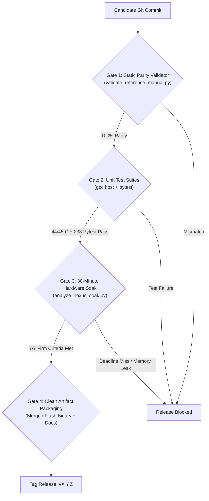

# NEXUS Release Engineering, Backup, and Disaster Recovery Playbook

## 1. Release Philosophy and Gating Criteria

NEXUS adheres to strict semantic release practices. Before any commit is tagged as a Release Candidate (`-rc`) or General Availability (`v1.0.0`), it must clear formal verification gates grounded in automated host tests and hardware qualification runs.



---

## 2. Release History and Gating Baselines

| Tag / Milestone | Commit Hash | Key Features & Qualification Baseline | Release Gate Status |
| :--- | :--- | :--- | :--- |
| **`v0.9.0-rc1`** | `7d4a12...` | Milestone 10 Extended Sensor Suite (LDR, DHT11, HW-870, MOC7811, HC-SR04). First complete physical excitation closure. | **Qualified** (Passed 30-min Soak Run 2, zero memory leak). |
| **`v0.9.0-rc2`** | `3ab168...` | Authoritative 115-command catalog, 27 parameters, Mission Control Command Builder & Reference Manual frontend, managed demo scripts. | **Qualified** (100% Parity on all 7 validator suites, 233/233 offline pytests pass). |
| **`v1.0.0`** | Planned | Formal production release with mutual TLS, RMT-based ultrasonic driver, and unified SQLite incident bridging. | Planned |

---

## 3. Firmware Build, Packaging, and Merging

### 3.1 Compiling Release Firmware
```bash
# Set ESP-IDF target to classic ESP32:
idf.py set-target esp32

# Build optimized release binary:
idf.py build
```

Build outputs are generated in the `build/` directory:
- `build/bootloader/bootloader.bin` (Offset `0x1000`)
- `build/partition_table/partition-table.bin` (Offset `0x8000`)
- `build/nexus_firmware.bin` (Offset `0x10000`)

### 3.2 Packaging a Single Unified Binary (`merge_bin`)
To facilitate factory flashing on new ESP32 units without requiring the full ESP-IDF toolchain on the flashing machine:

```bash
esptool.py --chip esp32 merge_bin \
  -o build/nexus_firmware_v0.9.0_merged.bin \
  --flash_mode dio \
  --flash_freq 40m \
  --flash_size 4MB \
  0x1000 build/bootloader/bootloader.bin \
  0x8000 build/partition_table/partition-table.bin \
  0x10000 build/nexus_firmware.bin
```

A technician can flash the merged image with a single command:
```bash
esptool.py --chip esp32 --port /dev/ttyUSB0 write_flash 0x0 build/nexus_firmware_v0.9.0_merged.bin
```

---

## 4. Backup Procedures

### 4.1 InfluxDB Time-Series Data Backup
InfluxDB stores telemetry in volume `nexus_influxdb_data`. To produce a portable, consistent snapshot while the container is running:

```bash
# 1. Create a timestamped backup directory inside the container:
BACKUP_DATE=$(date +%Y%m%d_%H%M%S)
podman exec -it nexus_influxdb influx backup /var/lib/influxdb2/backup_${BACKUP_DATE} \
  -t "${INFLUXDB_TOKEN}" \
  -o nexus_org

# 2. Copy the backup archive to host storage:
mkdir -p backups/influxdb
podman cp nexus_influxdb:/var/lib/influxdb2/backup_${BACKUP_DATE} backups/influxdb/

# 3. Clean up the container temporary directory:
podman exec -it nexus_influxdb rm -rf /var/lib/influxdb2/backup_${BACKUP_DATE}
```

### 4.2 SQLite Incident Database Backup
The incident store (`ground_station/data/nexus_incidents.db`) runs in SQLite Write-Ahead Logging (WAL) mode. Standard file copy (`cp`) can result in a corrupted snapshot if a transaction is mid-commit. Use SQLite's online vacuum/backup command:

```bash
mkdir -p backups/sqlite
sqlite3 ground_station/data/nexus_incidents.db \
  ".backup 'backups/sqlite/nexus_incidents_$(date +%Y%m%d_%H%M%S).db'"
```

### 4.3 Grafana Dashboards and Settings Backup
Grafana configuration is stored in named volume `nexus_grafana_data` (`/var/lib/grafana/grafana.db`):

```bash
mkdir -p backups/grafana
podman cp nexus_grafana:/var/lib/grafana/grafana.db \
  backups/grafana/grafana_$(date +%Y%m%d_%H%M%S).db
```

---

## 5. Disaster Recovery and Rollback Playbooks

### Playbook 1: InfluxDB Database Corruption or Accidental Volume Erasure
If InfluxDB fails to mount or reports corrupted TSM index files:

1. Stop existing containers:
   ```bash
   podman-compose -f docker-compose.yml stop
   ```
2. Re-create clean data volumes:
   ```bash
   podman volume rm nexus_influxdb_data
   podman volume create nexus_influxdb_data
   podman-compose -f docker-compose.yml up -d nexus_influxdb
   ```
3. Await InfluxDB `/health` readiness, then restore from snapshot:
   ```bash
   LATEST_BACKUP=$(ls -td backups/influxdb/backup_* | head -1)
   podman cp "${LATEST_BACKUP}" nexus_influxdb:/tmp/restore_backup
   podman exec -it nexus_influxdb influx restore /tmp/restore_backup \
     -t "${INFLUXDB_TOKEN}" \
     -o nexus_org
   ```

---

### Playbook 2: ESP32 Bootloop or Firmware Hard Fault Recovery
If bad configuration or corrupted flash causes the ESP32 to enter an unrecoverable reset loop (`Guru Meditation Error` or watchdog trigger):

1. **Erase Flash Completely:**
   Put ESP32 into bootloader mode (hold `BOOT` button, press `EN`, release `BOOT`), then run:
   ```bash
   esptool.py --chip esp32 --port /dev/ttyUSB0 erase_flash
   ```
2. **Re-flash Known-Good Qualified Image:**
   ```bash
   esptool.py --chip esp32 --port /dev/ttyUSB0 write_flash 0x0 build/nexus_firmware_v0.9.0_merged.bin
   ```
3. **Verify Cold Boot Recovery:**
   Open serial monitor with reset suppression:
   ```bash
   picocom -b 115200 --noreset /dev/ttyUSB0
   # Verify log output: [NEXUS_EXEC] Executive initialized successfully; reset_reason=1
   ```

---

### Playbook 3: Rolling Back Ground Station Code to a Previous Release Tag
If a regressions occurs after pulling new commits:

1. Stop running processes cleanly:
   ```bash
   ./scripts/nexus-demo-stop.sh
   ```
2. Check out the desired release tag:
   ```bash
   git checkout tags/v0.9.0-rc2
   ```
3. Re-run offline verification:
   ```bash
   source .venv/bin/activate
   pytest ground_station/tests --ignore=...live.py -q
   python scripts/validate_reference_manual.py
   ```
4. Restart the demo stack:
   ```bash
   ./scripts/nexus-demo-start.sh
   ```

