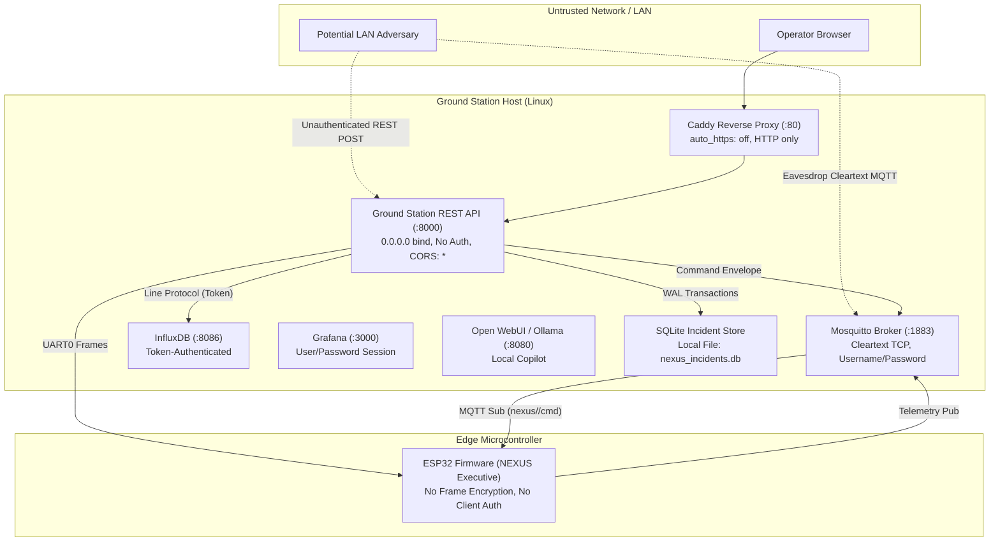
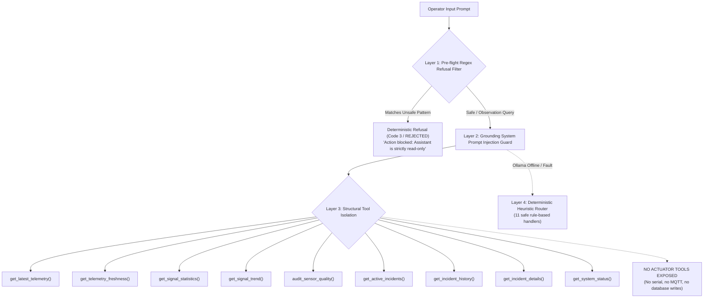

# NEXUS System Security Architecture & Threat Model

## 1. System Security Overview & Boundaries

NEXUS bridges an embedded ESP32 microcontroller, a host Python Ground Station, containerized database and telemetry brokers, and an AI conversational copilot. The primary operational objective is low-latency telemetry ingestion and multi-transport command routing.

Because NEXUS is engineered as an educational laboratory platform and aerospace telemetry testbed, certain production security controls (such as TLS encryption and client authentication) are balanced against hardware constraints (ESP32 RAM, cyclic executive tick deadlines) and local-network accessibility.



---

## 2. Threat Surface and Boundary Analysis

### 2.1 Network Exposure and Transport Security

| Service / Interface | Network Bind | Authentication | Encryption | Status | Residual Risk & Vulnerability Analysis |
| :--- | :--- | :--- | :--- | :--- | :--- |
| **Ground Station REST API** | `0.0.0.0:8000` | None | None (Cleartext HTTP) | **Implemented** | Any device on the same local subnet can read live telemetry, query incident databases, and dispatch commands via `POST /api/command`. |
| **CORS Policy** | `Access-Control-Allow-Origin: *` | None | N/A | **Implemented** | Unrestricted origin access. Malicious web pages loaded in an operator's browser can execute cross-origin fetch calls against the Ground Station API. |
| **Mosquitto MQTT Broker** | `127.0.0.1:1883` and `${MQTT_BIND_IP}:1883` | Username + Password (`nexus_user`) | None (Cleartext TCP) | **Implemented** | Wi-Fi frames carry telemetry and commands in cleartext JSON. Susceptible to passive LAN sniffing and traffic analysis. |
| **Mosquitto ACLs** | File-based (`mosquitto.conf`) | Topic restriction (`nexus/#`) | N/A | **Implemented** | Restricts `nexus_user` to the `nexus/` topic tree, preventing lateral movement to other broker topics. |
| **Caddy Reverse Proxy** | `:80` (HTTP) | None | None (`auto_https off`) | **Implemented** | Provides single-origin routing for dashboards, but explicitly disables automatic TLS. Traffic over port 80 is unencrypted. |
| **InfluxDB API** | `127.0.0.1:8086` | Token (`Authorization: Token <token>`) | None (HTTP) | **Implemented** | Bound to loopback interface in default compose setup; token prevents unauthorized database manipulation. |
| **ESP32 Serial Bus** | `/dev/ttyUSB0` | Physical / OS file permissions | Physical Wire | **Implemented** | Requires host OS user membership in `dialout` or `uucp` group. Inaccessible over network unless bridged. |

---

## 3. Command Execution & Safety Gating

### 3.1 Host-Enforced Confirmation Gating

In NEXUS, potentially disruptive commands (such as actuator toggles, executive state transitions, or peripheral reconfigurations) are marked with `requires_confirmation: true` in the authoritative command registry (`CommandRegistry`).

When an operator or external caller dispatches a hazardous command without the explicit confirmation flag (`confirmed: false`), the Python `CommandRouter` rejects the transmission:

```python
# ground_station/command_router/router.py (lines 595-605)
if entry.requires_confirmation and not confirmed:
    return CommandResponse(
        req_id=req_id,
        code=int(StatusCode.CONFIRMATION_REQUIRED), # Code 7
        data={"error": "Hazardous command requires explicit operator confirmation."},
    )
```

### 3.2 Firmware-Side Execution Model & Asymmetry

> [!WARNING]
> **Safety Gating Asymmetry:** Hazardous confirmation gating is enforced **strictly at the host layer**. 
> The ESP32 firmware Command Dispatcher (`main/nexus_cmd_dispatcher.c`) does NOT inspect client identities, cryptographic signatures, or confirmation tokens. If a command packet reaches the ESP32 via Serial UART or MQTT `nexus/<dev>/cmd`, the firmware parses the verb/noun and executes the corresponding hardware handler immediately.

Consequently, network isolation of the MQTT broker and Ground Station host is the sole barrier preventing unauthorized firmware actuation.

---

## 4. Secret and Credential Management

### 4.1 Git Tracking Policy

Source control rules are enforced via `.gitignore` to prevent secret leakage:

- **Ignored Files:**
  - `.env`, `.env.*` (local environment configurations)
  - `credentials/` (Mosquitto password databases, SSL/TLS certificates)
- **Tracked Template:**
  - `.env.example` (sanitized template with dummy placeholders)

### 4.2 Credential Inventory

| Credential Name | Storage Location | Default / Example Value | Usage Scope |
| :--- | :--- | :--- | :--- |
| `INFLUXDB_TOKEN` | `.env` | `nexus_super_secret_operator_token_2026` | InfluxDB Line Protocol writer & Query Service |
| `INFLUXDB_ADMIN_PASSWORD` | `.env` | `nexus_operator_password` | InfluxDB initial setup & web UI access |
| `MQTT_USER` | `.env`, `credentials/mosquitto/passwd` | `nexus_user` | MQTT publisher / subscriber authentication |
| `MQTT_PASSWORD` | `.env`, `credentials/mosquitto/passwd` | `nexus_password` | Mosquitto broker client handshake |
| `GRAFANA_ADMIN_PASSWORD` | `.env` | `nexus_grafana_password` | Grafana administrator portal login |

> [!IMPORTANT]
> When transitioning from a development testbed to a deployed network, all default credentials in `.env` and `credentials/mosquitto/passwd` must be rotated using cryptographically random strings.

---

## 5. Conversational AI Sandboxing & Injection Defenses

The NEXUS Ground Station incorporates a local AI assistant (`mistral:7b` via Ollama) designed to answer operator inquiries regarding telemetry trends and active incidents. Because large language models are vulnerable to prompt injection (both from untrusted operator prompts and malicious strings embedded in sensor data), NEXUS implements a **4-layer application-level defense-in-depth filter**:



### 5.1 Layer 1: Pre-flight Regex Refusal Filter
Before invoking the LLM, `ground_station/ai/agent.py` evaluates the user input against 15 pre-compiled regular expressions across 6 critical operational categories:
1. **Hardware Actuation & Power Cycles:** Blocks commands attempting to reboot, reset, cycle power, or toggle pins on the ESP32.
2. **Firmware Flashing:** Blocks attempts to burn, upload, or reflash binaries.
3. **Database & Incident Deletion:** Blocks queries containing `DROP TABLE`, `TRUNCATE`, `rm -rf`, or purge commands.
4. **Configuration & Threshold Alteration:** Blocks attempts to change alert thresholds, modify rules, or adjust sensor parameters.
5. **Direct Command Dispatch:** Blocks attempts to instruct the model to publish MQTT packets or transmit serial bytes.
6. **Host OS Shell Execution:** Blocks shell injection vectors (`bash`, `sudo`, `exec`, `chmod`).

If any pattern matches, the agent immediately halts and returns a structured refusal without consuming LLM inference tokens.

### 5.2 Layer 2: Grounding System Prompt & Anti-Hallucination Guardrails
The system prompt (`ground_station/ai/prompts.py`) imposes strict epistemic and operational boundaries:
- **Mandatory Tool Grounding:** The assistant is explicitly instructed that it has zero knowledge of current hardware state without invoking tools.
- **Sensor Conventions:** The model is prohibited from interpreting uncalibrated ADC counts (`x0_raw`, `x1_raw`) as ppm gas concentrations or magnetic field densities.
- **Missing Data Distinction:** The prompt forbids treating missing telemetry or `dht_valid=False` as numeric `0.0`.

### 5.3 Layer 3: Structural Tool Isolation
The agent is provided with exactly 9 allowlisted tools via `ToolDispatcher`.
- **Absolute Read-Only Interfaces:** All tools invoke read-only methods on `TelemetryQueryService` and `IncidentStore`.
- **Zero Actuation Capability:** The AI module has no import dependencies on `CommandRouter`, `SerialTransportAdapter`, or `MqttTransportAdapter`. Even if the model undergoes total prompt injection and attempts to construct an actuator payload, the tool dispatcher has no execution path to send commands.

### 5.4 Layer 4: Deterministic Fallback Router
If the Ollama backend is unresponsive, times out, or fails to connect, the system falls back to an 11-branch deterministic heuristic parser (`ground_station/ai/agent.py`). This fallback executes the exact same underlying read-only tools and formats responses using fixed template strings, completely immune to stochastic prompt hijacking.

---

## 6. Security Risk & Mitigation Matrix

| Identified Vulnerability / Risk | Severity | Status | Current Mitigation | Recommended Production Hardening |
| :--- | :--- | :--- | :--- | :--- |
| **Unauthenticated REST API on `0.0.0.0:8000`** | High | Implemented (Dev Default) | Bound to local subnet; no public exposure. | Add API key header or mutual TLS in Caddy / Nginx gateway. |
| **Wildcard CORS (`*`) on API** | Medium | Implemented (Dev Default) | None. Allowed for local debugging. | Restrict `Access-Control-Allow-Origin` to authorized operator workstation origins. |
| **Cleartext MQTT on LAN** | Medium | Implemented | Username/password authentication + ACL topic isolation. | Enable MQTTS (TLS v1.3 on port 8883) with ESP32 CA root verification. |
| **Firmware Execution without Auth** | High | Implemented | Gated at host Python `CommandRouter` via `confirmed=true`. | Implement HMAC-SHA256 signature verification inside `nexus_cmd_dispatcher.c`. |
| **Denial of Service via Serial Buffer Overflow** | Low | Implemented | Ring buffer bounded at 512 bytes with head-drop policy (`nexus_ring_buffer.c`). | Add rate-limiting on inbound UART frame parser. |
| **Hardcoded Default Passwords in `.env.example`** | Medium | Partially Verified | `.env` is Git-ignored; scripts check for `.env` presence. | Enforce automatic secret generation during clean-machine setup script. |

