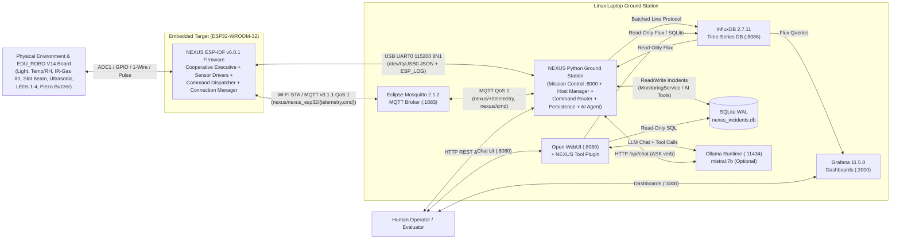
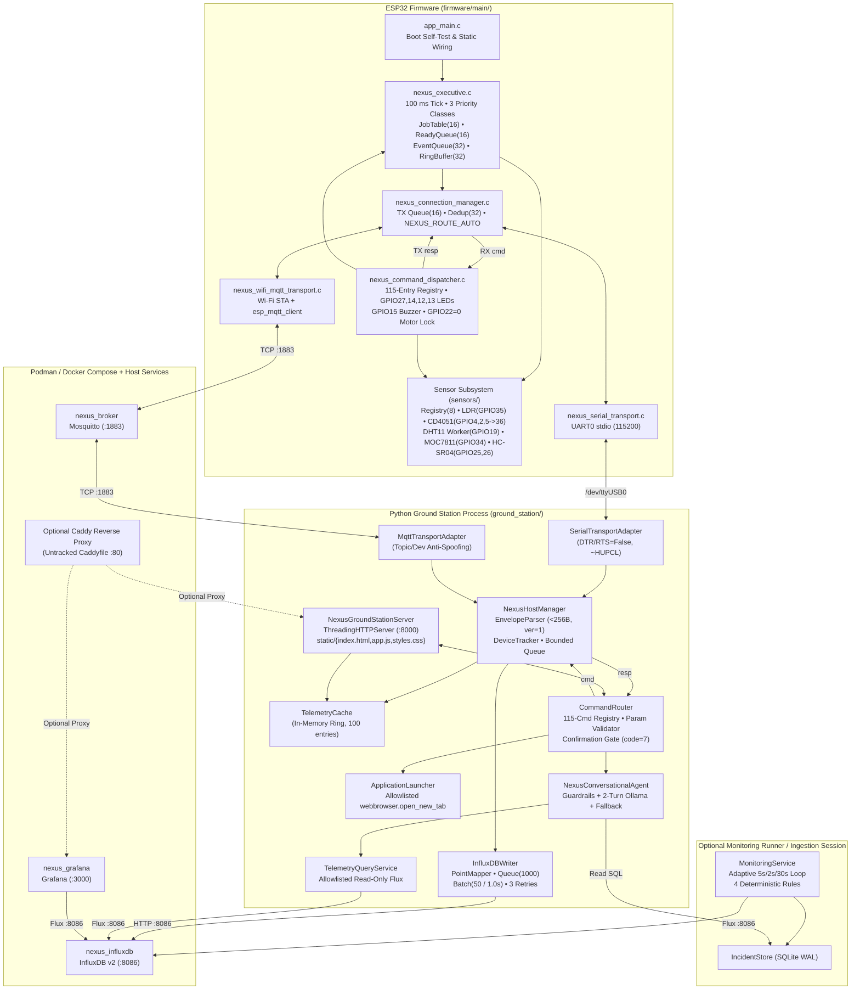
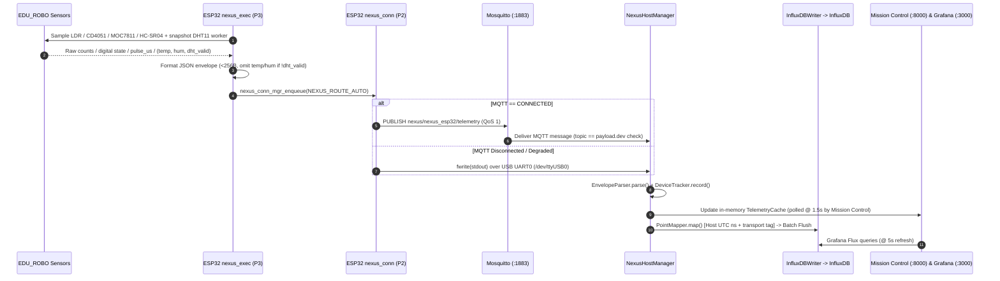
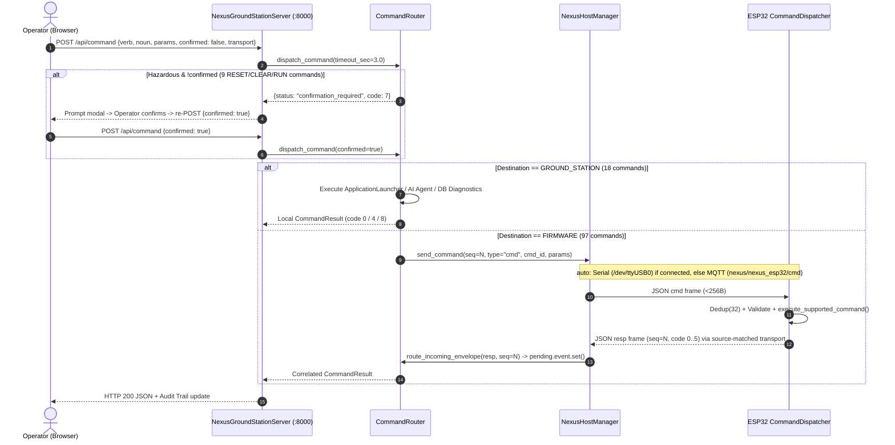
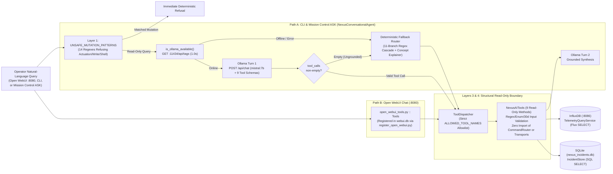

# NEXUS / EDU_ROBO — System Architecture

> **Document Status:** Authoritative Architecture Specification (`HEAD` commit `3ab168d`, branch `main`)  
> **Primary Evidence:** `firmware/main/**`, `ground_station/**`, `docker-compose.yml`, `grafana/**`, `scripts/nexus-demo-*.sh`

---

## 1. Executive Summary

**NEXUS** is an end-to-end embedded environmental monitoring, command-and-control, observability, and read-only AI diagnostics platform built on the **EDU_ROBO V14** trainer kit (`ESP32-WROOM-32` / `ESP32-D0WD-V3` rev `v3.1`) paired with a Linux laptop **Ground Station**.

### Architectural Truth & Status Summary

| Capability Domain | Status | Authoritative Implementation & Evidence |
| :--- | :--- | :--- |
| **Custom Cooperative Executive & Bounded Structures** | **Verified** | `firmware/main/executive/nexus_executive.c`, `firmware/main/data_structures/*.c`; host tests `tests/test_milestone2_host.c`, `test_milestone3_host.c`; 30-min soak `docs/validation/soak_qualification_run2_report.md` |
| **On-Board Sensor Acquisition (LDR, CD4051 X0, DHT11, MOC7811, HC-SR04)** | **Partially verified** | `firmware/main/sensors/*.c`; 5 physical channels verified on hardware (`docs/validation/m10_b1_ldr.log` .. `m10_c_hcsr04_live.log`), while `hall_x1` (`IC2`) is physically unpopulated yet polled as floating ADC counts, and `nexus_hcsr04.c` caps physical Echo wait at `8000 us` (~`137 cm` vs `400 cm` math) |
| **Protocol v1 JSON Framing (`< 256` bytes) & Dual Transport** | **Verified** | `firmware/main/transports/*.c`, `ground_station/connection_manager/*.py`; newline-delimited UTF-8 JSON (`ver: 1`); **CBOR is not implemented** |
| **Device-to-Host Routing (`NEXUS_ROUTE_AUTO`)** | **Verified** | **Active/standby failover** on ESP32 (`nexus_connection_manager.c:413-426`): sends JSON exclusively via MQTT when `MQTT_CONNECTED`, failing over to USB Serial (`UART0`) when MQTT is down. Host ingests Serial and MQTT concurrently |
| **Time-Series Persistence (InfluxDB 2.7.11) & Visualization (Grafana 11.5.0)** | **Verified** | `docker-compose.yml`, `ground_station/persistence/point_mapper.py`, `influxdb_writer.py`, `grafana/dashboards/nexus_telemetry.json` (11 panels across 4 rows) |
| **Canonical 115-Command Engine & Mission Control Web UI (`:8000`)** | **Partially verified** | `ground_station/command_router/command_registry.py`, `router.py`, `server.py`, `firmware/main/command/nexus_command_dispatcher.c`. 115 commands registered (`97` `FIRMWARE`, `18` `GROUND_STATION`): `42` firmware handlers perform live GPIO/state/readback, `51` are acknowledgement or hardcoded stubs, `10` are explicitly `UNSUPPORTED`, and `12` host-destined entries have no C switch case |
| **Deterministic SQLite Incident Monitoring (`nexus_incidents.db`)** | **Partially verified** | `ground_station/monitoring/service.py`, `store.py`, `rules/*.py`. Verified in unit/live tests (`test_monitoring_unit.py`, `test_monitoring_live.py`) and wired into `run_*_ingestion.py --enable-monitoring`, **not** started by `run_ground_station.py` (Mission Control `/api/incidents` computes stateless in-memory alerts from `TelemetryCache`) |
| **Read-Only AI Diagnostics (Ollama `mistral:7b` + Open WebUI + Fallback)** | **Partially verified** | `ground_station/ai/*.py`. 9 read-only Flux/SQLite tools + deterministic regex fallback. Offline unit tests pass (`test_ai_unit.py`), while `open_webui_validation_evidence.json` reveals off-topic/unknown-device prompts falling through to `nexus_esp32` latest telemetry. **Cactus-Compute is not implemented** |
| **Managed Demo Lifecycle (`nexus-demo-{start,status,stop}.sh`)** | **Implemented** | `scripts/nexus_demo_common.sh`, `nexus-demo-start.sh`, `nexus-demo-status.sh`, `nexus-demo-stop.sh` (commit `3ab168d`) |

---

## 2. System Context Diagram

---

## 3. Container & Component Architecture

The system enforces a strict **device-vs-host boundary**: real-time deterministic sampling, hardware safety locks, and bounded envelope framing execute on the ESP32 in C11, while unbounded storage, historical analytics, multi-panel visualization, incident persistence, hazardous command confirmation gating, and LLM tool orchestration execute on the Linux host.

---

## 4. Runtime Network & Port Topology

| Service / Process | Execution Runtime | Default Bind Address & Port | Protocol & Auth Posture | Primary Config / Source |
| :--- | :--- | :--- | :--- | :--- |
| **Mission Control & REST API** | Host Python (`run_ground_station.py`) | `0.0.0.0:8000` | Cleartext HTTP, **no authentication**, `Access-Control-Allow-Origin: *` | `ground_station/server.py:243, 764` |
| **Eclipse Mosquitto (`nexus_broker`)** | Container (`eclipse-mosquitto:2.1.2`) | `127.0.0.1:1883` and `${MQTT_BIND_IP:-10.12.252.18}:1883` | Cleartext MQTT v3.1.1, `allow_anonymous false`, password + topic ACLs (`credentials/mosquitto.*`) | `docker-compose.yml:58-82` |
| **InfluxDB (`nexus_influxdb`)** | Container (`influxdb:2.7.11`) | `127.0.0.1:8086` | HTTP API + UI, token-authenticated (`INFLUXDB_TOKEN`), org `nexus`, bucket `nexus_telemetry` | `docker-compose.yml:29-56` |
| **Grafana (`nexus_grafana`)** | Container (`grafana/grafana:11.5.0`) | `127.0.0.1:3000` | HTTP UI, login required by default (`GF_AUTH_ANONYMOUS_ENABLED=false`) | `docker-compose.yml:83-115` |
| **Open WebUI** | User `systemd` (`open-webui.service`) | `127.0.0.1:8080` (typical local bind) | Web UI + SQLite `webui.db` hosting `nexus_telemetry_tools` | `scripts/nexus-demo-start.sh:179-197`, `ground_station/ai/register_open_webui.py` |
| **Ollama Inference Engine** | Host service (`ollama`) | `127.0.0.1:11434` | Local HTTP JSON API (`/api/tags`, `/api/chat`), model `mistral:7b` | `ground_station/ai/agent.py:122-142` |
| **Caddy Reverse Proxy** *(optional)* | Host / untracked `Caddyfile` | `:80` (`auto_https off`) | Unauthenticated HTTP reverse proxy routing `/`->`:8000`, `/grafana*`->`:3000`, `/influxdb*`->`:8086`, `/ai*`->`:8080` | `Caddyfile` (untracked in working tree) |

---

## 5. End-to-End Execution Path Sequences

### 5.1 Telemetry Acquisition, Failover Transport, Persistence & Visualization

1. **Acquisition (`firmware/main/sensors/*.c`):** Every `100 ms` tick, `nexus_executive_tick()` (`nexus_executive.c:108`) schedules eligible `CLASS_1` sensor jobs (`ldr_acq` @ 500 ms, `mux_acq` @ 1000 ms, `dht11_acq` @ 2000 ms reading results from async `"nexus_dht11"` worker task, `moc7811_acq` @ 1000 ms, `hcsr04_acq` @ 1000 ms) into `s_sensor_registry`.
2. **Envelope Formatting (`app_main.c:96-211`, `nexus_envelope.c`):** Periodic executive jobs (`heartbeat` @ 1 s `CLASS_0`, `conn_telem` @ 2 s `CLASS_2`, `metrics` @ 5 s `CLASS_2`) snapshot latest sensor/executive metrics, format a `< 256`-byte newline-delimited JSON envelope (`ver: 1`), and enqueue it into `s_conn_mgr.tx_queue` (`16` slots) with policy `NEXUS_ROUTE_AUTO`. If `!dht_valid`, `temp` and `hum` keys are omitted from the JSON payload (`nexus_envelope.c:131-143`).
3. **Device Failover Dispatch (`nexus_connection_manager.c:38-82, 413-426`):** `"nexus_conn"` drains `tx_queue` every `10 ms`. Under `NEXUS_ROUTE_AUTO`, if `mqtt_transport.state == NEXUS_CONN_STATE_CONNECTED`, the frame is published **exclusively** to MQTT topic `nexus/nexus_esp32/telemetry` (QoS 1) and **not** emitted on USB Serial; if MQTT is disconnected/degraded, it falls back immediately to `stdout` (`UART0`).
4. **Host Ingestion & Persistence (`nexus_host_manager.py`, `point_mapper.py`, `influxdb_writer.py`):** Both `SerialTransportAdapter` and `MqttTransportAdapter` feed `NexusHostManager.handle_raw_message()`, which validates the schema via `EnvelopeParser.parse()`, tags provenance (`transport="serial"` or `"mqtt"`), updates `DeviceTracker` and `TelemetryCache`, and enqueues an InfluxDB `Point` stamped with **host UTC reception time (`ns`)** into `InfluxDBWriter` (`nexus_hb`, `nexus_telem`, `nexus_status`).
5. **Visualization (`grafana/dashboards/nexus_telemetry.json`, `ground_station/static/app.js`):** Mission Control polls `/api/status` and `/api/telemetry/latest` every `1.5 s`; Grafana refreshes Flux queries every `5 s` with `createEmpty: false` and `spanNulls: false` so invalid DHT intervals render as honest visual gaps.

---

### 5.2 Command Execution & Correlation Sequence

1. **Operator Submission (`app.js`, `server.py:700-755`):** Mission Control posts `{"verb","noun","params","confirmed","transport"}` to `POST /api/command`.
2. **Host Validation & Safety Gate (`router.py:493-754`):** `CommandRouter.dispatch_command()` looks up `(verb, noun)` in the 115-command `CommandRegistry`, rejects unsupported commands (`code=3`), enforces hazardous confirmation gating (`requires_confirmation` -> `code=7 CONFIRMATION_REQUIRED` when `confirmed=false`), and validates all parameters (`code=1 REJECTED` on range/enum/type violation).
3. **Host-Local vs Firmware Split:**
   - **`GROUND_STATION` (18 commands):** Executed locally in Python (`OPEN *` via `ApplicationLauncher`, `ASK *` via `NexusConversationalAgent`, `DIAGNOSTICS DATABASE/AI_SERVICE`, `EXPORT *`).
   - **`FIRMWARE` (97 commands):** Assigned a correlation `seq`, registered in `_pending_commands[seq]` (`3.0 s` HTTP timeout), serialized as `{"ver":1,"dev":"nexus_esp32","seq":N,"type":"cmd","cmd_id":ID,...}`, and sent via `NexusHostManager.send_command()` (`auto` prefers connected **Serial**, else **MQTT** `nexus/nexus_esp32/cmd`).
4. **Firmware Execution & Symmetric Reply (`nexus_command_dispatcher.c:969-1146`):** Firmware deduplicates `(source, dev, seq)` across a 32-entry window, validates `< 256` bytes and `cmd_id`, executes `execute_supported_command()`, and enqueues `{"type":"resp","seq":N,...}` locked to the **same transport** (`NEXUS_ROUTE_SERIAL_ONLY` or `NEXUS_ROUTE_MQTT_ONLY` -> `nexus/nexus_esp32/telemetry`).
5. **Host Correlation:** `MqttTransportAdapter` or `SerialTransportAdapter` delivers the `resp` envelope into `NexusHostManager` -> `CommandRouter.route_incoming_envelope()`, waking `pending.event` and returning HTTP `200` JSON to the UI.

---

### 5.3 Startup, Reconnection & Fault Recovery Flow

```mermaid
flowchart TD
    subgraph DeviceBoot["ESP32 Boot & Runtime Recovery (app_main.c)"]
        B0["Power-On / Reset"] --> B1["nexus_executive_run_selftest()\n(Static Job/Queue/Ring/Exec Verification)"]
        B1 -->|"FAIL"| BHalt["Log CRITICAL & Return from app_main()\n(Deterministic Halt, No Boot-Loop)"]
        B1 -->|"PASS"| B2["Init Executive (100ms) + Sensors\n(Spawns nexus_dht11 task; tolerates partial sensor init fail)"]
        B2 --> B3["nexus_conn_mgr_init()\n(Check Wi-Fi SSID & Mandatory MQTT Credentials)"]
        B3 -->|"SSID set without MQTT user/pass"| BSkip["Refuse Anonymous MQTT\n(Skip ConnMgr & CmdDispatcher start)"]
        B3 -->|"Valid Config (or SSID empty)"| B4["Init CmdDispatcher (GPIO22=0 Motor Lock)\n+ Start Serial & Wi-Fi/MQTT + Spawn nexus_conn"]
        B4 --> B5["Spawn nexus_exec (P3, 100ms Tick)"]
        B5 -->|"xTaskCreate != pdPASS"| BRestart["Delay 100ms -> esp_restart()"]
        B5 -->|"Running"| BLoop["Steady-State Cooperative Loop"]
        BLoop -->|"Wi-Fi Drop"| BReconn["State -> DEGRADED\nRoute Auto-Failover -> USB Serial\nReconnect Timer: 1s, 2s, 4s ... max 60s"]
        BReconn -->|"IP + MQTT Connected"| BLoop
    end

    subgraph HostBoot["Host Demo Lifecycle (scripts/nexus-demo-start.sh)"]
        H0["nexus-demo-start.sh"] --> H1["Validate .venv, .env, podman-compose / docker compose"]
        H1 --> H2["Ensure nexus_broker(:1883), nexus_influxdb(:8086), nexus_grafana(:3000) Up"]
        H2 --> H3["Probe Open WebUI (:8080) / systemctl --user start open-webui.service"]
        H3 --> H4["Start run_ground_station.py (:8000)\nSerial Reconnect (1s..5s) + Paho Async Loop + InfluxDB Retry (0.2s..2.0s)"]
        H4 --> H5["Verify Telemetry Freshness & Save demo_launcher_state.env"]
    end
```

---

### 5.4 Read-Only AI Tool & Data Access Flow

---

## 6. Cross-Cutting Engineering Invariants & Discrepancies

1. **Zero Fabrication of Missing Sensor Data (`Verified`):** Firmware omits `temp` and `hum` when `dht_valid == false` (`nexus_envelope.c:131-143`); Python `EnvelopeParser` sets `temp=None, hum=None` and quarantines any stray values into `suppressed_temp`/`suppressed_hum` (`envelope_parser.py:456-462`); `PointMapper` omits `temp`/`hum` fields in InfluxDB (`point_mapper.py:81-85`); Grafana configures `createEmpty: false` and `spanNulls: false`.
2. **Host-UTC vs Device-Monotonic Time (`Verified`):** ESP32 has no battery-backed RTC or SNTP client configured; firmware emits monotonic `uptime` (`esp_timer_get_time() / 1000LL`). Host `PointMapper` stamps InfluxDB `_time` with host UTC wall-clock arrival nanoseconds while storing `uptime_ms` as an integer field (`point_mapper.py:70, 126-130`).
3. **Device Failover vs Host Dual-Link Nuance (`Verified`):** Documentation in earlier milestones loosely referred to "simultaneous dual-transport streaming." In actual firmware (`app_main.c:303`, `nexus_connection_manager.c:413-426`), `NEXUS_ROUTE_AUTO` implements **active/standby failover** (MQTT primary when connected, Serial fallback when disconnected), whereas the Ground Station listens on both transports simultaneously and tags records with `transport=serial|mqtt`.
4. **Two Separate Incident Mechanisms on Host (`Implemented` — Architectural Split):**
   - `MonitoringService` (`ground_station/monitoring/service.py`) evaluates 4 deterministic Flux-backed rules with hysteresis into SQLite WAL (`nexus_incidents.db`), consumed by AI tools (`get_active_incidents`, `get_incident_history`, `get_incident_details`). It runs when invoked via `ground_station/monitoring/runner.py` or `run_*_ingestion.py --enable-monitoring`.
   - `run_ground_station.py` / `server.py` (`GET /api/incidents`, `L613-698`) does **not** start `MonitoringService` or query `nexus_incidents.db`; instead it computes ephemeral alerts directly from `TelemetryCache.get_latest()`.
5. **Host-Only Hazardous Command Confirmation (`Implemented`):** Confirmation gating (`requires_confirmation=True` -> `code=7`) is enforced in Python `CommandRouter` (`router.py:544`), not on the ESP32 (`nexus_command_dispatcher.c`). Direct serial/MQTT clients with valid broker ACLs can invoke `RESET *` or `CLEAR *` without a two-step handshake.

---

## 7. Related Documentation

- Embedded RTOS, executive, and bounded structures: [FIRMWARE_ARCHITECTURE.md](FIRMWARE_ARCHITECTURE.md)
- Historical and inferred architectural trade-offs: [ARCHITECTURE_DECISIONS.md](ARCHITECTURE_DECISIONS.md)
- EDU_ROBO V14 wiring, GPIO pin map, and sensor matrix: [HARDWARE.md](HARDWARE.md)
- Wire envelopes, framing, topics, and routing: [PROTOCOL_AND_TELEMETRY.md](PROTOCOL_AND_TELEMETRY.md)
- Complete 115-command & 27-parameter reference: [COMMAND_REFERENCE.md](COMMAND_REFERENCE.md)
- Time-series and incident database schemas: [DATABASE_SCHEMA.md](DATABASE_SCHEMA.md)
- Read-only AI architecture and Open WebUI plugin: [AI_INTEGRATION.md](AI_INTEGRATION.md)

