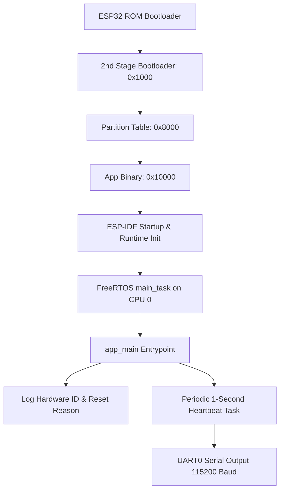

# NEXUS — Milestone 1: Native ESP-IDF Bootstrap & Hardware Baseline

## 1. Milestone Overview

Milestone 1 established the initial operational foundation for **NEXUS** (*Networked Environmental eXecutive with Unified Sensing*), originally designated *Apollo EDU_ROBO*. The project's overarching mission is to construct an industrial-grade, deterministic environmental monitoring and telemetry system deployed on an ESP32 microcontroller, communicating with host ground stations and analytics dashboards.

The primary objective of Milestone 1 was to stand up a clean, native ESP-IDF v6.0.1 development and compilation baseline targeting the classic ESP32 architecture, establish verified serial communication, flash the board over USB, and demonstrate deterministic application lifecycle logging (firmware metadata, reset reason, uptime, and free heap). It served as the foundational prerequisite gate before designing custom executive schedulers or integrating physical sensor hardware.

---

## 2. Starting State

Prior to Milestone 1, the repository was in an embryonic scaffold state:
- An initial repository structure existed with top-level documentation files: [`README.md`](file:///home/aryan/Projects/SPIT/NEXUS/README.md) and [`docs/PROJECT_BLUEPRINT.md`](file:///home/aryan/Projects/SPIT/NEXUS/docs/PROJECT_BLUEPRINT.md).
- A minimal CMake project scaffold existed under `firmware/` (`CMakeLists.txt` and `firmware/main/CMakeLists.txt`), with empty placeholder directories for future subsystems (`executive/`, `sensors/`, `transports/`, `command/`, `diagnostics/`, `data_structures/`).
- No build configuration (`sdkconfig`) had been generated for the target microcontroller.
- No hardware flashing had occurred; the toolchain environment on the host workstation (Fedora Linux) was unverified.
- Project identity was originally named `apollo_edu_robo` based on the Go-Green Technologies EDU_ROBO V14 IoT Trainer Kit specification.

---

## 3. Objectives and Requirements

### Original Requirements
1. **Target Architecture**: Configure native ESP-IDF to build strictly for the classic dual-core ESP32 (`esp32`), explicitly rejecting third-party abstraction layers such as the Arduino framework.
2. **Toolchain Verification**: Detect and activate the ESP-IDF v6.0.1 toolchain and Xtensa GCC compiler on Fedora Linux.
3. **Application Lifecycle Bootstrap**:
   - Provide an entrypoint [`firmware/main/app_main.c`](file:///home/aryan/Projects/SPIT/NEXUS/firmware/main/app_main.c) reporting firmware version, reset reason (`esp_reset_reason()`), uptime, and heap metrics.
   - Implement a non-crashing periodic heartbeat log emitted once every second ($1000\text{ ms}$).
   - Handle FreeRTOS task-creation failures explicitly.
4. **Hardware Validation Gate**:
   - Identify the physical serial device node (`/dev/ttyUSB*`).
   - Validate target chip revision and eFuse configuration.
   - Flash the compiled binary and capture serial output at 115200 baud without panics or bootloader resets.
5. **Project Renaming (Refinement)**:
   - Change project identity from `apollo_edu_robo` to `NEXUS` across all configuration, documentation, and log tags.

---

## 4. Design Decisions and Rationale

| Decision | Selection | Alternatives Considered | Rationale & Trade-offs |
|---|---|---|---|
| **Framework** | Native ESP-IDF v6.0.1 with FreeRTOS | Arduino-ESP32, Zephyr RTOS, Bare-metal | ESP-IDF provides direct control over FreeRTOS task scheduling, memory allocations, hardware timers, and low-level peripheral drivers. Arduino adds opaque background threads and non-deterministic memory overhead. |
| **Microcontroller Target** | Classic ESP32 (`ESP32-D0WD-V3`) | ESP32-S3, ESP32-C3 | Dictated by the physical trainer board (EDU_ROBO V14 with 30-pin DevKit V1). Dual-core Xtensa LX6 at 240 MHz provides ample headroom. |
| **Host Workstation Environment** | Fedora Linux with isolated Python venv | System Python / global packages | Espressif tools were installed in `/home/aryan/.espressif/tools/` with a dedicated Python 3.11/3.12 virtual environment (`activate_idf_v6.0.1.sh`). Prevents host dependency conflicts. |
| **Serial Baud Rate** | 115200 baud | 9600, 921600 | 115200 is the standard ESP-IDF bootloader and UART0 logging rate, ensuring boot messages and application logs share the same console without reconfiguration. |
| **Project Identity** | NEXUS (*Networked Environmental eXecutive with Unified Sensing*) | Apollo EDU_ROBO | User explicitly directed re-branding to reflect the custom executive and multi-transport architecture rather than a generic kit name. |

---

## 5. Architecture and Concepts

Milestone 1 implements the hardware and runtime initialization sequence:



### Key Concepts
- **Reset Reason**: Retrieved via `esp_reset_reason()`. Distinguishes cold power-on (`ESP_RST_POWERON = 1`), software restart (`ESP_RST_SW = 3`), watchdog resets (`ESP_RST_WDT`), and brownout events.
- **Uptime Timestamping**: Monotonic time acquired via `esp_timer_get_time()`, returning elapsed microseconds since boot. Converted to milliseconds for human-readable logging.
- **Heap Accounting**: Free 8-bit capable data heap monitored via `esp_get_free_heap_size()`. Serves as a baseline to detect leaks in future milestones.
- **Classic ESP32 Pad Architecture**: The ESP32-WROOM-32 DevKit V1 routes GPIO pins with specific constraints (e.g., GPIO 34–39 are input-only without internal pull-ups/pull-downs; UART0 occupies GPIO 1 and GPIO 3).

---

## 6. Implementation Walkthrough

### 6.1 Top-Level Build Configuration
- **File**: [`firmware/CMakeLists.txt`](file:///home/aryan/Projects/SPIT/NEXUS/firmware/CMakeLists.txt)
  - Calls `cmake_minimum_required(VERSION 3.16)`.
  - Includes `$ENV{IDF_PATH}/tools/cmake/project.cmake`.
  - Declares `project(nexus)`.

### 6.2 Component Registration
- **File**: [`firmware/main/CMakeLists.txt`](file:///home/aryan/Projects/SPIT/NEXUS/firmware/main/CMakeLists.txt)
  - Registers the `main` component using `idf_component_register(SRCS "app_main.c" INCLUDE_DIRS ".")`.
  - Links system dependencies (`esp_system`, `esp_timer`, `esp_driver_gpio`).

### 6.3 Application Entrypoint
- **File**: [`firmware/main/app_main.c`](file:///home/aryan/Projects/SPIT/NEXUS/firmware/main/app_main.c)
  - Defines the log tag: `static const char *TAG = "nexus_boot";` (updated from `apollo_boot`).
  - **`app_main()`**:
    - Queries `esp_reset_reason()` and logs reset status.
    - Queries project name, build timestamp, and ESP-IDF version (`esp_get_idf_version()`).
    - Enters the periodic heartbeat loop with `vTaskDelay(pdMS_TO_TICKS(1000))`.
    - At each interval, logs uptime (`esp_timer_get_time() / 1000LL`) and free heap (`esp_get_free_heap_size()`).

---

## 7. Execution and Data-Flow Walkthrough

1. **Hardware Power-On**: Silicon Labs CP2102 powers the ESP32 via Micro-USB.
2. **ROM Execution**: ESP32 ROM bootloader executes from internal mask ROM, detects flash parameters (DIO mode, 40 MHz, 4 MB).
3. **Bootloader Phase**: 2nd stage bootloader loads from flash offset `0x1000`, initializes RTC and flash cache, verifies partition table at `0x8000`.
4. **Application Launch**: Application binary mapped at `0x10000` is launched. FreeRTOS kernel initializes across CPU 0 and CPU 1.
5. **Main Task**: FreeRTOS creates `main_task` on CPU 0 (priority 1, stack size 3584 bytes), which invokes `app_main()`.
6. **Telemetry Cadence**: `app_main` logs banner information and blocks on `vTaskDelay(pdMS_TO_TICKS(1000))`, allowing the FreeRTOS idle task to reclaim CPU cycles.
7. **Periodic Output**: Every 1000 ms, the task unblocks, queries heap and timer registers, formats an `ESP_LOGI` string, and writes to UART0 line buffer.

---

## 8. Testing and Validation

### 8.1 Workstation & Toolchain Activation
- **Host OS**: Fedora Linux (Kernel 6.x, x86_64).
- **Environment Script**: `source /home/aryan/.espressif/tools/activate_idf_v6.0.1.sh`.
- **Target Setting**: `idf.py set-target esp32` generated target-specific `sdkconfig`.
- **Compiler**: `xtensa-esp32-elf-gcc (crosstool-NG esp-14.2.0_20251107) 14.2.0`.

### 8.2 Hardware Detection
- Command: `lsusb` and `dmesg | tail -n 25`.
- Detected Device: `Silicon Labs CP2102 USB to UART Bridge Controller` (`ID 10c4:ea60`, Bus 001 Device 009/010).
- Serial Port: `/dev/ttyUSB0` (aliased at `/dev/serial/by-id/usb-Silicon_Labs_CP2102_USB_to_UART_Bridge_Controller_0001-if00-port0`).
- Target Chip Verification via `esptool.py --port /dev/ttyUSB0 chip_id`:
  - Chip Type: `ESP32-D0WD-V3` (revision `v3.1`)
  - Features: Wi-Fi, BT, Dual Core, 240 MHz, Vref calibration in eFuse
  - MAC Address: `8c:94:df:7d:02:58`

### 8.3 Firmware Build
- Command: `cd firmware && idf.py build`
- Output:
  ```text
  Bootloader: 26,128 bytes (0x6610) at 0x1000
  Partition Table: 3,072 bytes (0xc00) at 0x8000
  Application (nexus.bin): 139,040 bytes (0x21f20) at 0x10000
  Compilation: 0 warnings, 0 errors
  ```

### 8.4 Hardware Flash & Serial Verification
- Command: `idf.py -p /dev/ttyUSB0 flash`
- Flashing Speed: 460,800 baud. Hash verification on all partitions passed.
- Observed Serial Stream (115200 baud):
  ```text
  I (13) boot: ESP-IDF v6.0.1 2nd stage bootloader
  I (14) boot: chip revision: v3.1
  I (16) boot.esp32: SPI Speed      : 40MHz
  I (20) boot.esp32: SPI Mode       : DIO
  I (24) boot.esp32: SPI Flash Size : 4MB
  ...
  I (252) nexus_boot: NEXUS bootstrap starting
  I (252) nexus_boot: reset_reason=1
  I (252) nexus_boot: project=nexus version=1 build=Oct 13 2026
  I (262) nexus_boot: target=classic_esp32 framework=esp-idf executive=bootstrap
  I (262) nexus_boot: heartbeat uptime_ms=47 free_heap=300540
  I (1262) nexus_boot: heartbeat uptime_ms=1049 free_heap=304748
  I (2262) nexus_boot: heartbeat uptime_ms=2049 free_heap=304748
  ```

---

## 9. Problems Encountered and Resolutions

1. **Stale Project Identity Across Repository**:
   - *Problem*: Initial commits inherited `apollo_edu_robo` identifiers across CMake files, binary names, and documentation.
   - *Diagnosis*: Scanned working tree with `grep -ri "apollo"`.
   - *Resolution*: Updated CMake project name to `nexus`, renamed binary targets to `nexus.bin`, updated log tags to `nexus_boot`, and aligned documentation.
2. **Missing Files Clarification**:
   - *Problem*: User raised concern whether any custom modular files from Milestone 1 were lost.
   - *Resolution*: Clarified that Milestone 1 was strictly the bootstrap verification gate. No modular data structures or drivers were created in Milestone 1; all modular architecture was reserved for Milestone 2.

---

## 10. Final State and Acceptance

- **Criteria Met**:
  - Native ESP-IDF v6.0.1 builds cleanly for classic ESP32.
  - Physical board detected at `/dev/ttyUSB0` as `ESP32-D0WD-V3` rev 3.1.
  - Flashing succeeds with full image hash validation.
  - Serial monitor confirms 1-second heartbeat, heap stability (~304 KB free), and clean power-on reset.
- **Remaining Limitations**:
  - `app_main` uses a simple FreeRTOS delay loop rather than a formal priority scheduler or cyclic executive.
  - No sensors, data structures, or communication protocols are present.

---

## 11. Lessons and Connections to Later Milestones

Milestone 1 proved that the hardware and host toolchain were completely operational. However, having `app_main` execute a blocking `vTaskDelay` loop demonstrated the necessity of an application-level executive. Relying on ad-hoc FreeRTOS tasks for every sensor or telemetry task would lead to task proliferation, stack memory exhaustion, and unpredictable scheduling jitter. This motivated the design of **Milestone 2: Executive Core & Bounded Data Structures**.

---

## 12. Source References and Evidence

- **Primary Commit**: `1c24124db13e385223bedc653ff781aca2586a30` (*core: initial code structure*)
- **Documentation & Renaming Commit**: `419e2c7cb93278f861874022df91868c5ef08489` (*docs: add comprehensive ESP32 trainer kit specification sheet and HTML version*)
- **Source Files**:
  - [`firmware/main/app_main.c`](file:///home/aryan/Projects/SPIT/NEXUS/firmware/main/app_main.c) (bootstrap revision)
  - [`firmware/CMakeLists.txt`](file:///home/aryan/Projects/SPIT/NEXUS/firmware/CMakeLists.txt)
  - [`firmware/main/CMakeLists.txt`](file:///home/aryan/Projects/SPIT/NEXUS/firmware/main/CMakeLists.txt)
  - [`firmware/sdkconfig`](file:///home/aryan/Projects/SPIT/NEXUS/firmware/sdkconfig)
  - [`docs/SPEC_SHEET.md`](file:///home/aryan/Projects/SPIT/NEXUS/docs/SPEC_SHEET.md)
