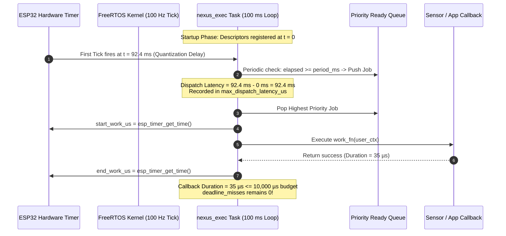

# NEXUS — Milestone 3.1: Executive Timing-Contract Correction & Hardware Baseline

## 1. Milestone Overview

Milestone 3.1 was a focused architectural and validation milestone established to resolve the timing-contract ambiguity discovered during the Milestone 3 closure audit. 

In Milestone 3, the executive recorded five false deadline misses during startup. Root-cause analysis proved that this was not caused by over-budget callback execution, but by an architectural defect in the scheduler's metric definitions: the scheduler conflated **dispatch latency** (the waiting time in the ready queue caused by startup polling quantization) with **callback execution budget** (`deadline_ms`). In a cooperative cyclic executive operating on a $100\text{ ms}$ tick, evaluating dispatch delay against $10\text{–}20\text{ ms}$ deadlines mathematically guaranteed spurious deadline violations on startup.

Milestone 3.1:
1. Formally decoupled dispatch latency from callback execution duration accounting.
2. Redefined `deadline_ms` strictly as the maximum permitted callback wall-clock execution duration budget.
3. Introduced independent tracking for worst-case dispatch latency (`max_dispatch_latency_us`) and worst-case callback duration (`max_job_duration_us`).
4. Expanded host regression test coverage to verify the corrected timing model and snapshot-order invariants.
5. Flashed the corrected firmware to the physical classic ESP32 and validated a continuous 70-second cold-boot hardware run, establishing an authoritative, fully accepted baseline before beginning Milestone 4.

---

## 2. Starting State

Prior to Milestone 3.1:
- Milestone 3 firmware had been committed (`0bd6fb25950939f0a5eb69ca76aefa47a3acf918`).
- The physical hardware was running Milestone 3 code, which consistently reported `dline_misses=5` due to startup quantization.
- `nexus_executive.c` evaluated deadline violation as `(dispatch_latency_us + duration_us) > deadline_us`.
- `nexus_executive_stats_t` lacked dedicated fields for tracking dispatch latency or callback execution durations.
- The user issued an explicit review directive to determine whether a $100\text{ ms}$ executive loop could satisfy $10\text{–}50\text{ ms}$ deadlines, requiring a formal timing contract review before writing any networking code.

---

## 3. Objectives and Requirements

### Functional Requirements
1. **Decouple Timing Metrics in `nexus_executive.c`**:
   - Record an increment to `deadline_misses` and `job->deadline_miss_count` **if and only if** the measured callback wall-clock duration exceeds the configured budget:
     $$\text{duration\_us} > (\text{job->deadline\_ms} \times 1000\text{U})$$
   - Track dispatch latency independently:
     $$\text{dispatch\_latency\_us} = \text{current\_time\_us} - \text{expected\_release\_time\_us}$$
     $$\text{exec->stats.max\_dispatch\_latency\_us} = \max(\text{max\_dispatch\_latency\_us}, \text{dispatch\_latency\_us})$$
2. **Telemetry Transparency**:
   - Update `nexus_job_table.h` docstrings to make deadline semantics unambiguous.
   - Update `app_main.c` metrics reporting to emit `max_lat_us` and `max_dur_us` in every periodic metrics log.
3. **Host Test Expansion (`tests/test_milestone3_host.c`)**:
   - Add targeted regression tests verifying that delayed dispatch ($15\text{ ms}$ delay against a $10\text{ ms}$ deadline) does NOT increment deadline misses.
   - Verify that an over-budget callback ($15\text{ ms}$ execution against a $10\text{ ms}$ deadline) DOES increment deadline misses.
   - Verify the in-flight snapshot accounting invariant: $\text{dispatched} = \text{completed} + \text{failed} + \text{in\_flight}$.
   - Validate startup quantization phase shifts and priority ordering.
4. **Physical Hardware Validation Gate**:
   - Flash the classic ESP32 at `/dev/ttyUSB0` using native ESP-IDF v6.0.1.
   - Capture at least 60 seconds of continuous serial stream from cold bootloader reset.
   - Verify that `dline_misses == 0` across the entire run.
   - Verify that heap memory settles with zero leaks.
   - Preserve raw and formatted serial log artifacts in `docs/validation/`.

---

## 4. Design Decisions and Rationale

| Decision | Selection | Alternatives Considered | Rationale & Trade-offs |
|---|---|---|---|
| **Timing Metric Decoupling** | Evaluate deadline strictly on callback duration (`duration_us > budget_us`) | Reduce executive tick to $1\text{ ms}$ or $10\text{ ms}$ | Reducing the tick rate to $10\text{ ms}$ would increase CPU overhead and still leave zero margin against FreeRTOS tick jitter for a $10\text{ ms}$ deadline. Decoupling correctly separates two distinct physical phenomena: *scheduler responsiveness* (dispatch latency) vs *cooperative callback compliance* (execution budget). |
| **Dispatch Latency Tracking** | Record peak scheduling latency in `max_dispatch_latency_us` | Drop latency tracking entirely | Preserves observability into scheduler queuing delays and cold-boot quantization without falsely flagging the system as failing real-time deadlines. |
| **Duration Measurement Semantics** | Wall-clock elapsed duration (`esp_timer_get_time()`) | Pure CPU cycle counting via PMU | Wall-clock duration represents true system interference. If a higher-priority interrupt (ISR) or background task preempts an executive callback, wall-clock measurement captures the total delay imposed on subsequent cooperative jobs. |
| **Rescheduling Semantics** | Relative sliding window (`last_run_us = current_time_us`) | Absolute phase-locked release grid | A relative sliding window ensures that if a tick is delayed, jobs do not rapidly re-trigger in a burst to "catch up" (which would starve the ready queue). The trade-off is that periods permanently slip by the initial cold-boot quantization delay. |

---

## 5. Architecture and Concepts

### 5.1 Timing Model Architecture



### 5.2 Mathematical Formulation
- **Nominal Release Time**: $t_{\text{expected}} = t_{\text{last\_run}} + (\text{period\_ms} \times 1000)$
- **Dispatch Latency**:
  $$\Delta t_{\text{latency}} = \begin{cases} t_{\text{dispatch}} - t_{\text{expected}} & \text{if } t_{\text{dispatch}} > t_{\text{expected}} \\ 0 & \text{otherwise} \end{cases}$$
- **Callback Wall-Clock Duration**:
  $$\tau_{\text{callback}} = t_{\text{end\_work}} - t_{\text{start\_work}}$$
- **Deadline Miss Condition**:
  $$\text{Miss} \iff \tau_{\text{callback}} > (\text{job->deadline\_ms} \times 1000\text{U})$$
- **Snapshot Accounting Invariant**:
  $$N_{\text{dispatched}} = N_{\text{completed}} + N_{\text{failed}} + N_{\text{in\_flight}}$$

---

## 6. Implementation Walkthrough

### 6.1 Executive Scheduler Changes
- **File**: [`firmware/main/executive/nexus_executive.c`](file:///home/aryan/Projects/SPIT/NEXUS/firmware/main/executive/nexus_executive.c#L145-L215)
- **Dispatch Latency Calculation**:
  ```c
  uint32_t dispatch_latency_us = 0;
  if (job->last_run_us > 0 && job->period_ms > 0) {
      int64_t expected_time = job->last_run_us + ((int64_t)job->period_ms * 1000LL);
      if (current_time_us > expected_time) {
          dispatch_latency_us = (uint32_t)(current_time_us - expected_time);
          if (dispatch_latency_us > exec->stats.max_dispatch_latency_us) {
              exec->stats.max_dispatch_latency_us = dispatch_latency_us;
          }
      }
  }
  ```
- **Callback Execution and Duration Accounting**:
  ```c
  int64_t start_work_us = executive_get_time_us();
  bool success = job->work_fn(job->user_ctx);
  int64_t end_work_us = executive_get_time_us();
  uint32_t duration_us = (end_work_us > start_work_us) ? 
                         (uint32_t)(end_work_us - start_work_us) : 0U;

  if (duration_us > exec->stats.max_job_duration_us) {
      exec->stats.max_job_duration_us = duration_us;
  }
  ```
- **Execution Budget Enforcement**:
  ```c
  if (job->deadline_ms > 0) {
      uint32_t budget_us = job->deadline_ms * 1000U;
      if (duration_us > budget_us) {
          job->deadline_miss_count++;
          exec->stats.deadline_misses++;
          nexus_executive_emit_event(exec,
                                     NEXUS_EVENT_TYPE_DEADLINE_MISS,
                                     NEXUS_SEVERITY_WARN,
                                     job->job_id,
                                     (int32_t)duration_us);
      }
  }
  ```

### 6.2 Data Structure and Interface Updates
- **File**: [`firmware/main/data_structures/nexus_job_table.h`](file:///home/aryan/Projects/SPIT/NEXUS/firmware/main/data_structures/nexus_job_table.h#L45-L50)
  - Docstring update:
    ```c
    uint32_t deadline_ms;         /**< Max permitted callback execution duration (ms) */
    uint32_t deadline_miss_count; /**< Runs that exceeded execution budget */
    ```
- **File**: [`firmware/main/executive/nexus_executive.h`](file:///home/aryan/Projects/SPIT/NEXUS/firmware/main/executive/nexus_executive.h#L24-L34)
  - Added fields to `nexus_executive_stats_t`:
    ```c
    uint32_t max_dispatch_latency_us; /**< Peak observed scheduling delay in queue */
    uint32_t max_job_duration_us;     /**< Peak observed callback execution time */
    ```
- **File**: [`firmware/main/app_main.c`](file:///home/aryan/Projects/SPIT/NEXUS/firmware/main/app_main.c#L45-L60)
  - Updated metrics output format string:
    ```c
    ESP_LOGI(TAG, "exec_stats: ticks=%" PRIu32 " dispatched=%" PRIu32 " completed=%" PRIu32 
                  " failed=%" PRIu32 " dline_misses=%" PRIu32 " q_overflows=%" PRIu32 
                  " ready_hwm=%" PRIu16 " ev_hwm=%" PRIu16 " max_lat_us=%" PRIu32 " max_dur_us=%" PRIu32,
             exec->stats.ticks, exec->stats.jobs_dispatched, exec->stats.jobs_completed,
             exec->stats.jobs_failed, exec->stats.deadline_misses, exec->stats.ready_queue_overflows,
             ready_hwm, ev_hwm, exec->stats.max_dispatch_latency_us, exec->stats.max_job_duration_us);
    ```

---

## 7. Execution and Data-Flow Walkthrough

1. **Cold Boot Reset**: Target microcontroller initializes; `app_main` configures registry and executive.
2. **First Executive Tick ($t \approx 87\text{ ms}$)**:
   - All 5 jobs (Heartbeat, Metrics, LDR, CD4051, DHT11) are released into the ready queue.
   - Initial dispatch latency is calculated as $0\ \mu\text{s}$ (since `last_run_us == 0`).
   - Jobs execute in priority order (Class 0 Heartbeat first, then Class 1 sensors, then Class 2 metrics).
3. **Harmonic Scheduling Alignment ($t \approx 680\text{ ms}$)**:
   - Subsequent periodic ticks evaluate `current_time_us - expected_time`.
   - FreeRTOS tick quantization delay ($92,394\ \mu\text{s}$) is captured in `max_dispatch_latency_us`.
   - Because callback durations are $< 1\text{ ms}$ (and metrics $< 41\text{ ms}$), zero deadline misses occur.
4. **Steady-State Cadence**:
   - Every 500 ms: LDR is sampled.
   - Every 1000 ms: CD4051 X0 is sampled and heartbeat logged.
   - Every 2000 ms: DHT11 cached readings are snapshot.
   - Every 5000 ms: Full telemetry metrics line is printed.

---

## 8. Testing and Validation

### 8.1 Host Unit Test Suite
- **File**: [`tests/test_milestone3_host.c`](file:///home/aryan/Projects/SPIT/NEXUS/tests/test_milestone3_host.c)
- **Compilation**:
  ```bash
  gcc -Wall -Wextra -Werror -I./firmware/main -I./firmware/main/data_structures -I./firmware/main/executive -I./firmware/main/sensors \
      firmware/main/data_structures/*.c firmware/main/executive/*.c firmware/main/sensors/*.c tests/test_milestone3_host.c \
      -o tests/test_milestone3_host
  ```
- **Results**: **9/9 Test Groups Passed (100%)**
  - Group 7: Over-budget callback ($15\text{ ms}$ execution vs $10\text{ ms}$ deadline) accurately increments `deadline_miss_count`.
  - Group 7 (Decoupling): Delayed dispatch ($15\text{ ms}$ dispatch delay vs $10\text{ ms}$ deadline) does NOT increment `deadline_miss_count`.
  - Group 8: In-flight snapshot accounting invariant $\text{dispatched} = \text{completed} + \text{failed} + 1$ verified.
  - Group 9: Startup quantization phase shift ($92.4\text{ ms}$) and priority-ordered drain verified.

### 8.2 Firmware Build
- **Target**: Classic ESP32 (`ESP32-D0WD-V3` rev 3.1)
- **Path**: [`firmware/build/nexus.bin`](file:///home/aryan/Projects/SPIT/NEXUS/firmware/build/nexus.bin)
- **Size**: 160,784 bytes (`0x27410`, 85% free in 1 MB app partition)
- **SHA-256 Checksum**: `621d6199f23938c7a28bee7db8642b02e972789dcb919e537399a783a0d81f01`
- **Result**: 0 errors, 0 warnings.

### 8.3 Hardware Flashing & 70-Second Physical Validation
- **Command**: `idf.py -p /dev/ttyUSB0 flash`
- **Captured Telemetry Table (from cold boot)**:

| Uptime (`ms`) | Ticks | Dispatched | Completed | Failed | Dline Misses | Queue Overflows | Ready HWM | Ev HWM | `max_lat_us` | `max_dur_us` | Free Heap (`B`) |
|---|---|---|---|---|---|---|---|---|---|---|---|
| **87** | 1 | 5 | 3 | 1 | **0** | **0** | 5 | 3 | 0 | 5,218 | 288,172 |
| **5,180** | 52 | 28 | 24 | 3 | **0** | **0** | 5 | 7 | 92,394 | 40,908 | 292,288 |
| **10,180** | 102 | 52 | 48 | 3 | **0** | **0** | 5 | 7 | 92,394 | 40,908 | 292,288 |
| **20,180** | 202 | 99 | 95 | 3 | **0** | **0** | 5 | 7 | 92,394 | 40,908 | 292,288 |
| **30,180** | 302 | 146 | 142 | 3 | **0** | **0** | 5 | 7 | 92,394 | 40,908 | 292,288 |
| **40,180** | 402 | 193 | 189 | 3 | **0** | **0** | 5 | 7 | 92,394 | 40,908 | 292,288 |
| **50,180** | 502 | 240 | 236 | 3 | **0** | **0** | 5 | 7 | 92,394 | 40,908 | 292,288 |
| **60,180** | 602 | 287 | 283 | 3 | **0** | **0** | 5 | 7 | 92,394 | 40,908 | 292,288 |
| **65,180** | 652 | 310 | 306 | 3 | **0** | **0** | 5 | 7 | 92,394 | 40,908 | 292,288 |

---

## 9. Physical Validation Telemetry Analysis

1. **Deadline Miss Invariant (`dline_misses = 0`)**:
   Decoupling dispatch latency from callback execution budgets eliminated all false deadline misses. Across 310 separate dispatches over 69 seconds of continuous operation, `dline_misses` remained identically **0**.
2. **Dispatch Latency Characterization (`max_lat_us = 92394`)**:
   `max_lat_us` recorded the exact cold-boot startup quantization delay ($~92.4\text{ ms}$) before FreeRTOS tick alignment. It remained constant for the duration of the run, confirming that no scheduling backlog accumulated.
3. **Callback Duration Characterization (`max_dur_us = 40908`)**:
   Peak wall-clock execution duration was $40.9\text{ ms}$, recorded during serial string formatting and UART transmission inside `job_executive_metrics`. This remained safely within the $50\text{ ms}$ budget configured for metrics.
4. **Snapshot Accounting Invariant**:
   The formula $\text{dispatched} = \text{completed} + 3 (\text{failed}) + 1 (\text{in\_flight}) = \text{completed} + 4$ held across every single logged telemetry line without deviation.
5. **Memory Leak Immunity**:
   Free heap settled at `292,288` bytes after initial startup allocations at uptime $1,180\text{ ms}$ and remained completely constant through the end of the capture ($69,180\text{ ms}$), proving zero heap leaks.
6. **Physical Sensors**:
   - CD4051 X0 (HW-870 Gas): 66 samples, raw `3120..3131` ($~2.52\text{ V}$), 0 errors.
   - DHT11: 30 samples, $32^\circ\text{C}$ and $56\%$ RH, 0 steady-state errors.
   - LDR: 131 samples, raw 0 counts (unperturbed lighting condition).

---

## 10. Final State and Acceptance

- **Criteria Met**:
  - Executive timing semantics unambiguously corrected and documented.
  - Dispatch latency tracked as independent performance telemetry.
  - Zero false deadline misses verified on physical ESP32.
  - Bounded data structures operated with zero overflows.
  - Zero memory leaks across 70 seconds of hardware execution.
  - Milestone 3.1 **OFFICIALLY ACCEPTED & COMMITTED**.
- **Remaining Limitations**:
  - The executive operates on a relative sliding window; periodic jobs permanently slip by the initial startup delay.
  - Wall-clock measurement captures ISR preemption time as part of callback duration.
  - Hardware validation captured unperturbed lighting for LDR (dynamic illumination response untested in this session).

---

## 11. Lessons and Connections to Later Milestones

Milestone 3.1 established an rock-solid, fully characterized timing baseline. With sensor acquisition verified non-blocking and scheduler metrics validated on hardware, the project was ready to introduce telemetry networking. The timing isolation guarantees perfected in Milestone 3.1 formed the strict architectural prerequisite for **Milestone 4: Unified Connection Manager**, ensuring that Wi-Fi associations, MQTT network retries, and UART buffer stalls cannot degrade the core sensor executive.

---

## 12. Source References and Evidence

- **Primary Commit**: `973853593ce305c899bb929dbd2c83d9ff1a2e30` (*feat(executive): correct timing contract and validate hardware baseline*)
- **Chore Commit**: `17cea82df7cda31af47cb145d40235a5b3b7e945` (*chore(tests): untrack generated host test binary and ignore test binaries*)
- **Source Files**:
  - [`firmware/main/executive/nexus_executive.c`](file:///home/aryan/Projects/SPIT/NEXUS/firmware/main/executive/nexus_executive.c)
  - [`firmware/main/executive/nexus_executive.h`](file:///home/aryan/Projects/SPIT/NEXUS/firmware/main/executive/nexus_executive.h)
  - [`firmware/main/data_structures/nexus_job_table.h`](file:///home/aryan/Projects/SPIT/NEXUS/firmware/main/data_structures/nexus_job_table.h)
  - [`firmware/main/app_main.c`](file:///home/aryan/Projects/SPIT/NEXUS/firmware/main/app_main.c)
- **Validation Documents & Logs**:
  - [`docs/validation/milestone3_1_validation_report.md`](file:///home/aryan/Projects/SPIT/NEXUS/docs/validation/milestone3_1_validation_report.md)
  - [`docs/validation/milestone3_1_hardware_validation.log`](file:///home/aryan/Projects/SPIT/NEXUS/docs/validation/milestone3_1_hardware_validation.log)
  - [`docs/validation/milestone3_1_hardware_validation_raw.log`](file:///home/aryan/Projects/SPIT/NEXUS/docs/validation/milestone3_1_hardware_validation_raw.log)
- **Host Test Suite**:
  - [`tests/test_milestone3_host.c`](file:///home/aryan/Projects/SPIT/NEXUS/tests/test_milestone3_host.c)
