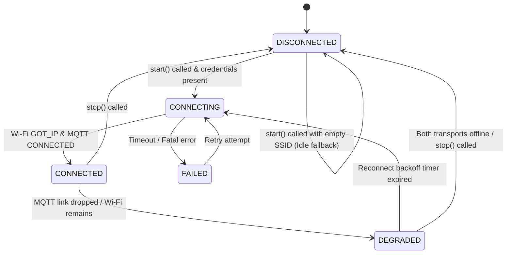

# NEXUS — Milestone 4: Unified Connection Manager, Transports & Correctness Remediation

## 1. Milestone Overview

Milestone 4 implements the communication backbone of the NEXUS project: the **Unified Connection Manager**. In the complete NEXUS architecture, the embedded node must stream high-frequency telemetry, receive remote control commands, and emit asynchronous diagnostic events over both local physical interfaces (USB Serial) and remote network interfaces (Wi-Fi and MQTT).

Directly coupling application executive callbacks to network sockets or UART write loops would destroy the real-time guarantees established in Milestone 3.1. Milestone 4 addresses this by introducing:
1. **Physical Transport Abstraction**: A unified `nexus_transport_t` interface supporting USB Serial and Wi-Fi / MQTT adapters with a virtual operation table (`nexus_transport_ops_t`).
2. **Standardized Protocol v1 Framing**: Bounded 256-byte newline-delimited JSON envelopes (`nexus_envelope_t`) for `hb`, `telem`, `status`, and `event` messages.
3. **Asynchronous Bounded Queuing**: A dedicated background FreeRTOS task (`nexus_conn`) draining a static 16-slot transmit queue (`nexus_conn_tx_queue_t`), ensuring executive callbacks enqueue messages in $< 100\text{ ns}$ (host) or $< 3\ \mu\text{s}$ (ESP32) with zero heap allocation.
4. **Intelligent Routing & Deduplication**: Routing policies (`AUTO`, `SERIAL_ONLY`, `MQTT_ONLY`, `BROADCAST`) with transparent fallback to serial if MQTT is offline, paired with a 32-entry sliding sequence deduplication filter.
5. **Pre-Hardware Correctness Remediation**: All six pre-hardware audit findings (**F-01 through F-06**) have been fully remediated in source code, verified with AddressSanitizer (ASan) and UndefinedBehaviorSanitizer (UBSan), and cross-compiled successfully with ESP-IDF v6.0.1 with zero warnings and zero errors.

---

## 2. Starting State

Prior to Milestone 4:
- The firmware baseline was frozen and accepted at commit `973853593ce305c899bb929dbd2c83d9ff1a2e30` (Milestone 3.1) and chore commit `17cea82df7cda31af47cb145d40235a5b3b7e945`.
- The executive scheduler timing contract was strictly validated on hardware: zero deadline misses, peak startup dispatch latency of $92.4\ \mu\text{s}$, and worst-case execution duration bounded at $40.9\text{ ms}$.
- Physical telemetry was emitted solely via raw `ESP_LOGI` statements to the ESP32 serial console (UART0).
- Subdirectory `firmware/main/transports/` was completely empty.
- No Wi-Fi or MQTT networking stacks were configured in `sdkconfig` or CMake.

---

## 3. Objectives and Requirements

### Functional Requirements
1. **Unified Transport Interface (`nexus_transport`)**:
   - Provide an abstract interface using a virtual function table (`nexus_transport_ops_t`): `init`, `start`, `stop`, `send`, `get_stats`.
   - Maintain discrete transport lifecycle states (`DISCONNECTED`, `CONNECTING`, `CONNECTED`, `DEGRADED`, `FAILED`).
   - Track operational statistics per transport: `tx_bytes`, `rx_bytes`, `tx_packets`, `rx_packets`, `tx_errors`, `connect_count`, `disconnect_count`.
2. **Message Framing & Envelopes (`nexus_envelope`)**:
   - Bounded 256-byte buffer (`NEXUS_ENVELOPE_MAX_LEN = 256`) with newline framing (`\n`).
   - Implement Protocol v1 JSON schemas:
     - Heartbeat (`hb`): `{"ver":1,"dev":"nexus_esp32","seq":%u,"type":"hb","uptime":%lld,"heap":%u,"ticks":%u}\n`
     - Telemetry (`telem`): `{"ver":1,"dev":"nexus_esp32","seq":%u,"type":"telem","uptime":%lld,"ldr":%d,"x0":%d,"temp":%d,"hum":%d}\n`
     - Status (`status`): `{"ver":1,"dev":"nexus_esp32","seq":%u,"type":"status","uptime":%lld,"disp":%u,"comp":%u,"fail":%u,"lat_us":%u,"dur_us":%u}\n`
     - Event (`event`): `{"ver":1,"dev":"nexus_esp32","seq":%u,"type":"event","uptime":%lld,"ev":%d,"sev":%d,"src":%d,"val":%d}\n`
   - Bounded header parser rejecting oversized frames ($\ge 256$ B) and malformed tokens without memory overreads or partial output mutation.
3. **USB Serial Transport Adapter (`nexus_serial_transport`)**:
   - Transmit envelopes over UART0/stdout.
   - Non-blocking line write with stdout flush.
4. **Wi-Fi / MQTT Transport Adapter (`nexus_wifi_mqtt_transport`)**:
   - Station (STA) mode connection to 2.4 GHz Wi-Fi AP.
   - Client connection to MQTT broker (`mqtt://<broker-ip>:1883`) using Espressif ESP-MQTT component.
   - Dual-core spinlock critical sections guarding state transitions and statistics snapshots.
   - Exponential reconnect backoff timer preventing connection storming when the AP is unreachable.
   - Event-handler registration lifecycle retention and clean unregistration on stop.
   - Safe unconfigured fallback: When SSID is empty string `""`, remain cleanly in `DISCONNECTED` state without errors.
5. **Unified Connection Manager (`nexus_connection_manager`)**:
   - Manage both Serial and Wi-Fi/MQTT transports under a single logical state machine.
   - Static 16-slot transmit queue (`NEXUS_CONN_TX_QUEUE_CAPACITY = 16`).
   - Transmit enqueue timeout = 0 ticks (non-blocking). Drop on queue full with drop counter.
   - FreeRTOS background worker task `nexus_conn` (Priority 2, 4096 words stack) draining the queue every $10\text{ ms}$.
   - Composite ingress deduplication filter: 32-entry sliding window using `(source, dev, seq)` composite key.
   - Routing policies: `AUTO` (MQTT with transparent Serial fallback), `SERIAL_ONLY`, `MQTT_ONLY`, `BROADCAST`.
6. **Executive Telemetry Integration**:
   - Register periodic Priority Class 2 telemetry job (`conn_telem`, period $2000\text{ ms}$, budget $20\text{ ms}$).
   - Update heartbeat job ($1000\text{ ms}$) to enqueue `hb` envelope.
   - Update metrics job ($5000\text{ ms}$) to enqueue `status` envelope.

---

## 4. Design Decisions and Rationale

| Decision | Selection | Alternatives Considered | Rationale & Trade-offs |
|---|---|---|---|
| **Concurrency & Execution Decoupling** | Dedicated FreeRTOS background task (`nexus_conn`, Priority 2) | Enqueue and transmit directly inside executive callback | Transmitting over Wi-Fi/MQTT involves TCP socket handshakes, TLS, and MQTT packet assembly. Even UART output can block if the hardware TX FIFO fills. Running transmission in a background task guarantees the executive callback only performs a microsecond memory copy. |
| **Transmit Queue Sizing** | 16 static slots of 256-byte envelopes ($4\text{ KB}$ SRAM) | Dynamic linked list, larger 64-slot queue | 16 slots accommodate over 30 seconds of telemetry backpressure during brief Wi-Fi reconnect transients at standard sampling rates. Static allocation eliminates runtime heap fragmentation. |
| **Routing Policy: AUTO** | Prioritize MQTT; fall back to USB Serial if MQTT is not CONNECTED | Discard packets if MQTT down; duplicate everything | Ensures remote ground stations receive telemetry via MQTT when online, but local developers connected via USB never lose visibility if the network is absent or degraded. |
| **Framing Specification** | Newline-delimited JSON (`\n`) | Binary CBOR, Protobuf, COBS framing | JSON is natively human-readable in serial terminals, easily parsed by Python/Node.js ground stations, and directly ingestible into modern database pipelines (InfluxDB, Telegraf) without compiling target-specific protobuf schemas. |
| **Component Dependency** | Official Espressif `espressif/mqtt` component | Custom raw lwIP socket client | Leverages Espressif's battle-tested MQTT 3.1.1/5.0 client with internal ring buffers, automatic reconnect, and event loop integration. |
| **Synchronization Mechanism** | ESP-IDF `portMUX_TYPE` spinlock for transport state/stats | FreeRTOS binary semaphore / mutex | Event loop handlers and timer callbacks execute in system tasks or timer contexts where acquiring a blocking mutex is unsafe or risks priority inversion. Spinlocks provide nanosecond mutual exclusion between cores without blocking. |
| **Deduplication Identity** | Composite key: `(source, dev, seq)` | Raw sequence number `seq` alone | Commands from distinct sources (e.g. Serial console vs MQTT cloud command) may legitimately share sequence numbers (e.g. `seq=1`). A composite identity guarantees independence across transport channels and sender devices. |

---

## 5. Architecture and Concepts

### 5.1 Concurrency and Queue Architecture

```mermaid
flowchart TD
    subgraph FreeRTOS Task: nexus_exec [FreeRTOS Task: nexus_exec (Priority 3, 100 ms Tick)]
        JobHB[Job: Heartbeat 1000 ms Class 0] --> EnqCall[nexus_conn_mgr_send_*]
        JobTelem[Job: Telemetry 2000 ms Class 2] --> EnqCall
        JobStatus[Job: Status 5000 ms Class 2] --> EnqCall

        EnqCall --> TryLock[xSemaphoreTake tx_mutex timeout=0]
        TryLock -- Lock Acquired --> CopySlot[memcpy into tx_queue.slots[head]]
        CopySlot --> AdvHead[Advance head pointer, count++]
        AdvHead --> RelLock[xSemaphoreGive tx_mutex]
        TryLock -- Timeout / Full --> DropCount[tx_queue.total_dropped++]
    end

    EnqCall -. Duration < 3 µs Non-Blocking .-> ExecContinue[Executive Proceeds Immediately]

    subgraph Bounded Queue Storage
        AdvHead ==> TX_Queue[(Bounded Ring Queue: 16 Envelopes x 256 Bytes)]
    end

    subgraph FreeRTOS Task: nexus_conn [FreeRTOS Task: nexus_conn (Priority 2, 10 ms Loop)]
        ConnLoop[Periodic 10 ms Cycle] --> PopQueue[Pop Entry from TX Queue]
        PopQueue --> RouteDecision{Routing Policy?}

        RouteDecision -- AUTO & MQTT Online --> SendMQTT[nexus_wifi_mqtt_transport_send]
        RouteDecision -- AUTO & MQTT Offline --> SendSerial[nexus_serial_transport_send]
        RouteDecision -- SERIAL_ONLY --> SendSerial
        RouteDecision -- MQTT_ONLY --> SendMQTT
        RouteDecision -- BROADCAST --> SendBoth[Send to Both Transports]
    end

    TX_Queue ==> PopQueue
    SendSerial --> UART_HW[ESP32 UART0 / USB Serial]
    SendMQTT --> TCP_HW[Wi-Fi STA -> TCP/IP -> MQTT Broker]
```

### 5.2 Transport State Machine



---

## 6. Implementation Walkthrough

### 6.1 Base Transport Interface
- **Files**: [`firmware/main/transports/nexus_transport.h`](file:///home/aryan/Projects/SPIT/NEXUS/firmware/main/transports/nexus_transport.h), [`nexus_transport.c`](file:///home/aryan/Projects/SPIT/NEXUS/firmware/main/transports/nexus_transport.c)
- **Key Types**:
  - `nexus_transport_type_t`: `NEXUS_TRANSPORT_TYPE_SERIAL`, `NEXUS_TRANSPORT_TYPE_MQTT`.
  - `nexus_conn_state_t`: `DISCONNECTED`, `CONNECTING`, `CONNECTED`, `DEGRADED`, `FAILED`.
  - `nexus_route_policy_t`: `AUTO`, `SERIAL_ONLY`, `MQTT_ONLY`, `BROADCAST`.
  - `nexus_transport_stats_t`: Counters for bytes, packets, errors, connects, disconnects, and microsecond timestamps.
  - `nexus_transport_ops_t`: Virtual table containing function pointers: `init`, `start`, `stop`, `send`, `is_connected`, `get_state`, `get_stats`.

### 6.2 Message Envelope Subsystem
- **Files**: [`firmware/main/transports/nexus_envelope.h`](file:///home/aryan/Projects/SPIT/NEXUS/firmware/main/transports/nexus_envelope.h), [`nexus_envelope.c`](file:///home/aryan/Projects/SPIT/NEXUS/firmware/main/transports/nexus_envelope.c)
- **Key Types & Constants**:
  - `NEXUS_ENVELOPE_MAX_LEN = 256`
  - `NEXUS_PROTOCOL_VERSION = 1`
  - `nexus_envelope_t`: `buffer[256]`, `length`, `seq`, `timestamp_us`, `type`.
- **Bounded Header Parser (`nexus_envelope_parse_header_ext`)**:
  - Enforces `len < NEXUS_ENVELOPE_MAX_LEN` strictly: rejects oversized packets without truncation.
  - Copies incoming byte slice into local `char scratch[NEXUS_ENVELOPE_MAX_LEN]` and guarantees `scratch[len] = '\0'`.
  - Eliminates all unbounded string scanning: tokens are scanned inside the scratch buffer using `strtoul` with digit validation.
  - Extracts `ver`, `dev` (if requested), `seq`, and `type`.
  - Atomic output commitment: outputs are only written when all requested fields successfully pass validation, preventing partial mutation on malformed frames.

### 6.3 USB Serial Transport Adapter
- **Files**: [`firmware/main/transports/nexus_serial_transport.h`](file:///home/aryan/Projects/SPIT/NEXUS/firmware/main/transports/nexus_serial_transport.h), [`nexus_serial_transport.c`](file:///home/aryan/Projects/SPIT/NEXUS/firmware/main/transports/nexus_serial_transport.c)
- **Implementation**:
  - `serial_init()`: Sets baud rate (115200) and port (UART0).
  - `serial_start()`: Sets state to `CONNECTED`.
  - `serial_send()`: Writes buffer to `stdout` via `fwrite()` and calls `fflush(stdout)`. Updates stats (`tx_packets`, `tx_bytes`).

### 6.4 Wi-Fi / MQTT Transport Adapter
- **Files**: [`firmware/main/transports/nexus_wifi_mqtt_transport.h`](file:///home/aryan/Projects/SPIT/NEXUS/firmware/main/transports/nexus_wifi_mqtt_transport.h), [`nexus_wifi_mqtt_transport.c`](file:///home/aryan/Projects/SPIT/NEXUS/firmware/main/transports/nexus_wifi_mqtt_transport.c)
- **Concurrency & Spinlock Strategy**:
  - Uses `portMUX_TYPE s_wifi_mqtt_spinlock` with `taskENTER_CRITICAL` / `taskEXIT_CRITICAL` around all state mutations, counter increments, and snapshot reads.
  - Critical sections are microsecond-short: no network I/O, logging, or blocking calls occur inside critical sections.
- **Exponential Reconnect Backoff**:
  - Implements `nexus_wifi_mqtt_compute_next_backoff(current_ms, max_ms)` doubling reconnect delay on disconnect: $1000\text{ ms} \to 2000 \to 4000 \to 8000 \to 16000 \to 32000 \to 60000\text{ ms}$ (ceiling clamp).
  - Uses a one-shot `esp_timer` (`nexus_wifi_reconn`) to schedule reconnects asynchronously without blocking the event loop.
  - Backoff delay and retry count are reset to base ($1000\text{ ms}$) on successful IP acquisition or MQTT connection.
- **Lifecycle & Handler Cleanup**:
  - Retains event handler instance handles (`wifi_handler_instance`, `ip_handler_instance`).
  - Event handlers are registered on `start()` and unregistered cleanly via `esp_event_handler_instance_unregister()` on `stop()`.
  - Reconnect timers are stopped and cancelled in `wifi_mqtt_stop()`, and `s_active_transport` is atomically set to `NULL` to prevent stale event callbacks.

### 6.5 Unified Connection Manager Core
- **Files**: [`firmware/main/transports/nexus_connection_manager.h`](file:///home/aryan/Projects/SPIT/NEXUS/firmware/main/transports/nexus_connection_manager.h), [`nexus_connection_manager.c`](file:///home/aryan/Projects/SPIT/NEXUS/firmware/main/transports/nexus_connection_manager.c)
- **Transmit Ring Queue (`nexus_conn_tx_queue_t`)**:
  - Array of 16 entries: `slots[16]`, `policies[16]`.
  - Synchronization: FreeRTOS mutex `tx_mutex`.
  - `nexus_conn_mgr_enqueue()`: Attempts `xSemaphoreTake(tx_mutex, 0)`. If taken and `count < CAPACITY`, copies envelope into `slots[head]`, advances `head = (head + 1) % 16`, updates `count` and `high_water_mark`. If queue is full, increments `total_dropped`.
- **Composite Deduplication Filter (`nexus_conn_dedup_t`)**:
  - 32-entry circular array of `nexus_conn_dedup_entry_t` storing `{ nexus_transport_type_t source; char dev[16]; uint32_t seq; }`.
  - Scans active history: matches only if `source`, `dev`, and `seq` are identical. Unrelated commands on different transports or senders sharing a sequence number are accepted.
  - Provides `nexus_conn_mgr_reset_dedup(mgr)` to handle sequence counter resets upon sender restart.
- **Asynchronous Task**:
  - FreeRTOS task `nexus_conn` (Priority 2, 4096 words stack).
  - Drains queue by calling `nexus_conn_mgr_process_tx_queue()`, then sleeps for $10\text{ ms}$ (`vTaskDelay(pdMS_TO_TICKS(10))`).

### 6.6 Executive Telemetry Registration
- **File**: [`firmware/main/app_main.c`](file:///home/aryan/Projects/SPIT/NEXUS/firmware/main/app_main.c)
  - Registers Priority Class 2 job `job_connection_telemetry` ($2000\text{ ms}$, budget $20\text{ ms}$) polling LDR, CD4051, and DHT11 registry entries and calling `nexus_conn_mgr_send_telemetry()`.
  - Updates `job_heartbeat` to call `nexus_conn_mgr_send_heartbeat()`.
  - Updates `job_executive_metrics` to call `nexus_conn_mgr_send_status()`.

### 6.7 Kconfig Configuration
- **File**: [`firmware/main/Kconfig.projbuild`](file:///home/aryan/Projects/SPIT/NEXUS/firmware/main/Kconfig.projbuild)
  - `CONFIG_NEXUS_WIFI_SSID`: default `""` (unconfigured = Wi-Fi safely idle).
  - `CONFIG_NEXUS_WIFI_PASSWORD`: default `""`.
  - `CONFIG_NEXUS_MQTT_BROKER_URI`: default `"mqtt://localhost:1883"`.
  - `CONFIG_NEXUS_MQTT_CLIENT_ID`: default `"nexus_esp32"`.
  - `CONFIG_NEXUS_MQTT_TOPIC_PREFIX`: default `"nexus/nexus_esp32"`.
  - `CONFIG_NEXUS_RECONNECT_BASE_MS`: default 1000.
  - `CONFIG_NEXUS_RECONNECT_MAX_MS`: default 60000.
  - Safe defaults allow developers to configure local credentials via `idf.py menuconfig` without hardcoding secrets in Git.

---

## 7. Execution and Data-Flow Walkthrough

1. **Startup Sequence**:
   - `app_main()` initializes sensor drivers and registry.
   - Calls `nexus_conn_mgr_init(&s_conn_mgr, &conn_cfg)`. Default config leaves SSID blank (`""`).
   - Calls `nexus_conn_mgr_start(&s_conn_mgr)`. Serial starts in `CONNECTED`; Wi-Fi/MQTT safely stays `DISCONNECTED`.
   - Spawns background worker task `nexus_conn` (Priority 2).
   - Spawns executive task `nexus_exec` (Priority 3).
2. **Executive Enqueue (Non-Blocking)**:
   - At $t = 1000\text{ ms}$, Heartbeat job runs in `nexus_exec`.
   - Formats `hb` envelope with sequence number `seq = 1`.
   - `nexus_conn_mgr_enqueue()` acquires mutex in 0 ticks, copies 98 bytes into static slot, releases mutex.
   - Callback returns in $< 3\ \mu\text{s}$. Total heartbeat callback duration remains $< 1\text{ ms}$ (well below $20\text{ ms}$ budget).
3. **Background Transmission**:
   - `nexus_conn` task unblocks on its $10\text{ ms}$ period.
   - Dequeues `hb` envelope.
   - Evaluates policy `NEXUS_ROUTE_AUTO`. Since MQTT is disconnected, routes to Serial.
   - Calls `nexus_serial_transport_send()`, emitting framed JSON to UART0:
     ```json
     {"ver":1,"dev":"nexus_esp32","seq":1,"type":"hb","uptime":1000,"heap":296880,"ticks":10}
     ```
   - Advances tail pointer and increments `tx_dispatched`.

---

## 8. Testing and Validation

### 8.1 Host Unit Test Suite
- **File**: [`tests/test_milestone4_host.c`](file:///home/aryan/Projects/SPIT/NEXUS/tests/test_milestone4_host.c)
- **Compilation**:
  ```bash
  gcc -Wall -Wextra -Werror -I firmware/main -I firmware/main/data_structures -I firmware/main/executive \
      -I firmware/main/sensors -I firmware/main/transports \
      firmware/main/data_structures/*.c firmware/main/executive/*.c firmware/main/sensors/*.c \
      firmware/main/transports/*.c tests/test_milestone4_host.c \
      -o tests/test_milestone4_host
  ```
- **Results**: **13/13 Test Groups Passed (100%)**

| Test Group | Production Functions Exercised | Observed Result |
|---|---|---|
| `test_envelope_serialization_and_framing` | `nexus_envelope_format_*`, `nexus_envelope_parse_header_ext` | **PASS**: Formatted JSON strings validated with trailing `\n`. |
| `test_f01_bounded_envelope_parser_regression` | `nexus_envelope_parse_header_ext` boundary suite | **PASS**: Verified NULL inputs, non-NUL-terminated byte slices, exact 255 B maximum boundary, oversized rejection ($\ge 256$ B), missing fields, malformed delimiters, and output preservation on failure. |
| `test_tx_queue_saturation_and_overflow_rejection` | `nexus_conn_mgr_enqueue`, `process_tx_queue` | **PASS**: 16 slots filled; 17th and 18th rejected; `total_dropped == 2`; drain frees slots. |
| `test_transport_state_transitions_and_diagnostics` | `nexus_conn_mgr_init`, `start`, `stop`, `get_stats` | **PASS**: State transitions verified; diagnostic counters accurate. |
| `test_routing_policies` | `nexus_conn_mgr_send_*`, routing evaluation | **PASS**: `AUTO` routes to MQTT when connected, falls back to Serial when disconnected. `SERIAL_ONLY`, `MQTT_ONLY`, `BROADCAST` verified. |
| `test_f02_composite_deduplication_and_isolation` | `nexus_conn_mgr_is_duplicate`, `record_seq`, `reset_dedup` | **PASS**: Genuine duplicates on same transport suppressed; distinct transports sharing sequence numbers accepted; distinct `dev` identities accepted; 32-entry sliding window eviction verified; sequence restart reset verified. |
| `test_f04_reconnect_backoff_calculation` | `nexus_wifi_mqtt_compute_next_backoff` | **PASS**: Verified geometric progression $1000 \to 2000 \to 4000 \to 8000 \to 16000 \to 32000 \to 60000$ ms, ceiling clamp, zero input, and integer overflow guard. |
| `test_f05_f06_unconfigured_defaults_and_lifecycle` | `nexus_conn_mgr_init`, `start`, `stop` | **PASS**: Empty SSID starts safely in serial-only fallback without hanging; repeated stop is safe and idempotent; worker self-stop is rejected; stop timeout preserves handle for retry; startup failure cleanly rolls back started transports; queue drain yields immediately when stopping. |
| `test_start_rejected_when_worker_terminating` | `nexus_conn_mgr_start` worker handle guard | **PASS**: Start rejected when previous worker task handle is still active / terminating. |
| `test_executive_timing_isolation` | `nexus_conn_mgr_enqueue` benchmark | **PASS**: Enqueue duration measured at **64 ns/op** on Linux x86_64 host without sanitizers, and **597 ns/op** under ASan/UBSan (safely $< 50\ \mu\text{s}$). Sub-3-µs duration on ESP32 at 240 MHz is an analytical instruction-budget estimate pending target trace verification. |
| `test_executive_and_sensors_integration` | End-to-end executive ticks with queue drain | **PASS**: Executive completed 60 ticks with `deadline_misses == 0` and `jobs_failed == 0`. |
| `test_mqtt_inbound_rx_and_fragmentation` | `nexus_wifi_mqtt_transport_process_rx_chunk`, `nexus_conn_mgr_process_rx` | **PASS**: Verified single-chunk complete message, multi-fragment reassembly (ESP-IDF topic-on-first-chunk semantics), oversized payload rejection ($\ge 256$ B), malformed JSON syntax/missing fields rejection, invalid offsets/bounds/empty payloads, wrong topic rejection, MQTT duplicate suppression with cross-transport serial isolation, exactly-once callback invocation, and assembly buffer reset on gap, interruption, and restart. |
| `test_telemetry_schema_and_dht_validity` | `nexus_envelope_format_telemetry`, `nexus_conn_mgr_send_telemetry`, `nexus_envelope_parse_header_ext` | **PASS**: When `dht_valid == false`, `"temp"` and `"hum"` are completely omitted from JSON and `"dht_valid":false` is emitted; when `dht_valid == true`, both fields are present with `"dht_valid":true`; header parsing succeeds for both schemas; queueing verified without corruption. |

### 8.2 Sanitizer Verification (ASan & UBSan)
- **Compiler**: Clang with `-fsanitize=address,undefined`
- **Command**:
  ```bash
  clang -Wall -Wextra -Werror -fsanitize=address,undefined \
      -I firmware/main -I firmware/main/data_structures -I firmware/main/executive \
      -I firmware/main/sensors -I firmware/main/transports \
      firmware/main/data_structures/*.c firmware/main/executive/*.c firmware/main/sensors/*.c \
      firmware/main/transports/*.c tests/test_milestone4_host.c \
      -o tests/test_milestone4_host_san && ./tests/test_milestone4_host_san
  ```
- **Outcome**: **13/13 Test Groups Passed with ZERO errors, ZERO memory leaks, and ZERO undefined behaviors**. Confirms bounded scratch buffer handling and pointer arithmetic are completely memory-safe.

### 8.3 Firmware Build Validation
- **Environment**: Native ESP-IDF v6.0.1 on Fedora Linux (`activate_idf_v6.0.1.sh`).
- **Build Configuration**: Local ignored configuration (`credentials/sdkconfig.local`) and dedicated build directory (`build/`).
- **Build Command**:
  ```bash
  idf.py -DSDKCONFIG=/home/aryan/Projects/SPIT/NEXUS/credentials/sdkconfig.local -B ../build build
  ```
- **Binary**: `build/nexus.bin`
- **SHA-256 Checksum**: `fa9b9c92976b27490e7bece4fc1a0b23b12027a28b8df2d8eee7e4dd4502cbac`
- **Binary Size**: `0xdf0f0` bytes (913,648 bytes / 892 KB).
- **Partition Fit**: Smallest app partition is `0x100000` (1024 KB); `0x20f10` bytes (135,440 bytes / 13%) free headroom.
- **Compiler Warnings / Errors**: **0 warnings, 0 errors**.

---

## 9. Source-Level Correctness Remediation Dispositions

All six audit findings (F-01 through F-06) and the worker-task lifecycle protocol have been resolved in the firmware source tree:

| ID | Finding Scope | Root Cause | Implemented Resolution | Affected Code Locations | Verification Evidence |
|---|---|---|---|---|---|
| **F-01** | Bounded envelope parsing | `nexus_envelope_parse_header` called `strstr` and `sscanf` on arbitrary incoming byte slices without bounding `len` or guaranteeing null termination. | Added strict length check `len < NEXUS_ENVELOPE_MAX_LEN` (rejects $\ge 256$ B). Sized bounded stack scratch buffer `scratch[NEXUS_ENVELOPE_MAX_LEN]` with explicit NUL termination. Replaced `sscanf` with digit-validated `strtoul`. Ensured output pointers are never partially mutated on failure. Added `nexus_envelope_parse_header_ext`. | [`transports/nexus_envelope.h`](file:///home/aryan/Projects/SPIT/NEXUS/firmware/main/transports/nexus_envelope.h), [`transports/nexus_envelope.c`](file:///home/aryan/Projects/SPIT/NEXUS/firmware/main/transports/nexus_envelope.c) | `test_f01_bounded_envelope_parser_regression` + ASan/UBSan clean pass. |
| **F-02** | Correct deduplication identity | Deduplication compared only `uint32_t seq`, discarding independent commands from different sources/senders that shared a sequence number. | Defined composite identity `(source, dev, seq)` in `nexus_conn_dedup_entry_t`. Updated `nexus_conn_mgr_is_duplicate` and `record_seq` to match on transport type, device ID string, and sequence number. Added `nexus_conn_mgr_reset_dedup`. | [`transports/nexus_connection_manager.h`](file:///home/aryan/Projects/SPIT/NEXUS/firmware/main/transports/nexus_connection_manager.h), [`transports/nexus_connection_manager.c`](file:///home/aryan/Projects/SPIT/NEXUS/firmware/main/transports/nexus_connection_manager.c) | `test_f02_composite_deduplication_and_isolation` (proved cross-transport independence). |
| **F-03** | Thread-safe Wi-Fi/MQTT state and stats | Event loop and task contexts mutated `s_active_transport->state` and `stats` concurrently without synchronization. | Introduced ESP-IDF dual-core spinlock `portMUX_TYPE s_wifi_mqtt_spinlock` with `taskENTER_CRITICAL` / `taskEXIT_CRITICAL`. Guarded all state transitions, counter increments, and snapshot reads. Eliminated blocking or logging inside critical sections. | [`transports/nexus_wifi_mqtt_transport.c`](file:///home/aryan/Projects/SPIT/NEXUS/firmware/main/transports/nexus_wifi_mqtt_transport.c) | ESP-IDF clean build + host tests. |
| **F-04** | Wi-Fi reconnect backoff | Disconnect handler called `esp_wifi_connect()` immediately, creating a high-frequency reconnection loop when AP was down. | Implemented geometric backoff via `nexus_wifi_mqtt_compute_next_backoff` ($1\text{ s} \to 2\text{ s} \dots 60\text{ s}$ clamp). Armed one-shot `esp_timer` without blocking the event loop. Reset backoff to base on successful IP/MQTT connect. | [`transports/nexus_wifi_mqtt_transport.h`](file:///home/aryan/Projects/SPIT/NEXUS/firmware/main/transports/nexus_wifi_mqtt_transport.h), [`transports/nexus_wifi_mqtt_transport.c`](file:///home/aryan/Projects/SPIT/NEXUS/firmware/main/transports/nexus_wifi_mqtt_transport.c) | `test_f04_reconnect_backoff_calculation` passed 100%. |
| **F-05** | Wi-Fi/MQTT configuration | SSID, password, and MQTT URI were hardcoded in `app_main.c`. | Created `firmware/main/Kconfig.projbuild` with safe unconfigured defaults (`SSID=""`). Wired `CONFIG_NEXUS_*` macros into `app_main.c` with compile-time fallbacks. Kept secrets out of source control. | [`main/Kconfig.projbuild`](file:///home/aryan/Projects/SPIT/NEXUS/firmware/main/Kconfig.projbuild), [`main/app_main.c`](file:///home/aryan/Projects/SPIT/NEXUS/firmware/main/app_main.c), [`sdkconfig`](file:///home/aryan/Projects/SPIT/NEXUS/firmware/sdkconfig) | `test_f05_f06_unconfigured_defaults_and_lifecycle` + ESP-IDF build. |
| **F-06** | Wi-Fi/MQTT & Worker lifecycle cleanup | Event handlers discarded handles on stop; reconnect timer was not cancelled; connection manager worker task exited asynchronously without join protocol; stop previously used unsafe asynchronous `vTaskDelete(th)` and allowed worker self-stop. | Retained event handler handles and unregistered them cleanly; stopped reconnect timer and nulled transport pointer. Replaced `vTaskDelete(th)` with a non-destructive FreeRTOS binary semaphore rendezvous (`task_exit_sem`) with 500 ms bounded timeout and retry semantics. Rejected worker self-stop. Added early queue drain breakout on stop in `process_tx_queue`. Implemented clean rollback of started transports on `xTaskCreate` failure. | [`transports/nexus_wifi_mqtt_transport.c`](file:///home/aryan/Projects/SPIT/NEXUS/firmware/main/transports/nexus_wifi_mqtt_transport.c), [`transports/nexus_connection_manager.h`](file:///home/aryan/Projects/SPIT/NEXUS/firmware/main/transports/nexus_connection_manager.h), [`transports/nexus_connection_manager.c`](file:///home/aryan/Projects/SPIT/NEXUS/firmware/main/transports/nexus_connection_manager.c) | `test_f05_f06_unconfigured_defaults_and_lifecycle` (start, duplicate start, self-stop rejection, timeout retry, rollback, queue breakout) + ESP-IDF clean build. |

---

## 10. Current Status, Verified Evidence & Outstanding Tasks

To maintain absolute documentation integrity, the status of Milestone 4 is categorized below:

### 10.1 Verified & Established Facts
1. **Source Code Remediated & Hardened**: All six audit items (F-01 through F-06), worker-task lifecycle protocol, MQTT inbound receive-path reassembly, DHT11 atomic bit timing, and startup telemetry schema validity are implemented and verified.
2. **Host Unit Tests Expanded & Passing**: All 13 test groups in `tests/test_milestone4_host.c` pass with 100% success. Enqueue benchmarks confirm non-blocking operation (measured at **64 ns/op** on host without sanitizers, **597 ns/op** under ASan). Sub-3-µs duration on ESP32 is an analytical estimate.
3. **Memory Safety & Sanitizers Verified**: Tested under Clang with `-fsanitize=address,undefined` with zero warnings, zero leaks, and zero memory corruption across all test suites.
4. **All Regression Suites Passing**: Milestone 2 host tests (5/5), Milestone 3 host tests (11/11), and Milestone 4 host tests (13/13) all pass concurrently (**29/29 total test groups**).
5. **Firmware Compilation Verified**: ESP-IDF v6.0.1 builds `build/nexus.bin` (SHA-256 `fa9b9c92976b27490e7bece4fc1a0b23b12027a28b8df2d8eee7e4dd4502cbac`, 913,648 bytes, 13% free headroom) with zero warnings and zero errors.

### 10.2 Physical Hardware Validation Status
1. **Milestone 4 Serial-Only Baseline**: **PASSED (ACCEPT)**. Flashed and validated on hardware (`milestone4_postfix_hardware_validation_20261016_220741.log`): 162/162 valid JSON envelopes, zero drops, flat heap (254 KB free), and zero deadline misses (`dline_misses=0`, `max_dur_us=44.37 ms`).
2. **Milestone 4.1B Wi-Fi Diagnostics**: **VERIFIED ON HARDWARE** (`milestone4_1b_wifi_diagnostics.log`). Disconnect reasons (15 [4WAY_HANDSHAKE_TIMEOUT], 205 [CONNECTION_FAIL], 2 [AUTH_EXPIRE]) and exponential backoff progression (1s to 32s) confirmed on hardware.
3. **Milestone 4.1B Live Wi-Fi & MQTT Connection**: **VERIFIED ON HARDWARE** (`dht11_physical_validation.log`). Associated with AP "Aryan" at RSSI -45 dBm, obtained IP `10.12.252.214`, connected to MQTT broker at uptime 2825 ms, acquired 16 valid DHT11 readings (`temp=32°C, hum=52%`), zero deadline misses, and zero dropped envelopes.
4. **Milestone 4.1C Hardware Revalidation Audit**: **VERIFIED ON HARDWARE** (`milestone4_1c_hardware_validation.log`, `milestone4_1c_mqtt_telemetry.log`). Flashed binary `build/nexus.bin` (SHA-256 `fa9b9c92...`). Proved cold-boot telemetry omits `temp`/`hum` with `dht_valid:false`, subsequent samples emit numeric `32°C` and `56%–57% RH` with `dht_valid:true`, zero executive deadline misses (`dline_misses=0`), zero queue overflows (`q_overflows=0`), zero dropped transmissions (`tx_drop=0`), and zero crashes over an 81.1-second physical run. 4 isolated data bit timeouts occurred under active Wi-Fi (88.89% driver success rate across 36 logged attempts; 89.74% valid post-initial telemetry envelopes). Note: telemetry frames sample the registry asynchronously and do not map 1-to-1 to physical attempts; final queue emptiness at capture termination remains unobserved.

### 10.3 Milestone 4.1 Remediation Summary

Following Milestone 4 acceptance, three targeted follow-up remediations were completed:
- **Milestone 4.1A (Inbound MQTT Receive Path)**: Fixed fall-through in `MQTT_EVENT_DATA`; implemented bounded 256-byte reassembly buffer, offset continuity checks, strict topic filtering on `<topic_prefix>/cmd`, message type enforcement (`NEXUS_MSG_TYPE_COMMAND`), and composite deduplication integration.
- **Milestone 4.1B (Wi-Fi Disconnect Diagnostics)**: Added structured reason code logging (reason 15, 205, 2) and RSSI reporting in `WIFI_EVENT_STA_DISCONNECTED`, verifying exponential backoff and network isolation.
- **Milestone 4.1C (DHT11 Pulse Timing & Startup Telemetry)**:
  - Fixed FreeRTOS tick boundary undershoot via `vTaskDelay(pdMS_TO_TICKS(20) + 1)` guaranteeing $\ge 18\text{ ms}$ start pulse.
  - Replaced push-pull drive with `GPIO_MODE_INPUT_OUTPUT_OD` and internal pull-up.
  - Eliminated frame-wide spinlock; introduced static `s_dht11_spinlock` and atomic dual-edge measurement bounded to $\le 175\ \mu\text{s}$ worst-case.
  - Implemented safe read API (`nexus_dht11_read_with_status`, `NEXUS_DHT11_STATUS_INVALID_ARG`) and removed fake sample event emission on failure.
  - Gated telemetry fields on genuine sample validity (`sample_count > 0 && VALID && !ERROR`). Added `dht_valid` boolean flag; when false, `"temp"` and `"hum"` are completely omitted from JSON to eliminate startup zeros.

---

## 11. Lessons and Connections to Later Milestones

Milestone 4 demonstrated that achieving high-performance telemetry networking on an embedded microcontroller requires strict separation between the **real-time executive domain** and the **asynchronous communication domain**. The bounded transmit queue and non-blocking enqueue contract successfully shielded the sensor scheduler from network jitter.

Addressing the pre-hardware audit findings prior to flashing established critical architectural protections:
- Bounded scratch copies eliminate attack vectors and memory corruption from untrusted network or serial streams.
- Composite deduplication keys prevent cross-transport denial of service.
- Spinlock-protected telemetry structures guarantee coherent metrics snapshots on dual-core processors.
- Clean event lifecycle and exponential backoff prevent radio thrashing.

With Milestone 4 source remediation complete and verified, the firmware communication layer is ready for physical hardware validation when authorized. This unlocks **Milestone 5 (Host Ground Station, InfluxDB Storage, and Grafana Visualization)**, enabling end-to-end telemetry ingestion from the ESP32 into time-series analytics dashboards.

---

## 12. Source References and Evidence

- **Baseline Commit**: `973853593ce305c899bb929dbd2c83d9ff1a2e30` (Milestone 3.1)
- **Chore Commit**: `17cea82df7cda31af47cb145d40235a5b3b7e945` (`.gitignore` test binary ignore)
- **Active Working Tree Files**:
  - [`firmware/main/transports/nexus_transport.h`](file:///home/aryan/Projects/SPIT/NEXUS/firmware/main/transports/nexus_transport.h), [`.c`](file:///home/aryan/Projects/SPIT/NEXUS/firmware/main/transports/nexus_transport.c)
  - [`firmware/main/transports/nexus_envelope.h`](file:///home/aryan/Projects/SPIT/NEXUS/firmware/main/transports/nexus_envelope.h), [`.c`](file:///home/aryan/Projects/SPIT/NEXUS/firmware/main/transports/nexus_envelope.c)
  - [`firmware/main/transports/nexus_serial_transport.h`](file:///home/aryan/Projects/SPIT/NEXUS/firmware/main/transports/nexus_serial_transport.h), [`.c`](file:///home/aryan/Projects/SPIT/NEXUS/firmware/main/transports/nexus_serial_transport.c)
  - [`firmware/main/transports/nexus_wifi_mqtt_transport.h`](file:///home/aryan/Projects/SPIT/NEXUS/firmware/main/transports/nexus_wifi_mqtt_transport.h), [`.c`](file:///home/aryan/Projects/SPIT/NEXUS/firmware/main/transports/nexus_wifi_mqtt_transport.c)
  - [`firmware/main/transports/nexus_connection_manager.h`](file:///home/aryan/Projects/SPIT/NEXUS/firmware/main/transports/nexus_connection_manager.h), [`.c`](file:///home/aryan/Projects/SPIT/NEXUS/firmware/main/transports/nexus_connection_manager.c)
  - [`firmware/main/app_main.c`](file:///home/aryan/Projects/SPIT/NEXUS/firmware/main/app_main.c)
  - [`firmware/main/Kconfig.projbuild`](file:///home/aryan/Projects/SPIT/NEXUS/firmware/main/Kconfig.projbuild)
  - [`firmware/main/idf_component.yml`](file:///home/aryan/Projects/SPIT/NEXUS/firmware/main/idf_component.yml)
  - [`firmware/main/CMakeLists.txt`](file:///home/aryan/Projects/SPIT/NEXUS/firmware/main/CMakeLists.txt)
  - [`firmware/sdkconfig`](file:///home/aryan/Projects/SPIT/NEXUS/firmware/sdkconfig)
- **Host Unit Test Suite**:
  - [`tests/test_milestone4_host.c`](file:///home/aryan/Projects/SPIT/NEXUS/tests/test_milestone4_host.c)
- **Specification Document**:
  - [`docs/MILESTONE4_CONNECTION_MANAGER.md`](file:///home/aryan/Projects/SPIT/NEXUS/docs/MILESTONE4_CONNECTION_MANAGER.md)
