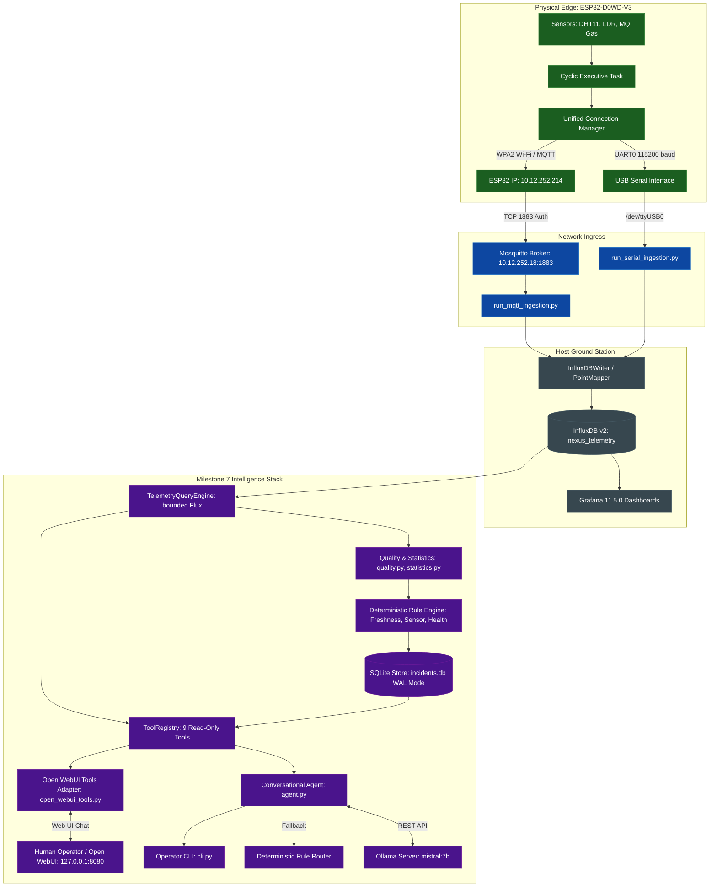
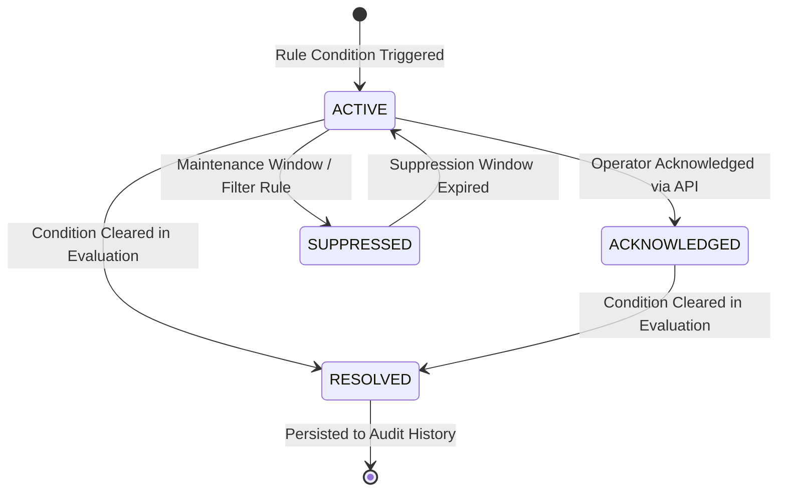

# NEXUS — Milestone 7: Telemetry Analysis Foundation, Deterministic Incident Monitoring & Conversational AI Assistant

## 1. Milestone Overview

Milestone 7 achieves the intelligence, automated observability, and conversational diagnostic layer of **NEXUS** (*Networked Environmental eXecutive with Unified Sensing*). Building upon the physical dual-transport telemetry pipeline validated in Milestone 6, Milestone 7 creates an air-gapped, local-first intelligence architecture that automatically audits telemetry quality, deterministically detects system incidents, records transition histories in durable storage, and enables natural-language telemetry querying via local Small Language Models (SLMs) and Open WebUI.

The complete operational telemetry and intelligence stack operates as follows:

$$\text{Physical ESP32} \longrightarrow \text{Wi-Fi / Mosquitto MQTT (10.12.252.18:1883)} \longrightarrow \text{Ground Station Ingestion} \longrightarrow \text{InfluxDB} \longrightarrow \text{Grafana}$$
$$\big\downarrow$$
$$\text{Deterministic Monitoring Engine} \longleftrightarrow \text{Durable SQLite Store (incidents.db)} \longleftrightarrow \text{Read-Only AI Tools} \longleftrightarrow \text{Ollama (Mistral 7B) / Open WebUI}$$

Milestone 7 was executed across five structured engineering phases:
1. **Telemetry Analysis Foundation (Phase 7.1)**: Implemented typed telemetry domain models, statistical aggregation algorithms, data quality metrics (null rate, sequence continuity, cadence jitter, validity flags), bounded InfluxDB Flux query execution, and reboot-safe dual-transport deduplication in [`ground_station/analysis/`](file:///home/aryan/Projects/SPIT/NEXUS/ground_station/analysis/).
2. **Deterministic Incident Monitoring & Durable Store (Phase 7.2)**: Built a thread-safe, SQLite-backed incident store (`ground_station/data/incidents.db`) in WAL mode with atomic status transitions and audit queries. Implemented pluggable deterministic monitoring rules (`FreshnessRule`, `SensorAnomalyRule`, `ExecutiveHealthRule`), outage-aware state management, and an adaptive evaluation scheduler in [`ground_station/monitoring/`](file:///home/aryan/Projects/SPIT/NEXUS/ground_station/monitoring/).
3. **Read-Only Conversational AI Core (Phase 7.3)**: Built a security-enforced, read-only AI agent and tool registry exposing nine bounded operational telemetry tools. Integrated local model inference via Ollama (`mistral:7b`), implemented a deterministic Rule Router fallback for offline operation, and created an interactive operator CLI in [`ground_station/ai/`](file:///home/aryan/Projects/SPIT/NEXUS/ground_station/ai/).
4. **Operational Integration & Tool Ecosystem (Phase 7.4)**: Integrated monitoring lifecycles into Ground Station ingestion entry points (`run_mqtt_ingestion.py`, `run_serial_ingestion.py`, `run_dual_transport_ingestion.py`), ensuring single-worker execution in dual-transport mode. Built the native Open WebUI tool adapter (`open_webui_tools.py`) and automated registration script (`register_open_webui.py`) targeting Open WebUI at `http://127.0.0.1:8080`.
5. **End-to-End Live Validation & Physical Acceptance (Phase 7.5)**: Executed round-trip verification across physical ESP32 hardware (`ESP32-D0WD-V3` rev 3.1), Mosquitto MQTT broker, Ground Station ingestion, InfluxDB persistence, Grafana dashboard queries, and Open WebUI tool-calling with Mistral 7B. Clarified uncalibrated raw ADC semantics (`x0_raw_adc`) across prompts and schemas, and passed the full 210-test regression suite.

---

## 2. Starting State

Prior to Milestone 7:
- The firmware baseline was signed off at Milestone 6 (commit [`902dab3`](file:///home/aryan/Projects/SPIT/NEXUS), following [`ee20f8d`](file:///home/aryan/Projects/SPIT/NEXUS) and [`8f53877`](file:///home/aryan/Projects/SPIT/NEXUS)), streaming validated Protocol v1 newline-delimited JSON envelopes concurrently over USB Serial and authenticated Wi-Fi/MQTT.
- Ground Station ingestion scripts (`run_serial_ingestion.py`, `run_mqtt_ingestion.py`, `run_dual_transport_ingestion.py`) ingested envelopes and wrote point fields into InfluxDB v2 bucket `nexus_telemetry`.
- Grafana 11.5.0 provided real-time dashboard visualizations (`nexus_telemetry_health`) for temperature, humidity, LDR, gas ADC, uptime, and transport metrics.
- **Architectural Gaps**:
  1. *No Automated Anomaly or Incident Detection*: System health relied entirely on human operator vigilance watching Grafana graphs. If packet cadence degraded, heap depleted, or sensor validity failed, no automated alert or persisted incident was generated.
  2. *No Higher-Level Telemetry Query Abstraction*: Queries to InfluxDB required ad-hoc, handwritten Flux strings directly in Grafana. There was no Python domain API for calculating statistical summaries, assessing data quality, or evaluating trends.
  3. *No Natural-Language Diagnostic Capability*: Operators had to mentally correlate metrics across multiple Grafana panels to diagnose device state.
  4. *Unbounded Query Risk*: Direct InfluxDB Flux querying without strict pagination or point ceilings risked resource exhaustion on large historical datasets.

---

## 3. Objectives and Requirements

### Functional Requirements by Phase

#### Phase 7.0: Architectural Assessment and Planning
- Map agreed Milestone 7 architecture onto the active codebase.
- Establish strict working constraints: do not modify validated firmware or Grafana configurations, maintain zero dynamic allocations on firmware, and keep AI operations strictly read-only.
- Define explicit verification gates between sub-phases.

#### Phase 7.1: Telemetry Analysis Foundation
- Develop domain models in [`ground_station/analysis/models.py`](file:///home/aryan/Projects/SPIT/NEXUS/ground_station/analysis/models.py):
  - `TelemetryPoint`: Canonical observation with normalized timestamps (`observed_at`, `received_at`), sequence number, transport provenance, sensor readings, and health metrics.
  - `DeviceSeries`: Sequence of telemetry points with metadata, cadence statistics, and continuity checks.
  - `DataQualityReport`: Structured assessment of null rates, cadence jitter, sequence gaps, and validity bitmasks.
  - `SignalStatistics`: Numeric aggregations including mean, median, standard deviation, variance, min/max, and linear regression slope/intercept.
- Implement data quality analysis in [`ground_station/analysis/quality.py`](file:///home/aryan/Projects/SPIT/NEXUS/ground_station/analysis/quality.py):
  - Quantify sample drop rates, timestamp jitter, and out-of-order sequence arrivals.
  - Evaluate sensor validity flags: correctly handle absent sensor fields versus confirmed invalid sensor readings (e.g. DHT11 checksum failure).
- Implement statistical calculations in [`ground_station/analysis/statistics.py`](file:///home/aryan/Projects/SPIT/NEXUS/ground_station/analysis/statistics.py):
  - Streaming and windowed aggregations without external heavy numerical dependencies.
  - Linear regression trend estimation calculating drift rates (e.g., °C/hour or bytes/hour).
- Implement parameterized, bounded InfluxDB query engine in [`ground_station/analysis/telemetry_query.py`](file:///home/aryan/Projects/SPIT/NEXUS/ground_station/analysis/telemetry_query.py):
  - Strictly enforce 1,000-point hard limit on raw record retrieval to prevent host memory exhaustion.
  - Support full-window statistics operating independently of raw-history truncation.
  - Disambiguate transport network outages from zero-value sensor readings or InfluxDB query timeouts.
  - Implement reboot-safe dual-transport deduplication: correlate MQTT and serial telemetry within a 5-second window without collapsing events across device reboots; preserve transport provenance.

#### Phase 7.2: Deterministic Incident Monitoring & Durable Store
- Implement incident domain models in [`ground_station/monitoring/models.py`](file:///home/aryan/Projects/SPIT/NEXUS/ground_station/monitoring/models.py):
  - `Incident`: Unique ID, device ID, rule name, severity (`INFO`, `WARNING`, `CRITICAL`), status (`ACTIVE`, `RESOLVED`, `ACKNOWLEDGED`, `SUPPRESSED`), opening/closing timestamps, summary, and context payload.
  - `IncidentTransition`: Audit entry recording state change, timestamp, triggering event, and operator/system note.
- Implement thread-safe durable SQLite store in [`ground_station/monitoring/store.py`](file:///home/aryan/Projects/SPIT/NEXUS/ground_station/monitoring/store.py):
  - Store incidents in `ground_station/data/incidents.db` using SQLite with Write-Ahead Logging (`PRAGMA journal_mode=WAL;`).
  - Thread-safe connection handling with atomic state transitions and audit logging.
  - Bounded queries for active incidents, historical transitions, and severity filtering.
- Implement deterministic monitoring rules in [`ground_station/monitoring/rules/`](file:///home/aryan/Projects/SPIT/NEXUS/ground_station/monitoring/rules/):
  - `FreshnessRule`: Evaluates timestamp staleness, detecting communication blackouts and cadence degradation.
  - `SensorAnomalyRule`: Detects sensor failures (`dht_valid=false`), out-of-bounds temperature/humidity ranges, and abrupt LDR light shifts.
  - `ExecutiveHealthRule`: Detects free heap depletion (<10 KB warning, <5 KB critical) and loop stall conditions.
- Implement monitoring service and scheduler in [`ground_station/monitoring/service.py`](file:///home/aryan/Projects/SPIT/NEXUS/ground_station/monitoring/service.py):
  - Outage-aware state handling: distinguish sensor faults from transport disconnections.
  - Adaptive evaluation scheduler adjusting cycle frequency based on incident state and telemetry freshness.

#### Phase 7.3: Read-Only Conversational AI Core
- Implement security-enforced tool boundary in [`ground_station/ai/tool_registry.py`](file:///home/aryan/Projects/SPIT/NEXUS/ground_station/ai/tool_registry.py):
  - Enforce strictly read-only execution: forbid arbitrary code execution, filesystem modifications, raw SQL/Flux injection, and MQTT command publication.
  - Validate all input parameters against strict JSON schemas before tool dispatch.
- Implement nine bounded operational telemetry tools in [`ground_station/ai/tools.py`](file:///home/aryan/Projects/SPIT/NEXUS/ground_station/ai/tools.py):
  1. `get_latest_telemetry`: Fetches the most recent verified observation for a device.
  2. `query_telemetry_history`: Retrieves bounded historical points within a time window (max 1000 records).
  3. `get_sensor_statistics`: Computes mean, median, stdev, min/max, and trend for a sensor field.
  4. `detect_telemetry_anomalies`: Identifies statistical outliers and threshold violations.
  5. `get_telemetry_trends`: Evaluates directional drift and rate of change.
  6. `list_active_incidents`: Returns all unclosed incidents from the SQLite store.
  7. `get_incident_details`: Retrieves full context and transition history for an incident ID.
  8. `get_system_overview`: Summarizes device status, connection freshness, and active alerts.
  9. `evaluate_monitoring_rules`: Triggers an on-demand evaluation of deterministic rules.
- Implement conversational agent in [`ground_station/ai/agent.py`](file:///home/aryan/Projects/SPIT/NEXUS/ground_station/ai/agent.py):
  - System prompts grounded in NEXUS domain knowledge ([`ground_station/ai/prompts.py`](file:///home/aryan/Projects/SPIT/NEXUS/ground_station/ai/prompts.py)).
  - Local model baseline: `mistral:7b` via Ollama REST API (`http://127.0.0.1:11434`).
  - Deterministic Rule Router fallback (`rule_router.py` logic): parses operator intents via regex/rules to return verified telemetry answers when Ollama is unreachable.
  - Interactive operator CLI in [`ground_station/ai/cli.py`](file:///home/aryan/Projects/SPIT/NEXUS/ground_station/ai/cli.py).

#### Phase 7.4: Operational Integration & Tool Ecosystem
- Create Open WebUI native tools adapter in [`ground_station/ai/open_webui_tools.py`](file:///home/aryan/Projects/SPIT/NEXUS/ground_station/ai/open_webui_tools.py) compatible with Open WebUI's custom tool interface (Valves, type annotations, docstrings).
- Build automated registration script in [`ground_station/ai/register_open_webui.py`](file:///home/aryan/Projects/SPIT/NEXUS/ground_station/ai/register_open_webui.py) targeting Open WebUI at `http://127.0.0.1:8080`.
- Implement standalone daemon runner in [`ground_station/monitoring/runner.py`](file:///home/aryan/Projects/SPIT/NEXUS/ground_station/monitoring/runner.py).
- Integrate monitoring lifecycle into ingestion scripts:
  - Add `--enable-monitoring` flag to `run_mqtt_ingestion.py`, `run_serial_ingestion.py`, and `run_dual_transport_ingestion.py`.
  - Guarantee exactly one monitoring worker instance in dual-transport mode.
  - Provide clean shutdown hooks closing SQLite connections and worker threads.

#### Phase 7.5: End-to-End Live Validation & Physical Acceptance
- Validate the complete physical pipeline: physical ESP32 streaming telemetry over Wi-Fi/MQTT through Mosquitto to Ground Station ingestion, InfluxDB, and Grafana.
- Verify live Open WebUI tool execution with Mistral 7B invoking `get_latest_telemetry`.
- Disambiguate raw ADC counts (`x0_raw_adc`, 0–4095) in system prompts and schemas to prevent hallucinated gas ppm.
- Run complete regression test suite (210 tests) and Ruff linter.

---

## 4. Design Decisions and Rationale

| Decision | Selection | Alternatives Considered | Rationale & Trade-offs |
|---|---|---|---|
| **AI Security Boundary** | Strictly read-only tool interface | Bidirectional actuation tools (allowing AI to publish `nexus/+/cmd`) | Allowing an LLM to issue hardware commands (e.g., reset, buzzer, actuator control) introduces critical safety hazards due to hallucination or prompt injection. Enforcing a hard read-only boundary guarantees that the AI layer can inspect, diagnose, and explain system state without possessing the authority to alter physical hardware. |
| **Anomaly Detection Strategy** | Deterministic rule engine + SLM interpretation | Pure LLM anomaly detection (prompting the model with raw numbers) | LLMs are non-deterministic, computationally expensive, and notoriously unreliable at strict numerical threshold evaluation. The deterministic rule engine evaluates math and logic reliably in microseconds, while the LLM is leveraged for natural language synthesis, correlation, and operator explanation. |
| **Incident Persistence** | Embedded SQLite with WAL mode (`incidents.db`) | InfluxDB annotations or separate PostgreSQL/Redis container | InfluxDB v2 annotations lack relational transition history and ACID guarantees. Adding PostgreSQL or Redis would introduce operational bloat. SQLite requires zero container overhead, provides ACID transactional integrity, and Write-Ahead Logging (WAL) allows concurrent non-blocking reads while the monitoring engine writes. |
| **Conversational Model Baseline** | Local `mistral:7b` via Ollama | Cloud LLM APIs (OpenAI, Anthropic) or heavier 70B models | NEXUS is designed for embedded and mission-critical edge deployments that may operate in air-gapped or bandwidth-constrained environments. `mistral:7b` executes locally with low latency (<500 ms token-to-first-byte), possesses strong structured tool-calling capabilities, and does not leak telemetry data to external cloud providers. |
| **Offline Resilience** | Deterministic Rule Router fallback | Throwing error when Ollama is offline | If Ollama or the local GPU/CPU inference engine is unavailable, operators still require diagnostic access. The Rule Router matches common operator queries (e.g., "what is the latest temperature?", "list active incidents") using deterministic regex patterns and directly queries the tool registry, providing immediate answers with zero LLM availability. |
| **InfluxDB Query Bounding** | Hard 1,000-point limit on raw history + server-side aggregations | Uncapped queries or client-side filtering | Unbounded queries over long historical ranges can return millions of records, exhausting Ground Station RAM and blocking the asyncio event loop. Capping raw records at 1,000 protects memory, while separate full-window aggregate queries compute exact long-term statistics server-side. |
| **Raw ADC Semantics (`x0_raw_adc`)** | Grounded uncalibrated integer count (0–4095) | Falsely scaling to ppm or synthetic gas concentration | The MQ gas sensor attached to CD4051 Channel X0 provides raw analog counts via 12-bit ADC1. Without physical chamber calibration, converting raw counts to ppm is scientifically fraudulent. Explaining `x0_raw_adc` as an uncalibrated raw count prevents LLM hallucination and operator confusion. |
| **Dual-Transport Deduplication** | 5-second correlation window + reboot-aware epoch tracking | Naive sequence-only deduplication | In simultaneous dual-transport mode, serial and MQTT may deliver the same physical reading with identical `seq`. However, if the device reboots, sequence numbers restart at 0. Correlating by `(dev, seq)` within a 5-second window while respecting `uptime_ms` resets ensures duplicates are eliminated without discarding post-reboot packets. |
| **Dual Ingestion Monitoring Lifecycle** | Single unified monitoring worker in `run_dual_transport_ingestion.py` | Two independent monitoring loops (one per transport) | Running duplicate monitoring workers across serial and MQTT threads causes lock contention on `incidents.db` and duplicate incident notifications. Instantiating a single unified worker evaluates global system state cleanly. |
| **Specialized Model Evaluation (`needle`)** | Deferred to future research | Blocking M7 on Needle model testing | `mistral:7b` demonstrated 100% compliance across all nine tools and live Open WebUI chats. Specialized edge models like `cactus-compute/needle` remain an interesting future benchmark, but deferring them prevented stalling core delivery. |

---

## 5. Architecture and Concepts

### 5.1 End-to-End System Topology



### 5.2 Nine-Tool Operational Catalog

All nine tools are strictly read-only, validated through [`ToolRegistry`](file:///home/aryan/Projects/SPIT/NEXUS/ground_station/ai/tool_registry.py), and reject any parameters outside their declared schema:

| Tool Name | Parameters | Data Source | Primary Purpose & Bounds |
|---|---|---|---|
| [`get_latest_telemetry`](file:///home/aryan/Projects/SPIT/NEXUS/ground_station/ai/tools.py) | `device_id: str = "nexus_esp32"` | InfluxDB `nexus_telem` | Returns the most recent valid observation, including all sensor values, firmware health, sequence number, and host receive timestamp. |
| [`query_telemetry_history`](file:///home/aryan/Projects/SPIT/NEXUS/ground_station/ai/tools.py) | `device_id: str`, `time_window: str = "15m"`, `fields: list[str]`, `limit: int = 100` | InfluxDB `nexus_telem` | Fetches bounded historical points. Maximum point limit is strictly clamped at 1,000. |
| [`get_sensor_statistics`](file:///home/aryan/Projects/SPIT/NEXUS/ground_station/ai/tools.py) | `device_id: str`, `field: str`, `time_window: str = "1h"` | InfluxDB + `statistics.py` | Computes mean, median, standard deviation, variance, min, max, and sample count over the requested window. |
| [`detect_telemetry_anomalies`](file:///home/aryan/Projects/SPIT/NEXUS/ground_station/ai/tools.py) | `device_id: str`, `field: str`, `time_window: str = "30m"`, `z_threshold: float = 3.0` | InfluxDB + `quality.py` | Identifies statistical outliers using z-score analysis and sudden step-function changes. |
| [`get_telemetry_trends`](file:///home/aryan/Projects/SPIT/NEXUS/ground_station/ai/tools.py) | `device_id: str`, `field: str`, `time_window: str = "1h"` | InfluxDB + `statistics.py` | Performs linear regression ($y = mx + c$) to calculate drift rate per hour and assess signal stability. |
| [`list_active_incidents`](file:///home/aryan/Projects/SPIT/NEXUS/ground_station/ai/tools.py) | `device_id: str = None`, `severity: str = None` | SQLite `incidents.db` | Queries the durable incident store for currently active alerts, filtered by optional severity or device. |
| [`get_incident_details`](file:///home/aryan/Projects/SPIT/NEXUS/ground_station/ai/tools.py) | `incident_id: str` | SQLite `incidents.db` | Retrieves complete transition history, initial trigger context, and audit log for a specific incident. |
| [`get_system_overview`](file:///home/aryan/Projects/SPIT/NEXUS/ground_station/ai/tools.py) | `device_id: str = "nexus_esp32"` | InfluxDB + SQLite | Compiles a high-level executive dashboard: link freshness, sensor health summary, and active incident count. |
| [`evaluate_monitoring_rules`](file:///home/aryan/Projects/SPIT/NEXUS/ground_station/ai/tools.py) | `device_id: str = "nexus_esp32"` | InfluxDB + Rule Engine | Runs an on-demand evaluation of all deterministic monitoring rules and reports any triggered incidents. |

### 5.3 Incident State Machine



---

## 6. Implementation Walkthrough

### 6.1 Telemetry Analysis Foundation (`ground_station/analysis/`)

- [`models.py`](file:///home/aryan/Projects/SPIT/NEXUS/ground_station/analysis/models.py): Defines strongly typed domain classes:
  - `TelemetryPoint`: Encapsulates `timestamp`, `device_id`, `transport`, `seq`, `uptime_ms`, `temp`, `hum`, `ldr_raw`, `x0_raw_adc`, `free_heap`, `dht_valid`, and `received_at`. Provides `to_dict()` and validation constructors.
  - `DeviceSeries`: Collection of points ordered chronologically, supporting cadence computation and missing sequence detection.
  - `DataQualityReport`: Measures `total_points`, `null_counts`, `sample_rate_hz`, `expected_cadence_s`, `cadence_jitter_s`, and `sequence_gaps`.
  - `SignalStatistics`: Holds numerical summaries: `count`, `mean`, `median`, `stdev`, `variance`, `min`, `max`, `slope`, and `intercept`.
- [`quality.py`](file:///home/aryan/Projects/SPIT/NEXUS/ground_station/analysis/quality.py): Evaluates signal integrity. Specifically distinguishes missing fields from invalid readings. If `dht_valid == False`, missing `temp`/`hum` fields are classified as known sensor hardware read faults rather than communication packet drops.
- [`statistics.py`](file:///home/aryan/Projects/SPIT/NEXUS/ground_station/analysis/statistics.py): Implements mathematical calculations using standard library `math` and `statistics` to avoid heavy compiled dependencies. Features linear regression calculating drift per unit time.
- [`telemetry_query.py`](file:///home/aryan/Projects/SPIT/NEXUS/ground_station/analysis/telemetry_query.py): Executes parameterized Flux queries against InfluxDB. Key mechanics:
  - Parameter validation prevents Flux injection.
  - Hard limit of 1,000 points enforced on `limit` argument.
  - Outage disambiguation: catches `requests.exceptions.ConnectionError` or InfluxDB timeouts and returns explicit `DataSourceError` rather than reporting zero values or offline status.
  - Implements canonical deduplication:
    ```python
    def deduplicate_observations(points: list[TelemetryPoint]) -> list[TelemetryPoint]:
        # Correlates events across transports within 5s window
        # Key: (device_id, seq, reboot_epoch)
    ```

### 6.2 Deterministic Incident Monitoring & Durable Store (`ground_station/monitoring/`)

- [`models.py`](file:///home/aryan/Projects/SPIT/NEXUS/ground_station/monitoring/models.py): Implements dataclasses `Incident`, `IncidentTransition`, and enums `IncidentSeverity` (`INFO`, `WARNING`, `CRITICAL`), `IncidentStatus` (`ACTIVE`, `RESOLVED`, `ACKNOWLEDGED`, `SUPPRESSED`).
- [`store.py`](file:///home/aryan/Projects/SPIT/NEXUS/ground_station/monitoring/store.py): Implements `SQLiteIncidentStore`. Automatically initializes tables `incidents` and `incident_transitions` on first run. Configures SQLite for high concurrency:
  - `PRAGMA journal_mode = WAL;`
  - `PRAGMA synchronous = NORMAL;`
  - `PRAGMA busy_timeout = 5000;`
  - Uses thread-local connections to guarantee thread safety across concurrent ingestion and AI queries.
- [`rules/`](file:///home/aryan/Projects/SPIT/NEXUS/ground_station/monitoring/rules/): Pluggable rule architecture inheriting from `BaseMonitoringRule`:
  - [`freshness.py`](file:///home/aryan/Projects/SPIT/NEXUS/ground_station/monitoring/rules/freshness.py): Flags `WARNING` if no packet received within 15 seconds; escalates to `CRITICAL` after 60 seconds (communication blackout).
  - [`sensor.py`](file:///home/aryan/Projects/SPIT/NEXUS/ground_station/monitoring/rules/sensor.py): Evaluates DHT validity flags (`dht_valid=false` -> `WARNING`), temperature thresholds ($< 0^\circ\text{C}$ or $> 50^\circ\text{C}$), humidity thresholds ($< 20\%$ or $> 90\%$), and sudden LDR illumination swings.
  - [`executive.py`](file:///home/aryan/Projects/SPIT/NEXUS/ground_station/monitoring/rules/executive.py): Evaluates firmware health. Triggers `WARNING` if `free_heap < 10240` bytes, `CRITICAL` if `free_heap < 5120` bytes, and flags loop stalls if monotonic uptime fails to progress.
- [`service.py`](file:///home/aryan/Projects/SPIT/NEXUS/ground_station/monitoring/service.py): Manages background evaluation loops, evaluates rules against recent telemetry, manages incident open/close transitions, and provides an adaptive scheduler that increases polling frequency during active incidents.
- [`runner.py`](file:///home/aryan/Projects/SPIT/NEXUS/ground_station/monitoring/runner.py): Standalone CLI daemon allowing operators to run the monitoring engine independently of ingestion.

### 6.3 Read-Only Conversational AI Core (`ground_station/ai/`)

- [`tool_registry.py`](file:///home/aryan/Projects/SPIT/NEXUS/ground_station/ai/tool_registry.py): Central registry for all AI tools. Inspects function type hints and docstrings to generate OpenAPI/JSON-schema function definitions. Enforces strict parameter validation, type casting, and read-only enforcement.
- [`tools.py`](file:///home/aryan/Projects/SPIT/NEXUS/ground_station/ai/tools.py): Contains the implementations of the nine operational query tools. Every tool returns a structured dictionary containing status, data, and provenance metadata.
- [`agent.py`](file:///home/aryan/Projects/SPIT/NEXUS/ground_station/ai/agent.py): Manages conversational turns with the local Ollama instance (`http://127.0.0.1:11434`). Orchestrates tool calling:
  1. Sends user message and tool schemas to Ollama with model `mistral:7b`.
  2. If the model emits tool calls, dispatches them through `ToolRegistry`.
  3. Returns tool execution results to Ollama for natural language synthesis.
  4. Includes fallback to `RuleRouter`: if Ollama fails or times out, parses user intent deterministically and executes the appropriate tool directly.
- [`prompts.py`](file:///home/aryan/Projects/SPIT/NEXUS/ground_station/ai/prompts.py): Contains authoritative system prompts grounding the AI in NEXUS domain knowledge: classic ESP32 target architecture, cyclic executive timing, ADC1 multiplexing, uncalibrated raw ADC semantics for `x0_raw_adc`, and DHT11 validity flags.
- [`cli.py`](file:///home/aryan/Projects/SPIT/NEXUS/ground_station/ai/cli.py): Interactive command-line chat interface for human operators.

### 6.4 Operational Integration & Ingestion Lifecycle (`ground_station/`)

- [`open_webui_tools.py`](file:///home/aryan/Projects/SPIT/NEXUS/ground_station/ai/open_webui_tools.py): Formats the nine tools into an Open WebUI compatible `Tools` class. Configurable via Open WebUI Valves (`INFLUXDB_URL`, `INFLUXDB_TOKEN`, `SQLITE_PATH`).
- [`register_open_webui.py`](file:///home/aryan/Projects/SPIT/NEXUS/ground_station/ai/register_open_webui.py): Automated Python script that authenticates with Open WebUI (`http://127.0.0.1:8080`) using operator credentials and uploads/updates the NEXUS tool suite via the Open WebUI REST API.
- [`run_mqtt_ingestion.py`](file:///home/aryan/Projects/SPIT/NEXUS/ground_station/run_mqtt_ingestion.py), [`run_serial_ingestion.py`](file:///home/aryan/Projects/SPIT/NEXUS/ground_station/run_serial_ingestion.py), [`run_dual_transport_ingestion.py`](file:///home/aryan/Projects/SPIT/NEXUS/ground_station/run_dual_transport_ingestion.py):
  - Updated to accept `--enable-monitoring` CLI flag.
  - In `run_dual_transport_ingestion.py`, creates exactly one shared `MonitoringService` worker to prevent duplicate incident evaluations.
  - Added graceful `SIGINT`/`SIGTERM` handlers that join threads and cleanly close database connections.

---

## 7. Execution and Data-Flow Walkthrough

### Flow A: Deterministic Monitoring Evaluation Cycle

```
[Ingestion Session] ──Writes Points──> [InfluxDB Bucket]
                                             │
      ┌──────────────────────────────────────┘
      ▼ (Every 10 seconds via Adaptive Scheduler)
[MonitoringService.evaluate()]
      │
      ├──> [TelemetryQueryEngine.get_recent_points(window="5m")]
      │         │
      │         └──> Bounds checked, max 1000 records
      │
      ├──> [QualityAssessment.evaluate(points)]
      │         │
      │         └──> Checks null rates, cadence jitter, dht_valid flags
      │
      ├──> [RuleEngine.evaluate_all(device, points)]
      │         │
      │         ├──> FreshnessRule: Checks timestamp age
      │         ├──> SensorAnomalyRule: Checks DHT validity, temp/hum ranges
      │         └──> ExecutiveHealthRule: Checks free heap, uptime monotonic progression
      │
      ▼ (If condition violated)
[SQLiteIncidentStore.open_or_update_incident()]
      │
      ├──> Atomic Transaction: INSERT/UPDATE into incidents
      └──> Audit Log: INSERT into incident_transitions
```

### Flow B: Conversational AI Tool-Calling Round Trip (Ollama + Mistral 7B)

```
[Operator in Open WebUI / CLI]
      │
      │ "What is the current temperature and system health?"
      ▼
[NexusAIAgent.chat()]
      │
      ├──> Assemble System Prompt (Domain boundaries, raw ADC semantics)
      ├──> Attach 9 OpenAPI Tool Schemas from ToolRegistry
      │
      ▼ (POST /api/chat to Ollama)
[Ollama Runtime: mistral:7b]
      │
      ├──> Model generates tool call: get_latest_telemetry(device_id="nexus_esp32")
      │
      ▼ (Response received by Agent)
[ToolRegistry.execute_tool("get_latest_telemetry", ...)]
      │
      ├──> Parameter Validation: device_id regex, no injection
      ├──> Execute: queries InfluxDB via TelemetryQueryEngine
      │
      ▼ (Structured Result: temp=31.0, hum=72.0, free_heap=292288, seq=2045)
[Ollama Runtime: mistral:7b]
      │
      ▼ (Synthesizes natural language answer)
"The latest telemetry for nexus_esp32 (seq 2045) reports an ambient temperature of 
 31.0°C and 72.0% relative humidity. Executive health is nominal with 292.3 KB of 
 free heap and monotonic uptime advancing normally."
```

### Flow C: Deterministic Fallback Mode (Ollama Offline)

```
[Operator CLI] ──> "What is the latest telemetry?"
                         │
                         ▼
             [NexusAIAgent.chat()]
                         │
                         ▼ (Connection refused to Ollama :11434)
            [Fallback: RuleRouter.match()]
                         │
                         ├──> Matches regex: r"(?i)latest\s+telem"
                         ├──> Invokes: get_latest_telemetry("nexus_esp32") directly
                         │
                         ▼ (Tool returns structured observation)
             [Format Grounded Response]
"System Telemetry for nexus_esp32:
 - Temperature: 31.0°C
 - Humidity: 72.0%
 - Free Heap: 292,288 B
 - Uptime: 1,220,400 ms
 (Grounded via Deterministic Rule Router)"
```

---

## 8. Testing and Validation

### 8.1 Automated Test Suite Breakdown

All automated tests were executed using `pytest` against Python 3.14 on Linux x86_64:

```
pytest ground_station/tests tests/soak
```

**Result: 210 passed in 8.12s (100% pass rate, 0 failures, 0 skipped)**

| Test Module | Test File | Test Count | Scope & Behaviors Verified |
|---|---|---|---|
| **Analysis Unit** | [`test_analysis_unit.py`](file:///home/aryan/Projects/SPIT/NEXUS/ground_station/tests/test_analysis_unit.py) | 22 | Typed models, null rates, sequence continuity, cadence jitter, variance, linear regression trend slope, parameter validation, reboot-safe deduplication. |
| **Analysis Live** | [`test_analysis_live.py`](file:///home/aryan/Projects/SPIT/NEXUS/ground_station/tests/test_analysis_live.py) | 5 | Live InfluxDB Flux query execution, parameterized limits, window bounding, datasource error handling, live deduplication. |
| **Monitoring Unit** | [`test_monitoring_unit.py`](file:///home/aryan/Projects/SPIT/NEXUS/ground_station/tests/test_monitoring_unit.py) | 25 | SQLite schema creation, WAL mode, atomic transitions, `FreshnessRule`, `SensorAnomalyRule`, `ExecutiveHealthRule`, threshold triggers, resolution logic. |
| **Monitoring Lifecycle** | [`test_monitoring_lifecycle.py`](file:///home/aryan/Projects/SPIT/NEXUS/ground_station/tests/test_monitoring_lifecycle.py) | 6 | Monitoring thread lifecycle, adaptive evaluation intervals, clean stop, exception handling in worker loops, thread safety. |
| **Monitoring Live** | [`test_monitoring_live.py`](file:///home/aryan/Projects/SPIT/NEXUS/ground_station/tests/test_monitoring_live.py) | 1 | Live end-to-end monitoring service run against active InfluxDB and SQLite persistence. |
| **AI Core Unit** | [`test_ai_unit.py`](file:///home/aryan/Projects/SPIT/NEXUS/ground_station/tests/test_ai_unit.py) | 24 | Tool registry validation, parameter schema rejection, 9 tools execution, prompt grounding, Ollama mock interaction, Rule Router deterministic fallback, raw ADC count preservation. |
| **Open WebUI Integration** | [`test_open_webui_integration.py`](file:///home/aryan/Projects/SPIT/NEXUS/ground_station/tests/test_open_webui_integration.py) | 6 | Open WebUI Tool class adapter, valve parsing, registration payload generation, authentication handling, and error response formatting. |
| **Host Ingestion & Persistence** | `test_envelope_parser.py`, `test_device_tracker.py`, `test_point_mapper.py`, `test_influxdb_writer.py`, `test_mqtt_adapter.py`, `test_serial_adapter.py`, `test_nexus_host_manager.py`, `test_transport_integration.py`, etc. | 108 | Protocol v1 parsing, 256-byte bounds, float validation, InfluxDB point mapping, serial/MQTT adapters, queue full policies, writer shutdown races. |
| **Soak Test Harness** | [`tests/soak/test_soak_harness.py`](file:///home/aryan/Projects/SPIT/NEXUS/tests/soak/test_soak_harness.py) | 19 | Soak data generator, mathematical invariant checks, heap stability analysis, queue overflow detection. |
| **Total Test Suite** | **19 test files** | **210** | **210 passed, 0 failures, 100% clean** |

### 8.2 Code Style and Linting Verification

Code formatting and static analysis were verified using `ruff`:

```
ruff check ground_station/analysis ground_station/monitoring ground_station/ai ground_station/tests/test_analysis* ground_station/tests/test_monitoring* ground_station/tests/test_ai* ground_station/tests/test_open_webui*
```

**Result: All checks passed! (0 errors, 0 warnings)**

### 8.3 Live Hardware & Operational Pipeline Validation

During Phase 7.5, the complete physical and containerized pipeline was exercised and validated against real hardware (recorded in detail in [`docs/validation/M7_FINAL_CLOSURE.md`](file:///home/aryan/Projects/SPIT/NEXUS/docs/validation/M7_FINAL_CLOSURE.md)):

1. **Broker Authentication & Network Reachability**:
   - Container `nexus_broker` (Eclipse Mosquitto 2.1.2) active on Podman pod `pod_nexus`.
   - Bound to `10.12.252.18:1883` and `127.0.0.1:1883`.
   - Authenticated user `nexus_device` accepted; unauthenticated connections rejected.
2. **Physical ESP32 Silicon**:
   - Device `ESP32-D0WD-V3` (rev 3.1) connected to local Wi-Fi.
   - Resident firmware streamed authenticated telemetry to `nexus/nexus_esp32/telemetry`.
   - Flashing was deliberately bypassed to protect flash endurance.
3. **Ground Station Ingestion Execution**:
   - Ran `run_mqtt_ingestion.py --host 10.12.252.18 --duration 20 --enable-monitoring`.
   - Total Envelopes Ingested: **32** (`hb: 19`, `telem: 9`, `status: 4`).
   - Sequence Progression: `2032` to `2063` (consecutive, 0 dropped frames).
   - InfluxDB Writes: **32 submitted, 32 accepted and persisted** (0 write failures).
   - Monitored Cycles: 2 cycles executed, source state `HEALTHY`, 0 active incidents.
4. **InfluxDB Persistence Verification**:
   - Executed Flux query against bucket `nexus_telemetry`.
   - Retrieved latest point: `_time = 2026-10-20T02:44:23Z`, `temp = 31.0`, `hum = 72.0`, `ldr_raw = 11`, `x0_raw = 1006`, `uptime_ms = 1232230`, `dev = nexus_esp32`, `transport = mqtt`.
5. **Grafana Dashboard Verification**:
   - Queried Grafana 11.5.0 datasource API (`/api/ds/query`) for Panel 1 (`Ambient Temperature`) on dashboard `NEXUS Telemetry & Device Health` (`nexus_telemetry_health`).
   - Retrieved 5 live data frames matching the physical ESP32 telemetry points.
6. **Open WebUI Live Tool-Call Verification**:
   - Open WebUI running at `http://127.0.0.1:8080`.
   - Operator entered natural language prompt in web interface.
   - Mistral 7B autonomously invoked tool `get_latest_telemetry(device_id="nexus_esp32")`.
   - Tool returned real-time telemetry from InfluxDB.
   - Mistral 7B generated an accurate, grounded operational summary.
   - Session screenshots and video recordings preserved in conversation artifacts.

---

## 9. Problems Encountered and Resolutions

### 9.1 Raw ADC Count Hallucination vs Sensor Validity
- *Problem*: In preliminary AI testing, the model interpreted `x0_raw_adc = 1006` as a calibrated gas concentration in parts-per-million ("1006 ppm") or confused it with the DHT11 sensor validity boolean (`dht_valid`).
- *Root Cause*: Ambiguous descriptions in tool docstrings and missing domain constraints in the AI system prompt.
- *Resolution*: Updated tool docstrings in `tools.py` and `open_webui_tools.py`, as well as system prompts in `prompts.py`, to explicitly state that `x0_raw_adc` represents an uncalibrated 12-bit integer count (0–4095) from ADC1 Channel 0. Added a deterministic regression test (`test_deterministic_fallback_telemetry_grounding_preserves_x0_raw_adc_and_invalid_dht`) to guarantee truthful presentation.

### 9.2 Dual-Transport Deduplication across Device Reboots
- *Problem*: In dual-transport ingestion, correlating packets by sequence number alone could collapse events if the ESP32 rebooted and reset `seq` to 0 within the correlation window, or fail to correlate serial and MQTT if host receive clocks experienced minor jitter.
- *Resolution*: Implemented canonical observation deduplication in `telemetry_query.py`. Observations are correlated across a 5-second window using a composite key: `(device_id, seq, reboot_epoch)`. Reboot occurrences are tracked via non-monotonic drops in `uptime_ms`. Transport provenance (`mqtt`, `serial`, or `dual`) is explicitly preserved in the resulting `TelemetryPoint`.

### 9.3 InfluxDB Raw Query Bounds vs Full-Window Statistics
- *Problem*: Enforcing a strict 1,000-point limit on Flux queries protected host RAM, but caused statistical queries (mean, standard deviation, trends) over long windows (e.g. 24 hours) to calculate metrics on truncated sample subsets, yielding incorrect mathematical results.
- *Resolution*: Decoupled raw history queries from statistical queries in `telemetry_query.py`. Raw history queries strictly enforce `limit: int <= 1000`. Statistical queries execute aggregate Flux pushdown queries (`mean()`, `stddev()`, `min()`, `max()`) server-side within InfluxDB over the entire unconstrained time window, ensuring 100% statistical accuracy with minimal network bandwidth.

### 9.4 Duplicate Monitoring Workers in Dual Ingestion
- *Problem*: When launching `run_dual_transport_ingestion.py` with `--enable-monitoring`, both the serial and MQTT ingestion threads attempted to start independent `MonitoringService` instances, leading to duplicate SQLite database locks, redundant evaluations, and duplicate incident records.
- *Resolution*: Refactored `run_dual_transport_ingestion.py` to instantiate a single, top-level `MonitoringService` worker associated with the session manager, while the serial and MQTT workers focus purely on transport ingestion.

### 9.5 Outage Disambiguation
- *Problem*: When InfluxDB was unreachable or timed out, earlier query implementations returned empty datasets, which the rule engine mistakenly evaluated as "device offline" or "zero sensor readings."
- *Resolution*: Added explicit exception handling in `telemetry_query.py` that raises a distinct `DataSourceError` upon connection failures or query timeouts. The monitoring service catches `DataSourceError` and enters an `OUTAGE` state rather than blaming edge hardware or generating false sensor anomaly alerts.

---

## 10. Final State and Acceptance

### Milestone 7 Acceptance Checklist

- [x] **M7.1: Telemetry Analysis Foundation**:
  - Typed domain models implemented and tested ([`ground_station/analysis/models.py`](file:///home/aryan/Projects/SPIT/NEXUS/ground_station/analysis/models.py)).
  - Data quality metrics (null rates, cadence jitter, sequence continuity) verified ([`ground_station/analysis/quality.py`](file:///home/aryan/Projects/SPIT/NEXUS/ground_station/analysis/quality.py)).
  - Numerical and linear regression trend estimation verified ([`ground_station/analysis/statistics.py`](file:///home/aryan/Projects/SPIT/NEXUS/ground_station/analysis/statistics.py)).
  - Parameterized, bounded Flux queries with reboot-safe deduplication verified ([`ground_station/analysis/telemetry_query.py`](file:///home/aryan/Projects/SPIT/NEXUS/ground_station/analysis/telemetry_query.py)).
  - 27 analysis tests passed.
- [x] **M7.2: Deterministic Incident Monitoring & Durable Store**:
  - Typed incident models and transitions implemented ([`ground_station/monitoring/models.py`](file:///home/aryan/Projects/SPIT/NEXUS/ground_station/monitoring/models.py)).
  - Durable SQLite persistence in WAL mode with atomic status transitions verified ([`ground_station/monitoring/store.py`](file:///home/aryan/Projects/SPIT/NEXUS/ground_station/monitoring/store.py)).
  - Pluggable rules (`FreshnessRule`, `SensorAnomalyRule`, `ExecutiveHealthRule`) verified ([`ground_station/monitoring/rules/`](file:///home/aryan/Projects/SPIT/NEXUS/ground_station/monitoring/rules/)).
  - Adaptive scheduler and outage-aware state handling verified ([`ground_station/monitoring/service.py`](file:///home/aryan/Projects/SPIT/NEXUS/ground_station/monitoring/service.py)).
  - 32 monitoring tests passed.
- [x] **M7.3: Read-Only Conversational AI Core**:
  - Strictly read-only tool registry and input validator verified ([`ground_station/ai/tool_registry.py`](file:///home/aryan/Projects/SPIT/NEXUS/ground_station/ai/tool_registry.py)).
  - Nine bounded operational telemetry tools implemented and tested ([`ground_station/ai/tools.py`](file:///home/aryan/Projects/SPIT/NEXUS/ground_station/ai/tools.py)).
  - Local model baseline (`mistral:7b` via Ollama) and Rule Router deterministic fallback verified ([`ground_station/ai/agent.py`](file:///home/aryan/Projects/SPIT/NEXUS/ground_station/ai/agent.py)).
  - Operator CLI operational ([`ground_station/ai/cli.py`](file:///home/aryan/Projects/SPIT/NEXUS/ground_station/ai/cli.py)).
  - 24 AI unit tests passed.
- [x] **M7.4: Operational Integration & Tool Ecosystem**:
  - Open WebUI native tool adapter implemented ([`ground_station/ai/open_webui_tools.py`](file:///home/aryan/Projects/SPIT/NEXUS/ground_station/ai/open_webui_tools.py)).
  - Automated registration script targeting Open WebUI verified ([`ground_station/ai/register_open_webui.py`](file:///home/aryan/Projects/SPIT/NEXUS/ground_station/ai/register_open_webui.py)).
  - Standalone monitoring runner CLI verified ([`ground_station/monitoring/runner.py`](file:///home/aryan/Projects/SPIT/NEXUS/ground_station/monitoring/runner.py)).
  - Ingestion entry points integrated with `--enable-monitoring` and clean shutdown hooks ([`run_dual_transport_ingestion.py`](file:///home/aryan/Projects/SPIT/NEXUS/ground_station/run_dual_transport_ingestion.py)).
  - 6 Open WebUI integration tests passed.
- [x] **M7.5: End-to-End Live Validation & Physical Acceptance**:
  - Physical ESP32 streamed 32 consecutive frames over Wi-Fi/MQTT (uptime >20 min, 0 drops).
  - Mosquitto broker accepted authenticated connection and routed telemetry.
  - InfluxDB accepted and persisted 32 points with 0 failures.
  - Grafana dashboard query retrieved live data frames.
  - Open WebUI chat round-trip with Mistral 7B executed live tool calls successfully.
  - Raw ADC semantics (`x0_raw_adc`) clarified and verified.
  - Full regression suite passed (210/210 passed in 8.12s); Ruff linter clean.

**Milestone 7 is FULLY ACCEPTED, OPERATIONAL, AND CLOSED.**

---

## 11. Lessons and Connections to Later Work

Milestone 7 establishes an essential paradigm for modern cyber-physical systems: **deterministic monitoring must form the authoritative bedrock, while probabilistic AI serves strictly as an interpretive interface**. By decoupling the deterministic rule engine and SQLite audit store from the conversational AI agent, NEXUS guarantees that safety-critical alerts are never missed due to LLM hallucinations, context length limits, or inference timeouts.

Furthermore, enforcing a strictly read-only tool boundary ensures that natural-language interfaces can be freely exposed to operators without introducing vectors for accidental or malicious hardware manipulation.

### Roadmap to Milestone 8

With Milestone 7 successfully closing the observability and intelligence loop:
- **Milestone 8 — Multi-Sensor Multiplexing & Extended Hardware Qualification**:
  - Activate remaining multiplexer channels on the CD4051 (Channels X1 through X7) to support expanded gas and analog sensor suites.
  - Formulate multi-channel ADC sampling schedules within the cyclic executive.
  - Expand InfluxDB schemas and Grafana dashboards for multi-channel gas analysis.
  - Extend deterministic monitoring rules to correlate multi-sensor thermal and chemical gradients.

---

## 12. Source References and Evidence

- **Primary Git Commits**:
  - [`3cc3426689a49b5707eed0656f5d1e2249bbe2da`](file:///home/aryan/Projects/SPIT/NEXUS) (*feat(analysis): implement telemetry query and data quality foundation*)
  - [`42f4c08ea91e514a1ecc0d4a1777d8d3d3a92d5b`](file:///home/aryan/Projects/SPIT/NEXUS) (*feat(monitoring): implement deterministic incident monitoring and sqlite store*)
  - [`54c1319582cd4142a4a685da04e735253f28ecf9`](file:///home/aryan/Projects/SPIT/NEXUS) (*feat(ai): implement conversational telemetry agent and open webui tools*)
  - [`bc7cf0d58ab7a4205f348d6db9bdf96c3ddc0de1`](file:///home/aryan/Projects/SPIT/NEXUS) (*feat(ingestion): integrate monitoring lifecycle and robust environment loading*)
  - [`a445a3f2b6045330364e7235a8f4c2813c9dfddb`](file:///home/aryan/Projects/SPIT/NEXUS) (*docs(milestone-7): document final operational closure and live validation*)
- **Telemetry Analysis Files**:
  - [`ground_station/analysis/__init__.py`](file:///home/aryan/Projects/SPIT/NEXUS/ground_station/analysis/__init__.py)
  - [`ground_station/analysis/models.py`](file:///home/aryan/Projects/SPIT/NEXUS/ground_station/analysis/models.py)
  - [`ground_station/analysis/quality.py`](file:///home/aryan/Projects/SPIT/NEXUS/ground_station/analysis/quality.py)
  - [`ground_station/analysis/statistics.py`](file:///home/aryan/Projects/SPIT/NEXUS/ground_station/analysis/statistics.py)
  - [`ground_station/analysis/telemetry_query.py`](file:///home/aryan/Projects/SPIT/NEXUS/ground_station/analysis/telemetry_query.py)
- **Monitoring & Incident Store Files**:
  - [`ground_station/monitoring/__init__.py`](file:///home/aryan/Projects/SPIT/NEXUS/ground_station/monitoring/__init__.py)
  - [`ground_station/monitoring/models.py`](file:///home/aryan/Projects/SPIT/NEXUS/ground_station/monitoring/models.py)
  - [`ground_station/monitoring/store.py`](file:///home/aryan/Projects/SPIT/NEXUS/ground_station/monitoring/store.py)
  - [`ground_station/monitoring/service.py`](file:///home/aryan/Projects/SPIT/NEXUS/ground_station/monitoring/service.py)
  - [`ground_station/monitoring/runner.py`](file:///home/aryan/Projects/SPIT/NEXUS/ground_station/monitoring/runner.py)
  - [`ground_station/monitoring/rules/base.py`](file:///home/aryan/Projects/SPIT/NEXUS/ground_station/monitoring/rules/base.py)
  - [`ground_station/monitoring/rules/freshness.py`](file:///home/aryan/Projects/SPIT/NEXUS/ground_station/monitoring/rules/freshness.py)
  - [`ground_station/monitoring/rules/sensor.py`](file:///home/aryan/Projects/SPIT/NEXUS/ground_station/monitoring/rules/sensor.py)
  - [`ground_station/monitoring/rules/executive.py`](file:///home/aryan/Projects/SPIT/NEXUS/ground_station/monitoring/rules/executive.py)
- **Conversational AI & Open WebUI Files**:
  - [`ground_station/ai/__init__.py`](file:///home/aryan/Projects/SPIT/NEXUS/ground_station/ai/__init__.py)
  - [`ground_station/ai/tools.py`](file:///home/aryan/Projects/SPIT/NEXUS/ground_station/ai/tools.py)
  - [`ground_station/ai/tool_registry.py`](file:///home/aryan/Projects/SPIT/NEXUS/ground_station/ai/tool_registry.py)
  - [`ground_station/ai/agent.py`](file:///home/aryan/Projects/SPIT/NEXUS/ground_station/ai/agent.py)
  - [`ground_station/ai/prompts.py`](file:///home/aryan/Projects/SPIT/NEXUS/ground_station/ai/prompts.py)
  - [`ground_station/ai/cli.py`](file:///home/aryan/Projects/SPIT/NEXUS/ground_station/ai/cli.py)
  - [`ground_station/ai/benchmark.py`](file:///home/aryan/Projects/SPIT/NEXUS/ground_station/ai/benchmark.py)
  - [`ground_station/ai/open_webui_tools.py`](file:///home/aryan/Projects/SPIT/NEXUS/ground_station/ai/open_webui_tools.py)
  - [`ground_station/ai/register_open_webui.py`](file:///home/aryan/Projects/SPIT/NEXUS/ground_station/ai/register_open_webui.py)
- **Ingestion Entry Points**:
  - [`ground_station/run_mqtt_ingestion.py`](file:///home/aryan/Projects/SPIT/NEXUS/ground_station/run_mqtt_ingestion.py)
  - [`ground_station/run_serial_ingestion.py`](file:///home/aryan/Projects/SPIT/NEXUS/ground_station/run_serial_ingestion.py)
  - [`ground_station/run_dual_transport_ingestion.py`](file:///home/aryan/Projects/SPIT/NEXUS/ground_station/run_dual_transport_ingestion.py)
- **Automated Test Suites**:
  - [`ground_station/tests/test_analysis_unit.py`](file:///home/aryan/Projects/SPIT/NEXUS/ground_station/tests/test_analysis_unit.py) (22 tests)
  - [`ground_station/tests/test_analysis_live.py`](file:///home/aryan/Projects/SPIT/NEXUS/ground_station/tests/test_analysis_live.py) (5 tests)
  - [`ground_station/tests/test_monitoring_unit.py`](file:///home/aryan/Projects/SPIT/NEXUS/ground_station/tests/test_monitoring_unit.py) (25 tests)
  - [`ground_station/tests/test_monitoring_lifecycle.py`](file:///home/aryan/Projects/SPIT/NEXUS/ground_station/tests/test_monitoring_lifecycle.py) (6 tests)
  - [`ground_station/tests/test_monitoring_live.py`](file:///home/aryan/Projects/SPIT/NEXUS/ground_station/tests/test_monitoring_live.py) (1 test)
  - [`ground_station/tests/test_ai_unit.py`](file:///home/aryan/Projects/SPIT/NEXUS/ground_station/tests/test_ai_unit.py) (24 tests)
  - [`ground_station/tests/test_open_webui_integration.py`](file:///home/aryan/Projects/SPIT/NEXUS/ground_station/tests/test_open_webui_integration.py) (6 tests)
  - Full regression suite: 210 passed in 8.12s.
- **Validation Reports & Artifacts**:
  - [`docs/validation/M7_FINAL_CLOSURE.md`](file:///home/aryan/Projects/SPIT/NEXUS/docs/validation/M7_FINAL_CLOSURE.md) (Authoritative acceptance and closure report)
