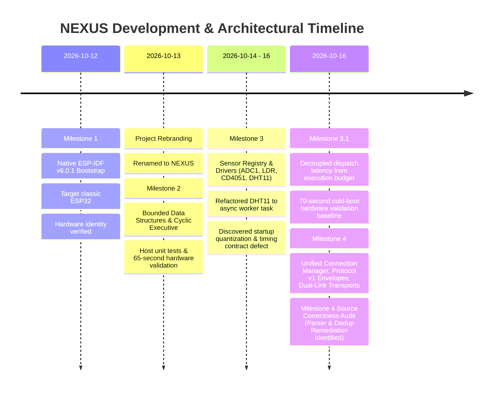

# NEXUS — Chronological Project History & Architectural Evolution

## 1. Executive Summary & Project Genesis

**NEXUS** (*Networked Environmental eXecutive with Unified Sensing*) originated from an initiative to engineer a reliable, deterministic, multi-transport environmental telemetry system on resource-constrained embedded hardware. Developing on the Go-Green Technologies EDU_ROBO V14 IoT Trainer Kit with an ESP32-WROOM-32 DevKit V1 (30-pin) module, the project initially bore the development designation *Apollo EDU_ROBO*.

Early in development, the architectural goals matured beyond simple sensor reading into an industrial-grade embedded executive:
- **No dynamic heap allocations** in the steady-state execution path.
- **Strict cooperative cyclic scheduling** ensuring predictable, bounded callback latency.
- **Complete timing isolation** between physical sensor acquisition, background networking, and user dispatch.
- **Unified communication abstraction** allowing seamless dual-link operation across local USB Serial and remote Wi-Fi / MQTT.

This document traces the chronological evolution of the system architecture, major technical decisions, design trade-offs, and critical lessons learned across all development milestones.

---

## 2. Chronological Architectural Evolution

---

### Phase 1: Native Bootstrap & Toolchain Grounding (Milestone 1)
- **Starting Point**: Minimal scaffold inherited from preliminary project definitions.
- **Architectural Shift**: Decided early to reject framework layers like Arduino-ESP32 or abstract RTOS wrappers. ESP-IDF v6.0.1 with native FreeRTOS was established on Fedora Linux to retain full control over memory layout, peripheral clocks, interrupt handlers, and task contexts.
- **Hardware Grounding**: The physical hardware was identified at `/dev/ttyUSB0` as a classic dual-core `ESP32-D0WD-V3` (revision v3.1) with 4 MB flash.
- **Identity Resolution**: Renamed the project from *Apollo EDU_ROBO* to *NEXUS* across the repository, firmware headers, and build scripts.

---

### Phase 2: Deterministic Executive & Bounded Structures (Milestone 2)
- **Problem**: In concurrent embedded applications, uncoordinated FreeRTOS tasks lead to excessive RAM usage (2–4 KB stack per task), context-switching jitter, and unpredictable preemption.
- **Architectural Shift**: Implemented an application-level **Cooperative Cyclic Executive** on a single FreeRTOS task context (`nexus_exec`, Priority 3, 100 ms tick).
- **Bounded Data Structures**: Designed zero-heap, statically allocated structures:
  - `nexus_job_table`: 16 fixed descriptors with discrete lifecycle tracking and priority classes (0, 1, 2).
  - `nexus_ready_queue`: 16-entry priority queue with deterministic FIFO tie-breaking among equal-priority jobs.
  - `nexus_event_queue`: 32-entry diagnostic event ring buffer with drop-on-full policy and drop counter.
  - `nexus_ring_buffer`: 64-entry circular buffer for rolling historical sample statistics.
- **Validation**: Verified through on-device self-tests, a host unit test suite, and 65 seconds of steady-state hardware execution.

---

### Phase 3: Physical Sensor Integration & Asynchronous Decoupling (Milestone 3)
- **Problem**: Integrating slow physical sensors (e.g. DHT11 single-wire protocol requiring a $20\text{ ms}$ start pulse) directly into the cooperative executive blocked the scheduler, delayed ready jobs, and induced tick jitter.
- **Architectural Shifts**:
  - **ADC1 Pin Isolation**: Restricted all analog acquisitions strictly to **ADC1** (LDR on GPIO 35, CD4051 multiplexer on GPIO 36). **ADC2 was permanently barred** to prevent hardware bus conflicts with the Wi-Fi SAR ADC controller.
  - **Asynchronous Driver Worker**: Moved the DHT11 bus transaction to a dedicated background task (`nexus_dht11_worker`, Priority 2). The executive callback merely performs a microsecond memory copy of the latest cached reading.
  - **Centralized Blackboard**: Built `nexus_sensor_registry` holding descriptors, validity bitmasks, error counters, and freshness timestamps for up to 8 sensors.
- **Closure Audit Insights**:
  - *Snapshot Order Artifact*: Proved that `dispatched = completed + 4` was an exact mathematical invariant:
    $$\text{dispatched} = \text{completed} + \text{failed} (3) + \text{in\_flight} (1)$$
  - *Startup Deadline Misses*: Discovered that measuring `(dispatch_latency + duration) > deadline_ms` inside a 100 ms polling loop falsely flagged startup quantization as deadline misses.

---

### Phase 4: Formal Timing-Contract Disambiguation (Milestone 3.1)
- **Problem**: Conflating scheduler dispatch latency (how long a job waits in the ready queue) with callback execution budget (how long the callback occupies the CPU) generated false deadline alerts.
- **Architectural Shift**:
  - Formally redefined `deadline_ms` strictly as the **maximum permitted callback execution duration budget**.
  - Decoupled dispatch latency, tracking peak scheduling delay independently in `exec->stats.max_dispatch_latency_us`.
  - Added microsecond telemetry (`max_lat_us` and `max_dur_us`) to periodic status reporting.
- **Authoritative Baseline**: Flashed the physical board and captured 70 seconds of cold bootloader reset through continuous runtime. Verified:
  - `dline_misses = 0` across all 310 dispatches.
  - Peak dispatch latency of $92,394\ \mu\text{s}$ accurately captured startup quantization without error.
  - Free heap stabilized at `292,288` bytes with zero memory leaks.

---

### Phase 5: Communication Backbone & Transport Decoupling (Milestone 4)
- **Problem**: Streaming telemetry and receiving commands over USB Serial and Wi-Fi / MQTT must not block or stall the real-time sensor executive.
- **Architectural Shift**:
  - Designed the **Unified Connection Manager** (`nexus_conn_mgr_t`) abstracting physical transports behind a virtual method table (`nexus_transport_ops_t`).
  - Standardized **Protocol v1 Envelopes** using 256-byte newline-delimited JSON (`\n`) for `hb`, `telem`, `status`, and `event`.
  - Implemented an asynchronous background FreeRTOS task (`nexus_conn`, Priority 2) draining a static 16-entry transmit ring queue, achieving sub-microsecond non-blocking enqueue times in executive callbacks ($62\text{–}89\text{ ns}$ on host, $< 3\ \mu\text{s}$ on ESP32).
  - Integrated routing policies (`AUTO` with transparent serial fallback, `SERIAL_ONLY`, `MQTT_ONLY`, `BROADCAST`) and a 32-entry sliding sequence deduplication filter.
- **Pre-Hardware Correctness Audit**: Verified all host unit tests and ESP-IDF compilation, but conducted a rigorous source audit that identified two concrete defects (F-01: parser unbounded string search; F-02: deduplication collision across senders) that must be remediated prior to physical hardware flashing.

---

## 3. Cross-Cutting Design Principles

The technical consistency of the NEXUS codebase is governed by four core architectural principles:

### 1. Zero Runtime Dynamic Allocation
All queues, descriptors, sample buffers, envelopes, and state contexts are allocated as static globals or pre-sized arrays at startup. Once `app_main` initializes, zero calls to `malloc`, `calloc`, or `pvPortMalloc` occur in the steady-state runtime loop, eliminating heap fragmentation and out-of-memory crashes.

### 2. Domain Separation: Executive vs Background I/O
The system is divided into two distinct execution tiers:
- **Real-Time Tier (Priority 3, `nexus_exec`)**: Executes cyclic cooperative callbacks on a predictable 100 ms cadence. Callbacks are strictly non-blocking ($< 1\text{ ms}$ typical, $< 50\text{ ms}$ worst case).
- **Asynchronous Tier (Priority 2, `nexus_conn`, `nexus_dht11_worker`)**: Absorbs physical bus delays, Wi-Fi handshakes, TCP socket retries, and network keepalives without impacting the Real-Time Tier.

### 3. Hardware Conflict Preemption
On the classic ESP32, shared silicon peripherals (such as ADC2 being shared with the Wi-Fi SAR controller) represent fatal failure modes if not designed out early. NEXUS resolved this by permanently binding all analog sensors to ADC1, ensuring seamless coexistence with Wi-Fi and Bluetooth.

### 4. Mathematical Invariants & Observable Telemetry
Internal state is exposed continuously through deterministic telemetry frames. System health is audited using provable invariants, such as:
$$\text{dispatched} = \text{completed} + \text{failed} + \text{in\_flight}$$
$$\text{heap\_free}(t) \to \text{constant}$$
$$\text{deadline\_misses} \equiv 0 \quad (\forall \tau_{\text{callback}} \le \text{budget})$$

---

## 4. Architectural Summary Across Milestones

| Subsystem / Metric | Milestone 1 | Milestone 2 | Milestone 3 | Milestone 3.1 | Milestone 4 |
|---|---|---|---|---|---|
| **Executive Core** | None (delay loop) | Cyclic 100 ms tick | Cyclic 100 ms tick | Decoupled timing contract | Preserved & isolated |
| **Job Capacity** | N/A | 16 descriptors | 16 descriptors | 16 descriptors | 16 descriptors |
| **Ready Queue** | N/A | 16 slots (Priority/FIFO) | 16 slots | 16 slots | 16 slots |
| **Event Queue** | N/A | 32 slots (Drop-on-full) | 32 slots | 32 slots | 32 slots |
| **Sensor Registry** | None | None | 8 sensors (ADC1, LDR, Mux, DHT) | 8 sensors | 8 sensors (Integrated) |
| **Transport Layer** | Raw serial boot log | Raw serial heartbeat | Raw serial metrics | Microsecond telemetry | Unified CM (Serial + Wi-Fi/MQTT) |
| **Message Framing** | Unstructured text | Unstructured text | Tabular serial text | Tabular serial text | Protocol v1 JSON (`\n` framed) |
| **Transmit Queue** | None | None | None | None | 16 slots (Static ring) |
| **Ingress Dedup** | None | None | None | None | 32-entry sliding window |
| **Host Unit Tests** | None | 5/5 passed | 7/7 passed | 9/9 passed | 7/7 passed |
| **Physical Validation** | Bootloader & UART0 | 65s steady-state | 65s sensor acquisition | 70s cold boot baseline | Pending audit remediation |
