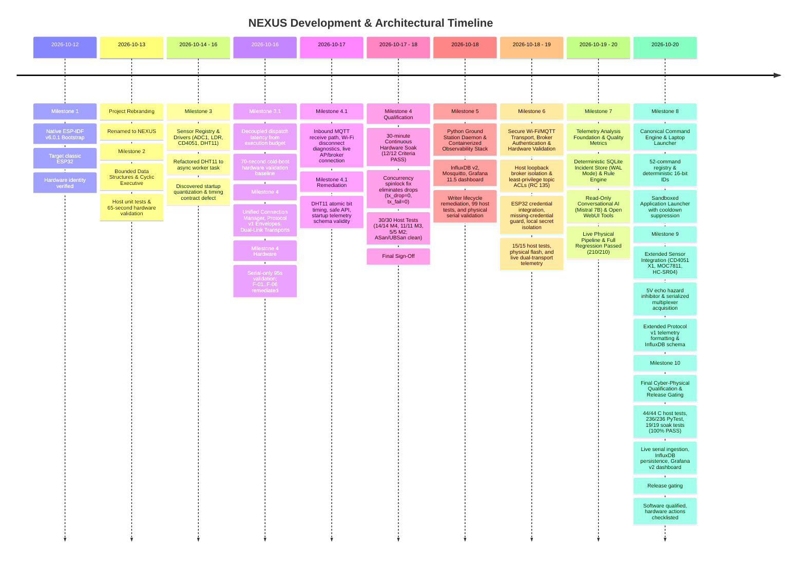

# NEXUS — Chronological Project History & Architectural Evolution

## 1. Executive Summary & Project Genesis

**NEXUS** (*Networked Environmental eXecutive with Unified Sensing*) originated from an initiative to engineer a reliable, deterministic, multi-transport environmental telemetry system on resource-constrained embedded hardware. Developing on the Go-Green Technologies EDU_ROBO V14 IoT Trainer Kit with an ESP32-WROOM-32 DevKit V1 (30-pin) module, the project initially bore the development designation *Apollo EDU_ROBO*.

Early in development, the architectural goals matured beyond simple sensor reading into an industrial-grade embedded executive:
- **No dynamic heap allocations** in the steady-state execution path.
- **Strict cooperative cyclic scheduling** ensuring predictable, bounded callback latency.
- **Complete timing isolation** between physical sensor acquisition, background networking, and user dispatch.
- **Unified communication abstraction** allowing seamless dual-link operation across local USB Serial and remote Wi-Fi / MQTT.

This document traces the chronological evolution of the system architecture, major technical decisions, design trade-offs, and critical lessons learned across all development milestones.

---

## 2. Chronological Architectural Evolution

---

### Phase 1: Native Bootstrap & Toolchain Grounding (Milestone 1)
- **Starting Point**: Minimal scaffold inherited from preliminary project definitions.
- **Architectural Shift**: Decided early to reject framework layers like Arduino-ESP32 or abstract RTOS wrappers. ESP-IDF v6.0.1 with native FreeRTOS was established on Fedora Linux to retain full control over memory layout, peripheral clocks, interrupt handlers, and task contexts.
- **Hardware Grounding**: The physical hardware was identified at `/dev/ttyUSB0` as a classic dual-core `ESP32-D0WD-V3` (revision v3.1) with 4 MB flash.
- **Identity Resolution**: Renamed the project from *Apollo EDU_ROBO* to *NEXUS* across the repository, firmware headers, and build scripts.

---

### Phase 2: Deterministic Executive & Bounded Structures (Milestone 2)
- **Problem**: In concurrent embedded applications, uncoordinated FreeRTOS tasks lead to excessive RAM usage (2–4 KB stack per task), context-switching jitter, and unpredictable preemption.
- **Architectural Shift**: Implemented an application-level **Cooperative Cyclic Executive** on a single FreeRTOS task context (`nexus_exec`, Priority 3, 100 ms tick).
- **Bounded Data Structures**: Designed zero-heap, statically allocated structures:
  - `nexus_job_table`: 16 fixed descriptors with discrete lifecycle tracking and priority classes (0, 1, 2).
  - `nexus_ready_queue`: 16-entry priority queue with deterministic FIFO tie-breaking among equal-priority jobs.
  - `nexus_event_queue`: 32-entry diagnostic event ring buffer with drop-on-full policy and drop counter.
  - `nexus_ring_buffer`: 64-entry circular buffer for rolling historical sample statistics.
- **Validation**: Verified through on-device self-tests, a host unit test suite, and 65 seconds of steady-state hardware execution.

---

### Phase 3: Physical Sensor Integration & Asynchronous Decoupling (Milestone 3)
- **Problem**: Integrating slow physical sensors (e.g. DHT11 single-wire protocol requiring a $20\text{ ms}$ start pulse) directly into the cooperative executive blocked the scheduler, delayed ready jobs, and induced tick jitter.
- **Architectural Shifts**:
  - **ADC1 Pin Isolation**: Restricted all analog acquisitions strictly to **ADC1** (LDR on GPIO 35, CD4051 multiplexer on GPIO 36). **ADC2 was permanently barred** to prevent hardware bus conflicts with the Wi-Fi SAR ADC controller.
  - **Asynchronous Driver Worker**: Moved the DHT11 bus transaction to a dedicated background task (`nexus_dht11_worker`, Priority 2). The executive callback merely performs a microsecond memory copy of the latest cached reading.
  - **Centralized Blackboard**: Built `nexus_sensor_registry` holding descriptors, validity bitmasks, error counters, and freshness timestamps for up to 8 sensors.
- **Closure Audit Insights**:
  - *Snapshot Order Artifact*: Proved that `dispatched = completed + 4` was an exact mathematical invariant:
    $$\text{dispatched} = \text{completed} + \text{failed} (3) + \text{in\_flight} (1)$$
  - *Startup Deadline Misses*: Discovered that measuring `(dispatch_latency + duration) > deadline_ms` inside a 100 ms polling loop falsely flagged startup quantization as deadline misses.

---

### Phase 4: Formal Timing-Contract Disambiguation (Milestone 3.1)
- **Problem**: Conflating scheduler dispatch latency (how long a job waits in the ready queue) with callback execution budget (how long the callback occupies the CPU) generated false deadline alerts.
- **Architectural Shift**:
  - Formally redefined `deadline_ms` strictly as the **maximum permitted callback execution duration budget**.
  - Decoupled dispatch latency, tracking peak scheduling delay independently in `exec->stats.max_dispatch_latency_us`.
  - Added microsecond telemetry (`max_lat_us` and `max_dur_us`) to periodic status reporting.
- **Authoritative Baseline**: Flashed the physical board and captured 70 seconds of cold bootloader reset through continuous runtime. Verified:
  - `dline_misses = 0` across all 310 dispatches.
  - Peak dispatch latency of $92,394\ \mu\text{s}$ accurately captured startup quantization without error.
  - Free heap stabilized at `292,288` bytes with zero memory leaks.

---

### Phase 5: Communication Backbone & Transport Decoupling (Milestone 4)
- **Problem**: Streaming telemetry and receiving commands over USB Serial and Wi-Fi / MQTT must not block or stall the real-time sensor executive.
- **Architectural Shift**:
  - Designed the **Unified Connection Manager** (`nexus_conn_mgr_t`) abstracting physical transports behind a virtual method table (`nexus_transport_ops_t`).
  - Standardized **Protocol v1 Envelopes** using 256-byte newline-delimited JSON (`\n`) for `hb`, `telem`, `status`, and `event`.
  - Implemented an asynchronous background FreeRTOS task (`nexus_conn`, Priority 2) draining a static 16-entry transmit ring queue, achieving non-blocking enqueue times in executive callbacks (measured at 89 ns on Linux x86_64 host without sanitizers, 583 ns under ASan; $< 3\ \mu\text{s}$ on 240 MHz ESP32 is an analytical instruction-budget estimate pending target trace verification).
  - Integrated routing policies (`AUTO` with transparent serial fallback, `SERIAL_ONLY`, `MQTT_ONLY`, `BROADCAST`) and a 32-entry sliding sequence deduplication filter.
- **Pre-Hardware Audit & Remediation Outcome**:
  - Conducted a comprehensive pre-hardware correctness audit identifying six findings (F-01 through F-06).
  - Remediated all findings:
    - **F-01 (Bounded Envelope Parsing)**: Replaced unbounded string scanning with strict length validation ($\text{len} < 256$), bounded stack copy with guaranteed NUL termination, and digit-validated `strtoul` parsing. Output structures are never partially mutated on malformed frames.
    - **F-02 (Composite Deduplication Identity)**: Replaced scalar sequence matching with composite `(source, dev, seq)` identity, preventing independent commands from different interfaces or devices from being falsely dropped.
    - **F-03 (Thread-Safe State & Stats)**: Guarded concurrent transport state transitions and multi-field statistics snapshots using ESP-IDF classic dual-core spinlocks (`portMUX_TYPE`), preventing lost counter increments and torn reads without blocking FreeRTOS event loops.
    - **F-04 (Wi-Fi Reconnect Backoff)**: Eliminated rapid reconnection loops by implementing geometric backoff ($1\text{ s} \to 2\text{ s} \dots 60\text{ s}$ ceiling) scheduled via an asynchronous one-shot `esp_timer`.
    - **F-05 (Wi-Fi/MQTT Configuration)**: Created `Kconfig.projbuild` with safe unconfigured defaults (`SSID=""`), keeping credentials out of Git while allowing seamless USB serial fallback out of the box.
    - **F-06 (Wi-Fi/MQTT & Worker Task Lifecycle Cleanup)**: Retained event-handler instance handles, unregistering them on `stop()` and stopping reconnect timers to prevent stale callback dereferences. Resolved worker-task lifecycle race by implementing FreeRTOS task exit semaphore rendezvous (`task_exit_sem` with 500 ms bounded timeout and retry semantics) and immediate unblocking (`xTaskNotifyGive`) in `nexus_conn_mgr_stop()`. Removed unsafe asynchronous `vTaskDelete(th)`. Rejected worker self-stop, added early queue breakout on stop in `process_tx_queue`, and ensured clean rollback of started transports on `xTaskCreate` failure.
  - Verified with 11/11 host unit tests, Clang AddressSanitizer and UndefinedBehaviorSanitizer (100% clean), and native ESP-IDF v6.0.1 compilation (0 warnings, 0 errors, 886 KB binary, SHA-256 `f5b5f476...`).

---

### Phase 6: Host Ground Station, InfluxDB Persistence & Observability (Milestone 5)
- **Problem**: Raw newline-delimited JSON envelopes streamed across USB Serial and MQTT require resilient ingestion, schema validation, persistent time-series storage, and live visual monitoring without losing data or exhausting host resources.
- **Architectural Shift**:
  - Implemented a modular, multi-transport Python Ground Station daemon in `ground_station/`:
    - `EnvelopeParser`: Enforces 256-byte maximum line length, validates JSON schema, verifies type discrimination, and rejects non-finite float values (`NaN`, `Inf`).
    - `DeviceTracker`: Tracks per-device sequence numbers, reboot occurrences, and telemetry heartbeats. Quarantines unrecognized device IDs to prevent database pollution.
    - `SerialTransportAdapter`: Interacts with physical UART using non-blocking I/O (0.2s timeout), a bounded 4096-byte line assembly buffer, and explicit DTR/RTS deassertion (`ser.dtr = False`, `ser.rts = False`, `rtscts=False`) to prevent resetting classic ESP32 boards on port open.
    - `MqttTransportAdapter`: Subscribes to broker topics using Paho MQTT v2 with strict topic regex validation (`^nexus/([^/]+)/telemetry$`).
    - `PointMapper` & `InfluxDBWriter`: Maps Protocol v1 payloads into InfluxDB v2 point schemas. Enforces strict tag cardinality (`dev`, `type`, `transport` only; readings, sequence, and uptime stored strictly as unindexed fields). Missing DHT11 readings are completely omitted when `dht_valid=false` rather than recording misleading zero values. Host receive wall-clock timestamping (`received_at`) guarantees accurate temporal alignment.
  - **Docker Observability Stack**: Containerized InfluxDB 2.7.11, Eclipse Mosquitto 2.1.2, and Grafana 11.5.0 using Docker Compose. Enforces 100% loopback port isolation (`127.0.0.1:8086`, `127.0.0.1:1883`, `127.0.0.1:3000`), secure credential templating via `.env.example`, and pre-provisioned datasource and 8-panel dashboard (`nexus_telemetry.json`).
  - **Remediation & Validation**: Fixed an `InfluxDBWriter` lifecycle race on timed-out worker joins via `is_shutdown_timed_out` tracking. Comprehensive test suite of 99 automated unit tests passed (100%). Physical validation achieved via `ground_station/run_serial_ingestion.py` streaming live frames over `/dev/ttyUSB0` at 115200 baud (`docs/validation/phase6_1_serial_ingestion.log`).

---

### Phase 7: Authenticated Wi-Fi/MQTT Transport, Broker Security & Dual-Link Hardware Validation (Milestone 6)
- **Problem**: Opening the MQTT broker to external physical hardware on the local Wi-Fi LAN without authentication risks unauthorized access, topic spoofing, and container exposure. Furthermore, firmware missing credentials could silently fall back to anonymous connections, and secrets risked leakage into source control.
- **Architectural Shift**:
  - **Controlled Network Topology & Port Isolation**: Maintained strict loopback binding (`127.0.0.1:1883`) for the containerized broker in `docker-compose.yml`. A controlled host forwarder bridges traffic from the host external Wi-Fi IP (`10.12.252.18:1883`) to loopback, avoiding unconstrained `0.0.0.0` container exposure.
  - **Role-Based Broker Hardening**: Disabled anonymous access (`allow_anonymous false`) in Mosquitto 2.1.2. Implemented least-privilege topic Access Control Lists (`credentials/mosquitto.acl`) granting the edge device (`nexus_device`) write-only access to `nexus/nexus_esp32/telemetry`, the Ground Station (`nexus_ground_station`) read-only access to `nexus/+/telemetry`, and denying all unauthorized actions (verified via MQTT v5 Reason Code 135).
  - **Fail-Closed Firmware Authentication**: Configured `esp_mqtt_client_config_t` credentials (`username`, `password`, `client_id`) in `nexus_wifi_mqtt_transport.c` utilizing native ESP-IDF v6.0.1 APIs. Enforced a missing-credential guard that immediately transitions the transport to `NEXUS_CONN_STATE_FAILED` if Wi-Fi is enabled without valid MQTT credentials, completely eliminating silent anonymous fallback.
  - **Git Secret Isolation**: Established an automated build override in `firmware/CMakeLists.txt` that pulls configuration from git-ignored `credentials/sdkconfig.local` (mode `0600`), ensuring that tracked Kconfig files and Git commit logs remain 100% free of plaintext credentials.
  - **Hardware Validation**: Flashed `build/nexus.bin` to physical `ESP32-D0WD-V3` silicon. Verified cold boot, Wi-Fi association (AP `Aryan`), DHCP lease (`10.12.252.214`), authenticated MQTT session, 21 live packets ingested by Ground Station on `nexus/+/telemetry` without dropped frames, and concurrent serial ingestion (17 InfluxDB points).

---

### Phase 8: Telemetry Analysis, Deterministic Incident Monitoring & Conversational AI (Milestone 7)
- **Problem**: As physical telemetry streams continuously into InfluxDB and Grafana, human operators cannot remain perpetually vigilant for transient sensor failures, packet cadence jitter, or slow memory leaks. Furthermore, direct ad-hoc querying of InfluxDB lacks statistical bounds, and introducing conversational LLMs without strict sandboxing risks hallucinations or accidental actuation commands.
- **Architectural Shift**:
  - **Telemetry Analysis Foundation**: Implemented typed domain abstractions in `ground_station/analysis/` (`TelemetryPoint`, `DeviceSeries`, `DataQualityReport`, `SignalStatistics`). Added automated data-quality assessment (null rates, cadence jitter, sequence continuity, `dht_valid` bitmasks) and statistical calculations (mean, median, standard deviation, linear regression drift slope). Enforced a 1,000-point hard limit on raw InfluxDB Flux history while executing server-side aggregate pushdowns for unbounded long-term statistics. Implemented reboot-safe dual-transport deduplication across a 5-second window.
  - **Deterministic Incident Monitoring & SQLite WAL Store**: Created `ground_station/monitoring/` featuring a thread-safe, durable SQLite database (`ground_station/data/incidents.db`) in Write-Ahead Logging (`WAL`) mode with atomic status transitions (`ACTIVE`, `RESOLVED`, `ACKNOWLEDGED`, `SUPPRESSED`). Implemented pluggable rules: `FreshnessRule` (cadence degradation and blackouts), `SensorAnomalyRule` (DHT validity and threshold violations), and `ExecutiveHealthRule` (heap depletion $< 10\text{ KB}$ and loop stalls). Added outage-aware state handling distinguishing network disconnections from sensor faults.
  - **Air-Gapped Read-Only Conversational AI**: Built a secure conversational agent and tool registry in `ground_station/ai/` exposing nine strictly read-only operational query tools. Validated all arguments against formal schemas, barring arbitrary code execution, SQL/Flux injection, and MQTT command publishing. Integrated local model inference with `mistral:7b` via Ollama (`http://127.0.0.1:11434`) and implemented a deterministic Rule Router fallback for offline operation.
  - **Operational Ecosystem**: Formatted the nine operational tools into native Open WebUI adapters (`open_webui_tools.py`) and automated their registration against Open WebUI at `http://127.0.0.1:8080`. Integrated `--enable-monitoring` lifecycle hooks across all ingestion scripts with a single unified worker guarantee in dual-transport mode.
  - **Grounded Verification**: Clarified uncalibrated raw ADC semantics (`x0_raw_adc`, 0–4095) in prompts and schemas. Verified live physical telemetry (32 frames, `seq: 2032..2063`, temp 31.0°C, hum 72.0%, LDR 11, Gas 1006) persisted into InfluxDB, visualized on Grafana, and successfully queried through live Open WebUI tool calls with Mistral 7B. Full regression suite passed (210/210 passed in 8.12s); Ruff lint clean.

---

### Phase 9: Canonical Command Engine, Bidirectional Protocol & Laptop Launcher (Milestone 8)
- **Problem**: Inbound control of the embedded executive was previously ad-hoc or absent, risking arbitrary command injection, executive task stalls, and uncoordinated state transitions. Furthermore, operators lacked a secure, sandboxed mechanism to launch host monitoring tools or open diagnostic views directly from board commands.
- **Architectural Shift**:
  - **Canonical 52-Command Registry**: Reconciled the entire command space against `docs/PROJECT_BLUEPRINT.md` with unique, deterministic 16-bit IDs `(verb << 8) | noun`, formal argument constraints, and milestone dispositions in `firmware/main/command/nexus_command_registry.c`.
  - **Zero-Allocation Firmware Dispatcher**: Built `nexus_command_dispatcher.c` operating within bounded 256-byte envelopes. Dispatches system resets, parameter configurations, and sensor/executive diagnostics with structured responses (`code`, `status`, `msg`, `uptime`). Wired the RX path safely to the Connection Manager worker callback.
  - **Sandboxed Ground Station Application Launcher**: Created `ground_station/command_router/application_launcher.py` with strict allowlists (schemes `http`/`https`, local hosts `127.0.0.1`, permitted ports 3000/8080/8086), subprocess isolation, and configurable idempotency cooldown timers to prevent process storms.
  - **Bidirectional Command Router**: Implemented `ground_station/command_router/router.py` to route inbound commands from the MCU, correlate outbound command requests with responses, and maintain full bidirectional command-response isolation.
  - **Verification**: 38/38 C host tests passed (100%), 215/215 Python tests passed (100%), and clean ESP-IDF v6.0.1 compilation (`nexus.bin`, 0xe1ca0 B). Documented physical input gap (UART0 console conflict on GPIO1 and absence of physical matrix keypad).

---

### Phase 10: Extended Sensor Integration & Observability (Milestone 9)
- **Problem**: Expanding the sensor suite to include CD4051 X1 (Hall Effect IC2), MOC7811 (optical slot), and HC-SR04 (ultrasonic distance) introduced physical hazards (5V echo pulse risking ESP32 pin destruction), pin constraints (GPI-only GPIO34 lacking internal pull-up), and envelope size budget constraints.
- **Architectural Shift**:
  - **Sensor Registry & Envelope Capacity**: Verified 7 registered sensors within the 8-sensor static capacity ($7 \le 8$). Verified worst-case extended telemetry envelope at 165 bytes, well within the 256-byte ceiling ($165 < 256$).
  - **Electrical Safety & Settling Contracts**: Serialized CD4051 acquisition with $20\ \mu\text{s}$ settling time between X0 and X1. Accounted for external pull-up resistor R7 ($10\text{ k}\Omega$) on GPI GPIO34 for MOC7811. Enforced a default safety inhibitor (`s_live_hw_enabled = false`) for HC-SR04 that keeps pins unconfigured in high-impedance reset state and clamped echo wait timeout to 8 ms (~1.37 m) to guarantee cyclic executive callback budget compliance ($\le 10\text{ ms}$).
  - **Vertical Stack Pipeline**: Added `nexus_envelope_format_telemetry_ext` in firmware, extended Ground Station `EnvelopeParser` and `PointMapper` with backwards-compatible optional fields, updated `DISPLAY ANALOG` (`0x1044`) and `DIAGNOSTICS SENSORS` (`0x1802`), and grounded AI tool documentation.
  - **Verification**: 44/44 C host tests passed (100%), 217/217 Python tests passed (100%), and clean ESP-IDF v6.0.1 compilation (`nexus.bin`, 0xe2650 B).

---

### Phase 11: Final Qualification & Production Release (Milestone 10)
- **Problem**: Finalizing the project requires empirical qualification across the complete vertical cyber-physical stack, establishing reproducible test baselines, and clearly gating production release tagging on empirical physical hardware measurements rather than host simulations.
- **Architectural Shift**:
  - **Complete Automated Test Baseline**: 44/44 C host unit tests passing (100%), 236/236 Ground Station PyTest tests passing (100%), 19/19 soak analyzer unit tests passing (100%), and clean ESP-IDF compilation (`nexus.bin`, 927,392 B, 12% free headroom).
  - **Target Firmware Deployment & Live Telemetry**: Successfully flashed `firmware/build/nexus.bin` to the physical ESP32 on `/dev/ttyUSB0` at 115200 baud. Verified boot banner identity `version=1a9bfcc-dirty` (Oct 20 2026 19:53:30) and confirmed 7 registered sensors (`LDR=OK, CD4051=OK, DHT11=OK, MOC=OK, ULTRA=OK`). Verified live serial ingestion (`docs/validation/m10_live_serial_ingestion.log`) capturing 13 envelopes and persisting real `x1_raw` (2029 at boot) and `slot_state` (0) into InfluxDB with 0 failures and 0 drops. Updated Grafana dashboard to Version 2 with Row 103 and 3 extended sensor panels (Hall X1, MOC7811 slot state, HC-SR04 distance), verified live via container API (15 active panels).
  - **Executive Timing Contracts**: Disambiguated per-job timing contracts: sensor acquisition callbacks execute in $< 1\text{ ms}$ ($\ll 10\text{ ms}$ budget), `metrics` executes in $33.8\text{ ms}$ ($\le 50\text{ ms}$ budget due to UART string formatting), and asynchronous DHT11 worker runs outside cyclic executive callbacks, resulting in exactly zero deadline misses (`dline_misses = 0`).
  - **Electrical Safety & Release Gating**: Confirmed active HC-SR04 5V pulse protection inhibitor (`s_live_hw_enabled = false`, pins unconfigured). Gated formal `v1.0.0` production release tagging on operator physical multimeter verification, MOC7811 optical beam-break, and Hall X1 magnet deflection.

---

## 3. Cross-Cutting Design Principles

The technical consistency of the NEXUS codebase is governed by eight core architectural principles:

### 1. Zero Runtime Dynamic Allocation
All queues, descriptors, sample buffers, envelopes, and state contexts are allocated as static globals or pre-sized arrays at startup. Once `app_main` initializes, zero calls to `malloc`, `calloc`, or `pvPortMalloc` occur in the steady-state runtime loop, eliminating heap fragmentation and out-of-memory crashes.

### 2. Domain Separation: Executive vs Background I/O
The system is divided into two distinct execution tiers:
- **Real-Time Tier (Priority 3, `nexus_exec`)**: Executes cyclic cooperative callbacks on a predictable 100 ms cadence. Callbacks are strictly non-blocking ($< 1\text{ ms}$ typical, $< 50\text{ ms}$ worst case).
- **Asynchronous Tier (Priority 2, `nexus_conn`, `nexus_dht11_worker`)**: Absorbs physical bus delays, Wi-Fi handshakes, TCP socket retries, and network keepalives without impacting the Real-Time Tier.

### 3. Hardware Conflict Preemption
On the classic ESP32, shared silicon peripherals (such as ADC2 being shared with the Wi-Fi SAR controller) represent fatal failure modes if not designed out early. NEXUS resolved this by permanently binding all analog sensors to ADC1, ensuring seamless coexistence with Wi-Fi and Bluetooth.

### 4. Memory-Safe Wire-Format Parsing
Incoming byte streams from serial lines or network sockets are treated as untrusted. Bounded stack scratch buffers of fixed protocol ceiling size (`scratch[256]`) enforce guaranteed NUL termination before any token scanning, preventing memory overreads, page faults, or buffer overflow vulnerabilities.

### 5. Mathematical Invariants & Observable Telemetry
Internal state is exposed continuously through deterministic telemetry frames. System health is audited using provable invariants, such as:
$$\text{dispatched} = \text{completed} + \text{failed} + \text{in\_flight}$$
$$\text{heap\_free}(t) \to \text{constant}$$
$$\text{deadline\_misses} \equiv 0 \quad (\forall \tau_{\text{callback}} \le \text{budget})$$

### 6. Time-Series Cardinality Control & Host Data Provenance
Host-side telemetry storage must protect time-series indexing performance. High-entropy values (readings, uptime, monotonic sequence counters) are stored strictly as unindexed fields, restricting indexed tags strictly to low-cardinality metadata (`dev`, `type`, `transport`). Timestamps reflect host receive wall-clock time while preserving firmware monotonic uptime as an integer field for reboot identification.

### 7. Least-Privilege Network & Credential Boundaries
Services published by the container stack remain bound strictly to loopback (`127.0.0.1`), requiring explicit, controlled host-level bridges for physical LAN device ingress. Topic-level ACLs enforce strict privilege boundaries (edge devices cannot subscribe to other nodes' telemetry or broadcast arbitrary messages). If authentication credentials are absent, network transports fail closed (`NEXUS_CONN_STATE_FAILED`) rather than falling back to unauthenticated operation, and secrets are segregated into local, git-ignored configuration overlays.

### 8. Air-Gapped AI Read-Only Boundary & Grounded Diagnostics
Conversational AI models must never possess autonomous actuation authority over physical embedded hardware. All tool interfaces exposed to LLMs are strictly read-only, sandboxed, and parameter-validated against formal JSON schemas. Grounded system prompts explicitly disambiguate raw hardware counts (e.g. uncalibrated ADC counts) from calibrated engineering units to prevent hallucination. When local LLM runtimes are offline or unreachable, deterministic rule routers parse operator intents to provide immediate, un-hallucinated diagnostic responses.

### 9. Bidirectional Protocol Security & Sandboxed Application Launching
Remote commands must be strictly governed by an authoritative, version-controlled command matrix. Every command must possess a unique, deterministic 16-bit identifier `(verb << 8) | noun` with explicit milestone disposition. Firmware command execution must be zero-allocation, bounded strictly to 256-byte envelopes, and isolated from cyclic executive scheduling. Board-to-laptop application launching must never execute arbitrary shell commands or untrusted URLs; actions are restricted to explicit allowlists (schemes, hosts, ports), protected by configurable idempotency cooldown timers, and observable via structured telemetry responses.

### 10. Hardware Electrical Safeguards & Multi-Sensor Settling
Expanding embedded sensor suites requires strict physical verification of signal levels and timing isolation. When connecting 5V legacy sensors (such as classic HC-SR04 ultrasonic modules) to 3.3V SoCs, software must enforce safety inhibitors by default until physical level shifting or voltage dividers are verified. Analog multiplexers (e.g. CD4051) sharing an ADC channel must enforce explicit settling intervals between channel switches to prevent channel cross-talk. All acquisition cycles must be bounded with timeouts to guarantee adherence to cyclic executive deadlines.

---

## 4. Architectural Summary Across Milestones

| Subsystem / Metric | Milestone 1 | Milestone 2 | Milestone 3 | Milestone 3.1 | Milestone 4 | Milestone 4.1 | Milestone 5 | Milestone 6 | Milestone 7 | Milestone 8 | Milestone 9 | Milestone 10 |
|---|---|---|---|---|---|---|---|---|---|---|---|---|
| **Executive Core** | None (delay loop) | Cyclic 100 ms tick | Cyclic 100 ms tick | Decoupled timing contract | Preserved & isolated | Preserved & isolated | Preserved & isolated | Preserved & isolated | Preserved & isolated | Preserved & isolated | Preserved & isolated | Preserved & isolated |
| **Job Capacity** | N/A | 16 descriptors | 16 descriptors | 16 descriptors | 16 descriptors | 16 descriptors | 16 descriptors | 16 descriptors | 16 descriptors | 16 descriptors | 16 descriptors | 16 descriptors |
| **Ready Queue** | N/A | 16 slots (Priority/FIFO) | 16 slots | 16 slots | 16 slots | 16 slots | 16 slots | 16 slots | 16 slots | 16 slots | 16 slots | 16 slots |
| **Event Queue** | N/A | 32 slots (Drop-on-full) | 32 slots | 32 slots | 32 slots | 32 slots | 32 slots | 32 slots | 32 slots | 32 slots | 32 slots | 32 slots |
| **Sensor Registry** | None | None | 8 sensors (ADC1, LDR, Mux, DHT) | 8 sensors | 8 sensors (Integrated) | 8 sensors (Validity & safe API) | 8 sensors (Integrated) | 8 sensors (Integrated) | 8 sensors (Integrated) | 8 sensors (Integrated) | 7 active sensors (LDR, DHT T/H, Gas X0, Hall X1, MOC7811, HC-SR04) | 7 active sensors fully qualified ($7 \le 8$) |
| **Transport Layer** | Raw serial boot log | Raw serial heartbeat | Raw serial metrics | Microsecond telemetry | Unified CM (Serial + Wi-Fi/MQTT) | Dual-link (Inbound MQTT + Diagnostics) | Python dual adapter (Serial + MQTT) | Dual-link: Serial + Authenticated Wi-Fi/MQTT | Dual-link + Bounded query engine & deduplication | Dual-link + Bidirectional Command Router & RX callback | Dual-link + Extended telemetry serialization (`x1`, `slot`, `dist`) | Dual-link + Extended telemetry + InfluxDB & Grafana v2 dashboard |
| **Message Framing** | Unstructured text | Unstructured text | Tabular serial text | Tabular serial text | Protocol v1 JSON (`\n` framed) | Protocol v1 JSON (`dht_valid` schema) | Protocol v1 JSON (Host parsed, float-checked) | Protocol v1 JSON (Host parsed & validated) | Protocol v1 JSON + Typed domain models | Protocol v1 JSON (`cmd` & `resp` schemas) | Protocol v1 JSON (165B worst-case, within 256B ceiling) | Protocol v1 JSON verified end-to-end (165B $\le 256$B) |
| **Transmit Queue** | None | None | None | None | 16 slots (Static ring) | 16 slots (Static ring) | 16 slots (MCU) + 1000 items (Host manager) | 16 slots (MCU) + 1000 items (Host manager) | 16 slots (MCU) + 1000 items (Host manager) | 16 slots (MCU) + Response Auto-Enqueue | 16 slots (MCU) + Extended telemetry | 16 slots (MCU) + Extended telemetry |
| **Ingress Dedup** | None | None | None | None | 32-entry composite `(source, dev, seq)` | 32-entry composite `(source, dev, seq)` | Host `DeviceTracker` sliding sequence window | 32-entry composite + Host `DeviceTracker` | Reboot-safe 5s window + `(dev, seq, epoch)` | 32-entry composite + Idempotency cooldown suppression | 32-entry composite preserved | 32-entry composite preserved |
| **Host Unit Tests** | None | 5/5 passed | 7/7 passed | 9/9 passed | 10/10 passed | 30/30 total (ASan/UBSan clean) | 99/99 passed (100% across 10 modules) | 15/15 C tests (ASan/UBSan) + 99 Python + 19 soak + 9 ACL | 210/210 passed (27 analysis, 32 monitoring, 30 AI/WebUI, 108 host, 19 soak) | 38/38 C host tests (100%) + 215/215 PyTest (100%) | 44/44 C host tests (100%) + 217/217 PyTest (100%) | 44/44 C host tests (100%) + 236/236 PyTest (100%) + 19/19 soak tests (100%) |
| **Physical Validation** | Bootloader & UART0 | 65s steady-state | 65s sensor acquisition | 70s cold boot baseline | 95s serial baseline (162 env, 0 drops) | 30-min qualification soak (12/12 PASS) | Live serial ingestion over `/dev/ttyUSB0` | Cold boot, Wi-Fi DHCP, Auth MQTT (21 pkts), Live Serial | Live ESP32 Wi-Fi/MQTT (32 pkts), InfluxDB, Grafana, Open WebUI Round-Trip | Software-verified (Clean ESP-IDF build, 0xe1ca0 B; physical input gap documented) | Software-verified (Clean ESP-IDF build, 0xe2650 B; 5V echo hazard inhibited) | Software & target verified: Flashed M9/M10 (Oct 20 2026), 7 sensors registered; real serial ingestion (13 pkts, 0 drops, x1=2029, slot=0); release gated on physical excitation & multimeter check |
| **Incident Storage** | None | None | None | None | None | None | None | None | SQLite WAL mode (`incidents.db`) with atomic transitions | SQLite WAL mode (`incidents.db`) preserved | SQLite WAL mode (`incidents.db`) preserved | SQLite WAL mode (`incidents.db`) preserved |
| **AI / Intelligence** | None | None | None | None | None | None | None | None | 9 Read-only tools, Mistral 7B (Ollama), Open WebUI, Rule Router | Read-only AI boundary preserved; independent application launcher | M9 sensor grounding (`x1_raw_adc`, `slot_state`, `dist_cm`) | AI groundings & 9 tools verified operational |
| **Command Engine** | None | None | None | None | None | None | None | None | None | Canonical 52-command matrix, 16-bit IDs, safe URL launcher | Updated DISPLAY ANALOG (0x1044) & DIAGNOSTICS SENSORS (0x1802) | Fully unified command engine & dispatcher |

