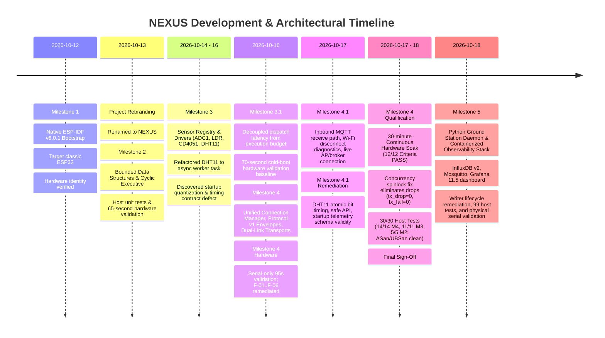

# NEXUS — Chronological Project History & Architectural Evolution

## 1. Executive Summary & Project Genesis

**NEXUS** (*Networked Environmental eXecutive with Unified Sensing*) originated from an initiative to engineer a reliable, deterministic, multi-transport environmental telemetry system on resource-constrained embedded hardware. Developing on the Go-Green Technologies EDU_ROBO V14 IoT Trainer Kit with an ESP32-WROOM-32 DevKit V1 (30-pin) module, the project initially bore the development designation *Apollo EDU_ROBO*.

Early in development, the architectural goals matured beyond simple sensor reading into an industrial-grade embedded executive:
- **No dynamic heap allocations** in the steady-state execution path.
- **Strict cooperative cyclic scheduling** ensuring predictable, bounded callback latency.
- **Complete timing isolation** between physical sensor acquisition, background networking, and user dispatch.
- **Unified communication abstraction** allowing seamless dual-link operation across local USB Serial and remote Wi-Fi / MQTT.

This document traces the chronological evolution of the system architecture, major technical decisions, design trade-offs, and critical lessons learned across all development milestones.

---

## 2. Chronological Architectural Evolution

---

### Phase 1: Native Bootstrap & Toolchain Grounding (Milestone 1)
- **Starting Point**: Minimal scaffold inherited from preliminary project definitions.
- **Architectural Shift**: Decided early to reject framework layers like Arduino-ESP32 or abstract RTOS wrappers. ESP-IDF v6.0.1 with native FreeRTOS was established on Fedora Linux to retain full control over memory layout, peripheral clocks, interrupt handlers, and task contexts.
- **Hardware Grounding**: The physical hardware was identified at `/dev/ttyUSB0` as a classic dual-core `ESP32-D0WD-V3` (revision v3.1) with 4 MB flash.
- **Identity Resolution**: Renamed the project from *Apollo EDU_ROBO* to *NEXUS* across the repository, firmware headers, and build scripts.

---

### Phase 2: Deterministic Executive & Bounded Structures (Milestone 2)
- **Problem**: In concurrent embedded applications, uncoordinated FreeRTOS tasks lead to excessive RAM usage (2–4 KB stack per task), context-switching jitter, and unpredictable preemption.
- **Architectural Shift**: Implemented an application-level **Cooperative Cyclic Executive** on a single FreeRTOS task context (`nexus_exec`, Priority 3, 100 ms tick).
- **Bounded Data Structures**: Designed zero-heap, statically allocated structures:
  - `nexus_job_table`: 16 fixed descriptors with discrete lifecycle tracking and priority classes (0, 1, 2).
  - `nexus_ready_queue`: 16-entry priority queue with deterministic FIFO tie-breaking among equal-priority jobs.
  - `nexus_event_queue`: 32-entry diagnostic event ring buffer with drop-on-full policy and drop counter.
  - `nexus_ring_buffer`: 64-entry circular buffer for rolling historical sample statistics.
- **Validation**: Verified through on-device self-tests, a host unit test suite, and 65 seconds of steady-state hardware execution.

---

### Phase 3: Physical Sensor Integration & Asynchronous Decoupling (Milestone 3)
- **Problem**: Integrating slow physical sensors (e.g. DHT11 single-wire protocol requiring a $20\text{ ms}$ start pulse) directly into the cooperative executive blocked the scheduler, delayed ready jobs, and induced tick jitter.
- **Architectural Shifts**:
  - **ADC1 Pin Isolation**: Restricted all analog acquisitions strictly to **ADC1** (LDR on GPIO 35, CD4051 multiplexer on GPIO 36). **ADC2 was permanently barred** to prevent hardware bus conflicts with the Wi-Fi SAR ADC controller.
  - **Asynchronous Driver Worker**: Moved the DHT11 bus transaction to a dedicated background task (`nexus_dht11_worker`, Priority 2). The executive callback merely performs a microsecond memory copy of the latest cached reading.
  - **Centralized Blackboard**: Built `nexus_sensor_registry` holding descriptors, validity bitmasks, error counters, and freshness timestamps for up to 8 sensors.
- **Closure Audit Insights**:
  - *Snapshot Order Artifact*: Proved that `dispatched = completed + 4` was an exact mathematical invariant:
    $$\text{dispatched} = \text{completed} + \text{failed} (3) + \text{in\_flight} (1)$$
  - *Startup Deadline Misses*: Discovered that measuring `(dispatch_latency + duration) > deadline_ms` inside a 100 ms polling loop falsely flagged startup quantization as deadline misses.

---

### Phase 4: Formal Timing-Contract Disambiguation (Milestone 3.1)
- **Problem**: Conflating scheduler dispatch latency (how long a job waits in the ready queue) with callback execution budget (how long the callback occupies the CPU) generated false deadline alerts.
- **Architectural Shift**:
  - Formally redefined `deadline_ms` strictly as the **maximum permitted callback execution duration budget**.
  - Decoupled dispatch latency, tracking peak scheduling delay independently in `exec->stats.max_dispatch_latency_us`.
  - Added microsecond telemetry (`max_lat_us` and `max_dur_us`) to periodic status reporting.
- **Authoritative Baseline**: Flashed the physical board and captured 70 seconds of cold bootloader reset through continuous runtime. Verified:
  - `dline_misses = 0` across all 310 dispatches.
  - Peak dispatch latency of $92,394\ \mu\text{s}$ accurately captured startup quantization without error.
  - Free heap stabilized at `292,288` bytes with zero memory leaks.

---

### Phase 5: Communication Backbone & Transport Decoupling (Milestone 4)
- **Problem**: Streaming telemetry and receiving commands over USB Serial and Wi-Fi / MQTT must not block or stall the real-time sensor executive.
- **Architectural Shift**:
  - Designed the **Unified Connection Manager** (`nexus_conn_mgr_t`) abstracting physical transports behind a virtual method table (`nexus_transport_ops_t`).
  - Standardized **Protocol v1 Envelopes** using 256-byte newline-delimited JSON (`\n`) for `hb`, `telem`, `status`, and `event`.
  - Implemented an asynchronous background FreeRTOS task (`nexus_conn`, Priority 2) draining a static 16-entry transmit ring queue, achieving non-blocking enqueue times in executive callbacks (measured at 89 ns on Linux x86_64 host without sanitizers, 583 ns under ASan; $< 3\ \mu\text{s}$ on 240 MHz ESP32 is an analytical instruction-budget estimate pending target trace verification).
  - Integrated routing policies (`AUTO` with transparent serial fallback, `SERIAL_ONLY`, `MQTT_ONLY`, `BROADCAST`) and a 32-entry sliding sequence deduplication filter.
- **Pre-Hardware Audit & Remediation Outcome**:
  - Conducted a comprehensive pre-hardware correctness audit identifying six findings (F-01 through F-06).
  - Remediated all findings:
    - **F-01 (Bounded Envelope Parsing)**: Replaced unbounded string scanning with strict length validation ($\text{len} < 256$), bounded stack copy with guaranteed NUL termination, and digit-validated `strtoul` parsing. Output structures are never partially mutated on malformed frames.
    - **F-02 (Composite Deduplication Identity)**: Replaced scalar sequence matching with composite `(source, dev, seq)` identity, preventing independent commands from different interfaces or devices from being falsely dropped.
    - **F-03 (Thread-Safe State & Stats)**: Guarded concurrent transport state transitions and multi-field statistics snapshots using ESP-IDF classic dual-core spinlocks (`portMUX_TYPE`), preventing lost counter increments and torn reads without blocking FreeRTOS event loops.
    - **F-04 (Wi-Fi Reconnect Backoff)**: Eliminated rapid reconnection loops by implementing geometric backoff ($1\text{ s} \to 2\text{ s} \dots 60\text{ s}$ ceiling) scheduled via an asynchronous one-shot `esp_timer`.
    - **F-05 (Wi-Fi/MQTT Configuration)**: Created `Kconfig.projbuild` with safe unconfigured defaults (`SSID=""`), keeping credentials out of Git while allowing seamless USB serial fallback out of the box.
    - **F-06 (Wi-Fi/MQTT & Worker Task Lifecycle Cleanup)**: Retained event-handler instance handles, unregistering them on `stop()` and stopping reconnect timers to prevent stale callback dereferences. Resolved worker-task lifecycle race by implementing FreeRTOS task exit semaphore rendezvous (`task_exit_sem` with 500 ms bounded timeout and retry semantics) and immediate unblocking (`xTaskNotifyGive`) in `nexus_conn_mgr_stop()`. Removed unsafe asynchronous `vTaskDelete(th)`. Rejected worker self-stop, added early queue breakout on stop in `process_tx_queue`, and ensured clean rollback of started transports on `xTaskCreate` failure.
  - Verified with 11/11 host unit tests, Clang AddressSanitizer and UndefinedBehaviorSanitizer (100% clean), and native ESP-IDF v6.0.1 compilation (0 warnings, 0 errors, 886 KB binary, SHA-256 `f5b5f476...`).

---

### Phase 6: Host Ground Station, InfluxDB Persistence & Observability (Milestone 5)
- **Problem**: Raw newline-delimited JSON envelopes streamed across USB Serial and MQTT require resilient ingestion, schema validation, persistent time-series storage, and live visual monitoring without losing data or exhausting host resources.
- **Architectural Shift**:
  - Implemented a modular, multi-transport Python Ground Station daemon in `ground_station/`:
    - `EnvelopeParser`: Enforces 256-byte maximum line length, validates JSON schema, verifies type discrimination, and rejects non-finite float values (`NaN`, `Inf`).
    - `DeviceTracker`: Tracks per-device sequence numbers, reboot occurrences, and telemetry heartbeats. Quarantines unrecognized device IDs to prevent database pollution.
    - `SerialTransportAdapter`: Interacts with physical UART using non-blocking I/O (0.2s timeout), a bounded 4096-byte line assembly buffer, and explicit DTR/RTS deassertion (`ser.dtr = False`, `ser.rts = False`, `rtscts=False`) to prevent resetting classic ESP32 boards on port open.
    - `MqttTransportAdapter`: Subscribes to broker topics using Paho MQTT v2 with strict topic regex validation (`^nexus/([^/]+)/telemetry$`).
    - `PointMapper` & `InfluxDBWriter`: Maps Protocol v1 payloads into InfluxDB v2 point schemas. Enforces strict tag cardinality (`dev`, `type`, `transport` only; readings, sequence, and uptime stored strictly as unindexed fields). Missing DHT11 readings are completely omitted when `dht_valid=false` rather than recording misleading zero values. Host receive wall-clock timestamping (`received_at`) guarantees accurate temporal alignment.
  - **Docker Observability Stack**: Containerized InfluxDB 2.7.11, Eclipse Mosquitto 2.1.2, and Grafana 11.5.0 using Docker Compose. Enforces 100% loopback port isolation (`127.0.0.1:8086`, `127.0.0.1:1883`, `127.0.0.1:3000`), secure credential templating via `.env.example`, and pre-provisioned datasource and 8-panel dashboard (`nexus_telemetry.json`).
  - **Remediation & Validation**: Fixed an `InfluxDBWriter` lifecycle race on timed-out worker joins via `is_shutdown_timed_out` tracking. Comprehensive test suite of 99 automated unit tests passed (100%). Physical validation achieved via `ground_station/run_serial_ingestion.py` streaming live frames over `/dev/ttyUSB0` at 115200 baud (`docs/validation/phase6_1_serial_ingestion.log`).

---

## 3. Cross-Cutting Design Principles

The technical consistency of the NEXUS codebase is governed by six core architectural principles:

### 1. Zero Runtime Dynamic Allocation
All queues, descriptors, sample buffers, envelopes, and state contexts are allocated as static globals or pre-sized arrays at startup. Once `app_main` initializes, zero calls to `malloc`, `calloc`, or `pvPortMalloc` occur in the steady-state runtime loop, eliminating heap fragmentation and out-of-memory crashes.

### 2. Domain Separation: Executive vs Background I/O
The system is divided into two distinct execution tiers:
- **Real-Time Tier (Priority 3, `nexus_exec`)**: Executes cyclic cooperative callbacks on a predictable 100 ms cadence. Callbacks are strictly non-blocking ($< 1\text{ ms}$ typical, $< 50\text{ ms}$ worst case).
- **Asynchronous Tier (Priority 2, `nexus_conn`, `nexus_dht11_worker`)**: Absorbs physical bus delays, Wi-Fi handshakes, TCP socket retries, and network keepalives without impacting the Real-Time Tier.

### 3. Hardware Conflict Preemption
On the classic ESP32, shared silicon peripherals (such as ADC2 being shared with the Wi-Fi SAR controller) represent fatal failure modes if not designed out early. NEXUS resolved this by permanently binding all analog sensors to ADC1, ensuring seamless coexistence with Wi-Fi and Bluetooth.

### 4. Memory-Safe Wire-Format Parsing
Incoming byte streams from serial lines or network sockets are treated as untrusted. Bounded stack scratch buffers of fixed protocol ceiling size (`scratch[256]`) enforce guaranteed NUL termination before any token scanning, preventing memory overreads, page faults, or buffer overflow vulnerabilities.

### 5. Mathematical Invariants & Observable Telemetry
Internal state is exposed continuously through deterministic telemetry frames. System health is audited using provable invariants, such as:
$$\text{dispatched} = \text{completed} + \text{failed} + \text{in\_flight}$$
$$\text{heap\_free}(t) \to \text{constant}$$
$$\text{deadline\_misses} \equiv 0 \quad (\forall \tau_{\text{callback}} \le \text{budget})$$

### 6. Time-Series Cardinality Control & Host Data Provenance
Host-side telemetry storage must protect time-series indexing performance. High-entropy values (readings, uptime, monotonic sequence counters) are stored strictly as unindexed fields, restricting indexed tags strictly to low-cardinality metadata (`dev`, `type`, `transport`). Timestamps reflect host receive wall-clock time while preserving firmware monotonic uptime as an integer field for reboot identification.

---

## 4. Architectural Summary Across Milestones

| Subsystem / Metric | Milestone 1 | Milestone 2 | Milestone 3 | Milestone 3.1 | Milestone 4 | Milestone 4.1 | Milestone 5 |
|---|---|---|---|---|---|---|---|
| **Executive Core** | None (delay loop) | Cyclic 100 ms tick | Cyclic 100 ms tick | Decoupled timing contract | Preserved & isolated | Preserved & isolated | Preserved & isolated |
| **Job Capacity** | N/A | 16 descriptors | 16 descriptors | 16 descriptors | 16 descriptors | 16 descriptors | 16 descriptors |
| **Ready Queue** | N/A | 16 slots (Priority/FIFO) | 16 slots | 16 slots | 16 slots | 16 slots | 16 slots |
| **Event Queue** | N/A | 32 slots (Drop-on-full) | 32 slots | 32 slots | 32 slots | 32 slots | 32 slots |
| **Sensor Registry** | None | None | 8 sensors (ADC1, LDR, Mux, DHT) | 8 sensors | 8 sensors (Integrated) | 8 sensors (Validity & safe API) | 8 sensors (Integrated) |
| **Transport Layer** | Raw serial boot log | Raw serial heartbeat | Raw serial metrics | Microsecond telemetry | Unified CM (Serial + Wi-Fi/MQTT) | Dual-link (Inbound MQTT + Diagnostics) | Python dual adapter (Serial + MQTT) |
| **Message Framing** | Unstructured text | Unstructured text | Tabular serial text | Tabular serial text | Protocol v1 JSON (`\n` framed) | Protocol v1 JSON (`dht_valid` schema) | Protocol v1 JSON (Host parsed, float-checked) |
| **Transmit Queue** | None | None | None | None | 16 slots (Static ring) | 16 slots (Static ring) | 16 slots (MCU) + 1000 items (Host manager) |
| **Ingress Dedup** | None | None | None | None | 32-entry composite `(source, dev, seq)` | 32-entry composite `(source, dev, seq)` | Host `DeviceTracker` sliding sequence window |
| **Host Unit Tests** | None | 5/5 passed | 7/7 passed | 9/9 passed | 10/10 passed | 30/30 total (ASan/UBSan clean) | 99/99 passed (100% across 10 modules) |
| **Physical Validation** | Bootloader & UART0 | 65s steady-state | 65s sensor acquisition | 70s cold boot baseline | 95s serial baseline (162 env, 0 drops) | 30-min qualification soak (12/12 PASS) | Live serial ingestion over `/dev/ttyUSB0` |
