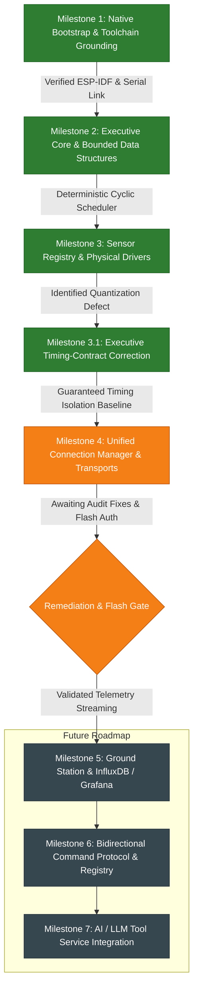

# NEXUS — Milestone Documentation Index & Development Roadmap

Welcome to the definitive milestone and technical documentation index for **NEXUS** (*Networked Environmental eXecutive with Unified Sensing*). 

This directory contains the sequential, fully documented technical records of every architectural phase, design decision, debugging investigation, and validation campaign across the project's development history.

---

## 1. Milestone Index & Authoritative Status Table

| Milestone | Document Link | Title & Subsystem Scope | Status | Evidence Level | Primary Artifacts & Commits |
|---|---|---|---|---|---|
| **M1** | [**MILESTONE_1.md**](MILESTONE_1.md) | Native ESP-IDF Bootstrap & Hardware Verification Baseline | **ACCEPTED** | Physical Hardware Serial Log | `1c24124`, `419e2c7` |
| **M2** | [**MILESTONE_2.md**](MILESTONE_2.md) | Executive Core & Bounded Data Structures | **ACCEPTED** | Host Unit Tests + 65s Physical Serial Log | `0666a9f` |
| **M3** | [**MILESTONE_3.md**](MILESTONE_3.md) | Sensor Subsystem, Sensor Registry & Initial Active Drivers | **ACCEPTED** (with timing audit) | Host Unit Tests + 65s Physical Telemetry | `0bd6fb2` |
| **M3.1** | [**MILESTONE_3_1.md**](MILESTONE_3_1.md) | Executive Timing-Contract Correction & Hardware Baseline | **ACCEPTED** | Host Regression Tests + 70s Physical Telemetry | `9738535`, `17cea82`, [`milestone3_1_validation_report.md`](../validation/milestone3_1_validation_report.md) |
| **M4** | [**MILESTONE_4.md**](MILESTONE_4.md) | Unified Connection Manager, Protocol v1 Envelopes & Audit | **REMEDIATED & VERIFIED** | Host Unit Tests (10/10, ASan/UBSan) + ESP-IDF Clean Build | Working tree, [`MILESTONE4_CONNECTION_MANAGER.md`](../MILESTONE4_CONNECTION_MANAGER.md), `tests/test_milestone4_host.c` |
| **Hist** | [**PROJECT_HISTORY.md**](PROJECT_HISTORY.md) | Chronological Project History & Architectural Evolution | **CURRENT** | Synthesis of all repository milestones | [`PROJECT_HISTORY.md`](PROJECT_HISTORY.md) |

---

## 2. Milestone Summaries

### [Milestone 1 — Native ESP-IDF Bootstrap & Hardware Baseline](MILESTONE_1.md)
- **Objective**: Establish native ESP-IDF v6.0.1 development toolchain on Fedora Linux, verify classic ESP32 target architecture (`ESP32-D0WD-V3` rev 3.1), and validate bootloader and UART0 communication at 115200 baud.
- **Key Deliverables**: Initial CMake configuration, `sdkconfig` generation, `app_main.c` reporting reset reason and free heap, 1-second periodic heartbeat.
- **Outcome**: Flashed cleanly to `/dev/ttyUSB0`; verified power-on reset (`reset_reason=1`), heap baseline (~304 KB free), and project identity transition from *Apollo EDU_ROBO* to *NEXUS*.

### [Milestone 2 — Executive Core & Bounded Data Structures](MILESTONE_2.md)
- **Objective**: Eliminate dynamic memory allocation and replace ad-hoc FreeRTOS task proliferation with a deterministic, application-level cooperative cyclic executive.
- **Key Deliverables**: 16-descriptor static job table (`nexus_job_table`), 16-entry priority ready queue with FIFO tie-breaking (`nexus_ready_queue`), 32-entry diagnostic event ring buffer (`nexus_event_queue`), 64-sample sensor history buffer (`nexus_ring_buffer`), and a 100 ms cyclic executive task (`nexus_exec`, Priority 3).
- **Outcome**: 5/5 host unit tests passed (100%); on-device self-test passed; validated over 65 seconds of continuous hardware execution with zero overflows and zero watchdog resets.

### [Milestone 3 — Sensor Subsystem, Sensor Registry & Initial Active Drivers](MILESTONE_3.md)
- **Objective**: Integrate physical environmental sensors into the executive as Priority Class 1 jobs while adhering to the non-blocking execution contract.
- **Key Deliverables**: Centralized 8-sensor registry (`nexus_sensor_registry`), ADC1-only driver (`nexus_adc`), LDR light driver on GPIO 35 (`nexus_adc_ldr`), CD4051 8:1 multiplexer driver on GPIO 36/4/2/5 reading HW-870 MQ Gas sensor on Channel X0 (`nexus_cd4051`), and single-wire DHT11 driver on GPIO 19 (`nexus_dht11`).
- **Debugging & Audit**:
  - Remediated executive-blocking $20\text{ ms}$ DHT11 start pulse by refactoring driver to an asynchronous FreeRTOS worker task (`nexus_dht11_worker`, Priority 2).
  - Resolved `dispatched = completed + 4` snapshot-order invariant: $\text{dispatched} = \text{completed} + 3 (\text{startup failures}) + 1 (\text{in-flight})$.
  - Identified startup deadline miss defect where startup quantization was falsely evaluated against callback execution budgets.

### [Milestone 3.1 — Executive Timing-Contract Correction & Hardware Baseline](MILESTONE_3_1.md)
- **Objective**: Disambiguate the executive timing contract and establish an authoritative, fully characterized physical validation baseline.
- **Key Deliverables**:
  - Decoupled dispatch latency from callback execution budgets in `nexus_executive.c`.
  - Redefined `deadline_ms` strictly as maximum permitted callback execution duration.
  - Added independent peak tracking for dispatch latency (`max_dispatch_latency_us`) and callback duration (`max_job_duration_us`).
  - Added regression test suite covering budget-only violations, snapshot invariants, and startup quantization timelines.
- **Outcome**: Flashed to ESP32 (`SHA-256: 621d6199...`, 160,784 B); 70-second cold-boot serial capture proved `dline_misses = 0` throughout all 310 dispatches, peak dispatch latency of $92.4\ \mu\text{s}$ (startup quantization), callback duration bounded at $40.9\text{ ms}$ ($< 50\text{ ms}$ budget), and zero heap leaks. Milestone **ACCEPTED**.

### [Milestone 4 — Unified Connection Manager, Envelopes & Correctness Remediation](MILESTONE_4.md)
- **Objective**: Build an asynchronous, multi-transport communication backbone abstracting USB Serial and Wi-Fi/MQTT without violating executive real-time guarantees.
- **Key Deliverables**:
  - Unified transport interface (`nexus_transport_t`) with virtual ops table.
  - Standardized Protocol v1 256-byte newline-delimited JSON envelopes (`nexus_envelope_t`) for `hb`, `telem`, `status`, and `event`.
  - Dedicated background FreeRTOS worker task (`nexus_conn`, Priority 2, 10 ms loop) draining a static 16-slot transmit queue.
  - Routing policies (`AUTO` with transparent serial fallback, `SERIAL_ONLY`, `MQTT_ONLY`, `BROADCAST`) and 32-entry sliding sequence deduplication filter.
  - Remediated all pre-hardware audit findings F-01 through F-06 and the worker task lifecycle race: bounded scratch parser ($\text{len} < 256$), composite deduplication key `(source, dev, seq)`, dual-core spinlocks for telemetry state/stats, geometric Wi-Fi reconnect backoff timer, Kconfig configuration isolation (`Kconfig.projbuild`), event handler cleanup, and safe FreeRTOS task exit semaphore rendezvous (`task_exit_sem` with 500 ms bounded timeout and retry semantics, removal of `vTaskDelete(th)`, worker self-stop rejection, early queue drain breakout, and startup rollback).
  - Expanded host test suite (`tests/test_milestone4_host.c`): 11/11 test groups passed (100%), verified with Clang AddressSanitizer and UndefinedBehaviorSanitizer (zero errors/leaks).
- **Build & Verification Status**:
  - Native ESP-IDF v6.0.1 builds `nexus.bin` (SHA-256 `f5b5f476...`, 886 KB) with zero warnings and zero errors.
  - Physical flashing and on-air network verification remain **PENDING** explicit hardware authorization.

---

## 3. Subsystem Dependency & Progression Graph

---

## 4. Evidence Classification Standards

To prevent ambiguity regarding what has been physically demonstrated versus simulated or compiled, NEXUS documentation enforces five strict evidence classifications:

1. **Host Unit Tests (`HOST_TEST`)**:
   Code is compiled on Fedora Linux with `gcc` and executed locally against mocked hardware or loopback interfaces. Demonstrates algorithmic correctness, memory bounds, and queue mechanics. Does NOT prove ESP32 silicon execution.
2. **Firmware Compilation (`BUILD_PASS`)**:
   Cross-compilation for Xtensa LX6 using ESP-IDF `idf.py build` succeeds with zero errors and zero warnings. Proves binary linkability, memory partition fitting, and header compatibility.
3. **Physical Serial Log (`HW_SERIAL_LOG`)**:
   Firmware binary is hashed and flashed to physical ESP32 flash memory (`idf.py flash`), rebooted, and continuous serial output is recorded via hardware UART at 115200 baud. Proves bootloader stability, RTOS scheduling, and physical register interactions.
4. **Source Correctness Audit (`SOURCE_AUDIT`)**:
   Static manual inspection of code paths, pointer math, FreeRTOS task synchronization, lock ordering, and boundary conditions. Identifies race conditions, memory leaks, and protocol defects prior to hardware testing.
5. **Pending Validation (`PENDING_VAL`)**:
   Features implemented in code but lacking empirical hardware confirmation. Never claimed as functioning until verified on physical target.

---

## 5. Future Development Roadmap

Following the completion and physical validation of Milestone 4:
- **Milestone 5 — Host Ground Station, InfluxDB & Grafana**:
  - Python-based host serial/MQTT ingestion daemon in `ground_station/`.
  - InfluxDB time-series storage schema for environmental telemetry.
  - Production Grafana dashboard displaying live temperature, humidity, gas concentration, light intensity, and executive health metrics.
- **Milestone 6 — Bidirectional Command Protocol & Command Registry**:
  - Formal command dispatch table on ESP32 (`nexus_command_registry`).
  - Secure inbound command parsing (`LED`, `BUZ`, `RATE`, `RESET`, `CALIB`).
  - Host-to-device command acknowledgments with explicit error codes.
- **Milestone 7 — AI / LLM Telemetry Service**:
  - Python tool service bridging local telemetry to Open WebUI.
  - Evaluation of local SLM inference (Cactus-Compute / Needle) on compatible models.
