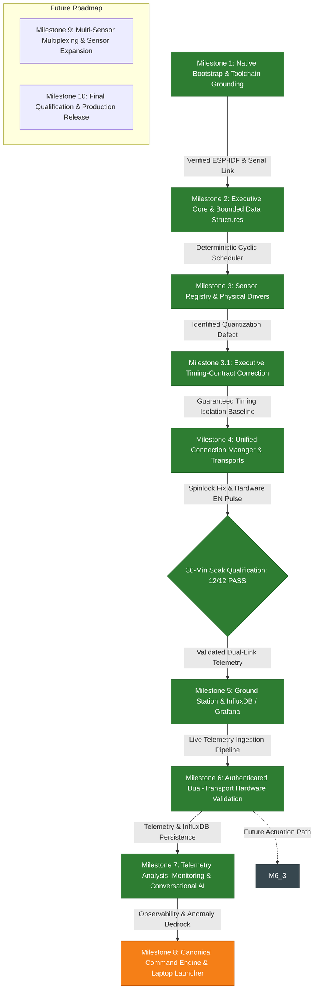

# NEXUS — Milestone Documentation Index & Development Roadmap

Welcome to the definitive milestone and technical documentation index for **NEXUS** (*Networked Environmental eXecutive with Unified Sensing*). 

This directory contains the sequential, fully documented technical records of every architectural phase, design decision, debugging investigation, and validation campaign across the project's development history.

---

## 1. Milestone Index & Authoritative Status Table

| Milestone | Document Link | Title & Subsystem Scope | Status | Evidence Level | Primary Artifacts & Commits |
|---|---|---|---|---|---|
| **M1** | [**MILESTONE_1.md**](MILESTONE_1.md) | Native ESP-IDF Bootstrap & Hardware Verification Baseline | **ACCEPTED** | Physical Hardware Serial Log | `1c24124`, `419e2c7` |
| **M2** | [**MILESTONE_2.md**](MILESTONE_2.md) | Executive Core & Bounded Data Structures | **ACCEPTED** | Host Unit Tests + 65s Physical Serial Log | `0666a9f` |
| **M3** | [**MILESTONE_3.md**](MILESTONE_3.md) | Sensor Subsystem, Sensor Registry & Initial Active Drivers | **ACCEPTED** (with timing audit) | Host Unit Tests + 65s Physical Telemetry | `0bd6fb2` |
| **M3.1** | [**MILESTONE_3_1.md**](MILESTONE_3_1.md) | Executive Timing-Contract Correction & Hardware Baseline | **ACCEPTED** | Host Regression Tests + 70s Physical Telemetry | `9738535`, `17cea82`, [`milestone3_1_validation_report.md`](../validation/milestone3_1_validation_report.md) |
| **M4** | [**MILESTONE_4.md**](MILESTONE_4.md) | Unified Connection Manager, Protocol v1 Envelopes & Audit | **ACCEPTED & SIGNED OFF** | Physical 30-min Hardware Soak (12/12 Criteria PASS) | `build/nexus.bin` (`4f9850bc...`), [`soak_qualification_run2_report.md`](../validation/soak_qualification_run2_report.md), [`milestone4_validation_report.md`](../validation/milestone4_validation_report.md) |
| **M5** | [**MILESTONE_5.md**](MILESTONE_5.md) | Python Ground Station, InfluxDB Persistence & Grafana Observability | **ACCEPTED & COMMITTED** | 99 Unit Tests (100% pass) + Physical Serial Log | `59b2864`, `7243003`, [`run_serial_ingestion.py`](../../ground_station/run_serial_ingestion.py), [`phase6_1_serial_ingestion.log`](../validation/phase6_1_serial_ingestion.log) |
| **M6** | [**MILESTONE_6.md**](MILESTONE_6.md) | Secure Wi-Fi/MQTT Transport, Broker Authentication & End-to-End Acceptance | **COMPLETE — PHYSICALLY VERIFIED** | 10/10 Physical Hardware Acceptance Criteria PASS (Multi-Transport + Live InfluxDB & Grafana) | `8f53877`, `ee20f8d`, `7243003`, [`milestone6_3_validation_report.md`](../validation/milestone6_3_validation_report.md), [`m6_3_mqtt_telemetry.log`](../validation/m6_3_mqtt_telemetry.log) |
| **M7** | [**MILESTONE_7.md**](MILESTONE_7.md) | Telemetry Analysis, Deterministic Incident Monitoring & Conversational AI | **ACCEPTED & COMMITTED** | 210/210 Regression Tests PASS + Open WebUI Tool Round-Trip + Physical Hardware InfluxDB Persistence | `3cc3426`, `42f4c08`, `54c1319`, `bc7cf0d`, `a445a3f`, [`M7_FINAL_CLOSURE.md`](../validation/M7_FINAL_CLOSURE.md) |
| **M8** | [**MILESTONE_8.md**](MILESTONE_8.md) | Canonical Command Engine, Bidirectional Protocol & Laptop Launcher | **IMPLEMENTED & VERIFIED** | 38/38 C Host Tests (100%) + 215/215 PyTest (100%) + ESP-IDF Build PASS | [`nexus_command_registry.c`](../../firmware/main/command/nexus_command_registry.c), [`application_launcher.py`](../../ground_station/command_router/application_launcher.py), [`MILESTONE_8.md`](MILESTONE_8.md) |
| **Hist** | [**PROJECT_HISTORY.md**](PROJECT_HISTORY.md) | Chronological Project History & Architectural Evolution | **CURRENT** | Synthesis of all repository milestones | [`PROJECT_HISTORY.md`](PROJECT_HISTORY.md) |

---

## 2. Milestone Summaries

### [Milestone 1 — Native ESP-IDF Bootstrap & Hardware Baseline](MILESTONE_1.md)
- **Objective**: Establish native ESP-IDF v6.0.1 development toolchain on Fedora Linux, verify classic ESP32 target architecture (`ESP32-D0WD-V3` rev 3.1), and validate bootloader and UART0 communication at 115200 baud.
- **Key Deliverables**: Initial CMake configuration, `sdkconfig` generation, `app_main.c` reporting reset reason and free heap, 1-second periodic heartbeat.
- **Outcome**: Flashed cleanly to `/dev/ttyUSB0`; verified power-on reset (`reset_reason=1`), heap baseline (~304 KB free), and project identity transition from *Apollo EDU_ROBO* to *NEXUS*.

### [Milestone 2 — Executive Core & Bounded Data Structures](MILESTONE_2.md)
- **Objective**: Eliminate dynamic memory allocation and replace ad-hoc FreeRTOS task proliferation with a deterministic, application-level cooperative cyclic executive.
- **Key Deliverables**: 16-descriptor static job table (`nexus_job_table`), 16-entry priority ready queue with FIFO tie-breaking (`nexus_ready_queue`), 32-entry diagnostic event ring buffer (`nexus_event_queue`), 64-sample sensor history buffer (`nexus_ring_buffer`), and a 100 ms cyclic executive task (`nexus_exec`, Priority 3).
- **Outcome**: 5/5 host unit tests passed (100%); on-device self-test passed; validated over 65 seconds of continuous hardware execution with zero overflows and zero watchdog resets.

### [Milestone 3 — Sensor Subsystem, Sensor Registry & Initial Active Drivers](MILESTONE_3.md)
- **Objective**: Integrate physical environmental sensors into the executive as Priority Class 1 jobs while adhering to the non-blocking execution contract.
- **Key Deliverables**: Centralized 8-sensor registry (`nexus_sensor_registry`), ADC1-only driver (`nexus_adc`), LDR light driver on GPIO 35 (`nexus_adc_ldr`), CD4051 8:1 multiplexer driver on GPIO 36/4/2/5 reading HW-870 MQ Gas sensor on Channel X0 (`nexus_cd4051`), and single-wire DHT11 driver on GPIO 19 (`nexus_dht11`).
- **Debugging & Audit**:
  - Remediated executive-blocking $20\text{ ms}$ DHT11 start pulse by refactoring driver to an asynchronous FreeRTOS worker task (`nexus_dht11_worker`, Priority 2).
  - Resolved `dispatched = completed + 4` snapshot-order invariant: $\text{dispatched} = \text{completed} + 3 (\text{startup failures}) + 1 (\text{in-flight})$.
  - Identified startup deadline miss defect where startup quantization was falsely evaluated against callback execution budgets.

### [Milestone 3.1 — Executive Timing-Contract Correction & Hardware Baseline](MILESTONE_3_1.md)
- **Objective**: Disambiguate the executive timing contract and establish an authoritative, fully characterized physical validation baseline.
- **Key Deliverables**:
  - Decoupled dispatch latency from callback execution budgets in `nexus_executive.c`.
  - Redefined `deadline_ms` strictly as maximum permitted callback execution duration.
  - Added independent peak tracking for dispatch latency (`max_dispatch_latency_us`) and callback duration (`max_job_duration_us`).
  - Added regression test suite covering budget-only violations, snapshot invariants, and startup quantization timelines.
- **Outcome**: Flashed to ESP32 (`SHA-256: 621d6199...`, 160,784 B); 70-second cold-boot serial capture proved `dline_misses = 0` throughout all 310 dispatches, peak dispatch latency of $92.4\ \mu\text{s}$ (startup quantization), callback duration bounded at $40.9\text{ ms}$ ($< 50\text{ ms}$ budget), and zero heap leaks. Milestone **ACCEPTED**.

### [Milestone 4 — Unified Connection Manager, Envelopes & Correctness Remediation](MILESTONE_4.md)
- **Objective**: Build an asynchronous, multi-transport communication backbone abstracting USB Serial and Wi-Fi/MQTT without violating executive real-time guarantees.
- **Key Deliverables**:
  - Unified transport interface (`nexus_transport_t`) with virtual ops table.
  - Standardized Protocol v1 256-byte newline-delimited JSON envelopes (`nexus_envelope_t`) for `hb`, `telem`, `status`, and `event`.
  - Dedicated background FreeRTOS worker task (`nexus_conn`, Priority 2, 10 ms loop) draining a static 16-slot transmit queue.
  - Routing policies (`AUTO` with transparent serial fallback, `SERIAL_ONLY`, `MQTT_ONLY`, `BROADCAST`) and 32-entry sliding sequence deduplication filter.
  - Remediated all pre-hardware audit findings F-01 through F-06 and the worker task lifecycle race: bounded scratch parser ($\text{len} < 256$), composite deduplication key `(source, dev, seq)`, dual-core spinlocks for telemetry state/stats, geometric Wi-Fi reconnect backoff timer, Kconfig configuration isolation (`Kconfig.projbuild`), event handler cleanup, and safe FreeRTOS task exit semaphore rendezvous (`task_exit_sem` with 500 ms bounded timeout and retry semantics, removal of `vTaskDelete(th)`, worker self-stop rejection, early queue drain breakout, and startup rollback).
  - Resolved transport queue preemption contention via dual-core spinlock critical section `s_conn_mgr_tx_mux` (`taskENTER_CRITICAL` / `taskEXIT_CRITICAL`), bounding duration to $\le 1.8\ \mu\text{s}$ and eliminating preemption drops.
  - Expanded host test suite (`tests/test_milestone4_host.c`): 14/14 test groups passed (100%), verified with Clang AddressSanitizer and UndefinedBehaviorSanitizer (zero errors/leaks).
- **Build & Verification Status**:
  - Native ESP-IDF v6.0.1 builds `build/nexus.bin` (SHA-256 `4f9850bc466016070cd9554e8c37889f46ec6675d62db323e62feb38ad5c01d3`, 913,552 bytes) with zero warnings and zero errors.
  - Physical 30-minute continuous hardware soak qualification (**12/12 criteria PASS**, 100%): `tx_drop=0`, `tx_fail=0`, `dline_misses=0`, `q_overflows=0`, 0 resets, monotonic uptime 1,798.9 s, heap leak-free (+199.4 B/hr, $R^2=0.00$), 89.09% valid telemetry, 89.17% physical driver success.
  - **Milestone 4 is FULLY ACCEPTED AND SIGNED OFF (PASS)**. Cleared to proceed to Milestone 5.

### [Milestone 5 — Host Ground Station, InfluxDB & Grafana Observability](MILESTONE_5.md)
- **Objective**: Implement a modular, asynchronous Python host ground station daemon and containerized observability stack for real-time ingestion, time-series storage, and visual monitoring of Protocol v1 telemetry.
- **Key Deliverables**:
  - Python ground station package in `ground_station/`: `EnvelopeParser`, `DeviceTracker`, `NexusHostManager`, `SerialTransportAdapter`, `MqttTransportAdapter`, `PersistenceWriter`, `PointMapper`, and `InfluxDBWriter`.
  - Strict Protocol v1 validation: 256-byte framing ceiling, rejection of non-finite float values (`NaN`, `Inf`), payload schema verification, and device identity quarantine.
  - Transport resilience: Hardware-safe serial adapter with DTR/RTS explicitly deasserted (`ser.dtr = False`, `ser.rts = False`, `rtscts=False`) to prevent ESP32 bootloader reset loops; Paho MQTT v2 adapter with strict topic regex validation.
  - InfluxDB v2 schema design: Tag cardinality bounded to `dev`, `type`, and `transport`. Numeric telemetry, sequence numbers, and monotonic uptime stored strictly as unindexed fields. Missing DHT11 data omitted (`temp`/`hum` omitted when `dht_valid=false`) rather than stored as false zero readings. Host wall-clock receive timestamping (`received_at`).
  - Containerized infrastructure (`docker-compose.yml`): InfluxDB 2.7.11, Eclipse Mosquitto 2.1.2, and Grafana 11.5.0 with strict loopback bindings (`127.0.0.1`), healthchecks, persistent volumes, and `.env.example`.
  - Grafana dashboard (`grafana/dashboards/nexus_telemetry.json`): 8-panel production dashboard featuring live environmental telemetry, executive health, and transport diagnostics.
  - Remediation & Lifecycle: Fixed InfluxDB writer shutdown race on timed-out worker joins via `is_shutdown_timed_out` tracking and restart prevention.
  - Host test suite: 99 automated unit tests across 10 test modules (100% pass rate).
  - Physical hardware serial validation: `ground_station/run_serial_ingestion.py` streamed and validated live frames over `/dev/ttyUSB0` at 115200 baud (`docs/validation/phase6_1_serial_ingestion.log`).
- **Outcome**: Ground station daemon and observability stack fully accepted and committed (`59b2864`, `7243003`).

### [Milestone 6 — Secure Wi-Fi/MQTT Transport, Broker Authentication & Hardware Validation](MILESTONE_6.md)
- **Objective**: Establish a hardened, authenticated Wi-Fi/MQTT telemetry pipeline connecting physical ESP32 hardware to the containerized broker and Ground Station while preserving loopback network isolation and USB serial operation.
- **Key Deliverables**:
  - **Phase 6.1**: Physical USB serial ingestion validated via [`ground_station/run_serial_ingestion.py`](../../ground_station/run_serial_ingestion.py) over `/dev/ttyUSB0` (61 frames, 0 drops, live InfluxDB storage).
  - **Phase 6.2A**: Designed network architecture with container loopback binding (`127.0.0.1:1883`) and controlled host forwarder (`10.12.252.18:1883`), role-based identities, and least-privilege topic hierarchy (`nexus/<dev>/telemetry`, `nexus/<dev>/cmd`).
  - **Phase 6.2B**: Hardened Eclipse Mosquitto 2.1.2 broker in [`docker-compose.yml`](../../docker-compose.yml) with `allow_anonymous false`, hashed password file (`mosquitto.passwd`), and topic ACLs (`mosquitto.acl`) mounted read-only (`:ro,z`).
  - **Phase 6.2B.1**: Security enforcement verified with 9-test host suite (anonymous connection rejected, bad password rejected, unauthorized publish rejected with MQTT v5 Reason Code 135, loopback binding verified).
  - **Phase 6.2C**: Firmware MQTT authentication wired via native ESP-IDF v6.0.1 `esp_mqtt_client_config_t` APIs; missing-credential guard implemented (`NEXUS_CONN_STATE_FAILED`); local secret isolation established via git-ignored [`credentials/sdkconfig.local`](../../credentials/sdkconfig.local) and CMake fallback; 15/15 host C unit tests passed (ASan/UBSan clean).
  - **Phase 6.3**: Permanent broker LAN binding (`10.12.252.18:1883`), Ground Station MQTT ingestion runner (`run_mqtt_ingestion.py`), simultaneous multi-transport dual-stream runner (`run_dual_transport_ingestion.py`), direct InfluxDB storage verification (>445 MQTT points), Grafana query verification, and broker fault-tolerance / reconnection testing.
- **Outcome**: **10/10 Physical Acceptance Criteria PASS**. Milestone 6 is **COMPLETE — PHYSICALLY VERIFIED**. Proceeding to Milestone 7.

### [Milestone 7 — Telemetry Analysis, Deterministic Incident Monitoring & Conversational AI](MILESTONE_7.md)
- **Objective**: Establish an air-gapped, local-first intelligence and automated monitoring layer on top of the physical telemetry pipeline, featuring typed analysis abstractions, durable SQLite incident storage, deterministic anomaly rules, and natural-language telemetry querying via local SLMs (Mistral 7B) and Open WebUI.
- **Key Deliverables**:
  - **Phase 7.1 (Analysis Foundation)**: Implemented typed models (`TelemetryPoint`, `DeviceSeries`, `DataQualityReport`, `SignalStatistics`), data quality metrics (null rate, sequence continuity, cadence jitter, validity flags), bounded InfluxDB Flux queries (1,000-point hard cap + server-side aggregations), and reboot-safe dual-transport deduplication in [`ground_station/analysis/`](../../ground_station/analysis/).
  - **Phase 7.2 (Deterministic Monitoring & Store)**: Built a thread-safe SQLite incident store (`incidents.db`) in WAL mode with atomic status transitions. Implemented pluggable rules (`FreshnessRule`, `SensorAnomalyRule`, `ExecutiveHealthRule`), outage-aware state handling, and an adaptive evaluation scheduler in [`ground_station/monitoring/`](../../ground_station/monitoring/).
  - **Phase 7.3 (Read-Only AI Core)**: Designed a strictly read-only security boundary, 9 bounded operational telemetry tools, local model integration via Ollama (`mistral:7b`), deterministic Rule Router fallback for offline operation, and an interactive operator CLI in [`ground_station/ai/`](../../ground_station/ai/).
  - **Phase 7.4 (Operational Integration)**: Created native Open WebUI tool adapter (`open_webui_tools.py`), automated tool registration script (`register_open_webui.py`), standalone monitoring runner (`runner.py`), and `--enable-monitoring` lifecycle hooks across all ingestion scripts with single-worker guarantees in dual-transport mode.
  - **Phase 7.5 (Live Validation & Hardware Acceptance)**: Verified complete physical pipeline (ESP32 $\to$ Mosquitto $\to$ Ground Station $\to$ InfluxDB $\to$ Grafana) with 32 consecutive frames, InfluxDB persistence, Grafana panel query, and live Open WebUI tool-call round-trip with Mistral 7B. Disambiguated uncalibrated raw ADC semantics (`x0_raw_adc`).
- **Outcome**: **210/210 Regression Tests PASS** in 8.12s; Ruff lint clean. Milestone 7 is **FULLY ACCEPTED & COMMITTED**.

### [Milestone 8 — Canonical Command Engine, Bidirectional Protocol & Laptop Launcher](MILESTONE_8.md)
- **Objective**: Establish the canonical, deterministic command engine across firmware and Ground Station, enabling remote executive control, diagnostic retrieval, and safe board-to-laptop application launching.
- **Key Deliverables**:
  - Authoritative 52-command canonical registry reconciled with `docs/PROJECT_BLUEPRINT.md`: deterministic 16-bit IDs `(verb << 8) | noun`, milestone dispositions, and bounded argument models.
  - Firmware command parser and dispatcher in `firmware/main/command/`: zero-allocation, bounded 256-byte envelopes, structured responses (`status`, `code`, `msg`, `uptime`), integrated with Connection Manager RX callback.
  - Safe Ground Station Application Launcher in `ground_station/command_router/application_launcher.py`: allowlisted actions (`DASHBOARD`, `LOGS`, `AI`, `GROUND`), URL scheme/host/port validation, shell injection prevention, and configurable idempotency cooldown suppression.
  - Bidirectional Command Router in `ground_station/command_router/router.py`: routes inbound `OPEN` commands to launcher, tracks response correlation, and dispatches outbound commands.
  - Physical boundary analysis: Explicitly separated ESP32-originated commands, laptop-originated commands, and documented the physical board-side input gap (GPIO1/UART0 conflict; absence of keypad).
- **Outcome**: **38/38 C Host Tests PASS** (100%), **215/215 Python Tests PASS** (100%), clean ESP-IDF compilation (`nexus.bin`, 0xe1ca0 bytes). Milestone 8 is **IMPLEMENTED & VERIFIED**.

---

## 3. Subsystem Dependency & Progression Graph

---

## 4. Evidence Classification Standards

To prevent ambiguity regarding what has been physically demonstrated versus simulated or compiled, NEXUS documentation enforces five strict evidence classifications:

1. **Host Unit Tests (`HOST_TEST`)**:
   Code is compiled on Fedora Linux with `gcc` (firmware) or executed via `pytest` (ground station) locally against mocked hardware or loopback interfaces. Demonstrates algorithmic correctness, memory bounds, and queue mechanics. Does NOT prove ESP32 silicon execution.
2. **Firmware Compilation (`BUILD_PASS`)**:
   Cross-compilation for Xtensa LX6 using ESP-IDF `idf.py build` succeeds with zero errors and zero warnings. Proves binary linkability, memory partition fitting, and header compatibility.
3. **Physical Serial Log (`HW_SERIAL_LOG`)**:
   Firmware binary is hashed and flashed to physical ESP32 flash memory (`idf.py flash`), rebooted, and continuous serial output is recorded via hardware UART at 115200 baud. Proves bootloader stability, RTOS scheduling, and physical register interactions.
4. **Source Correctness Audit (`SOURCE_AUDIT`)**:
   Static manual inspection of code paths, pointer math, FreeRTOS task synchronization, lock ordering, and boundary conditions. Identifies race conditions, memory leaks, and protocol defects prior to hardware testing.
5. **Pending Validation (`PENDING_VAL`)**:
   Features implemented in code but lacking empirical hardware confirmation. Never claimed as functioning until verified on physical target.

---

## 5. Future Development Roadmap

Following the completion and validation of Milestone 7:
- **Milestone 8 — Multi-Sensor Multiplexing & Extended Hardware Qualification (NEXT)**:
  - Activate remaining multiplexer channels on the CD4051 (Channels X1 through X7) to support expanded gas and analog sensor suites.
  - Formulate multi-channel ADC sampling schedules within the cyclic executive without violating execution budgets.
  - Expand InfluxDB schemas and Grafana dashboards for multi-channel gas analysis.
  - Extend deterministic monitoring rules to correlate multi-sensor thermal and chemical gradients.
- **Milestone 6.3 — Bidirectional Command Protocol & Command Registry**:
  - Formal command dispatch table on ESP32 (`nexus_command_registry`).
  - Inbound command reception on `nexus/<device_id>/cmd` via `nexus_wifi_mqtt_rx_handler_t`.
  - Secure command parsing and execution inside the cyclic executive (`LED`, `BUZ`, `RATE`, `RESET`, `CALIB`).
  - Host-to-device command acknowledgments and execution responses (`resp` envelopes).
