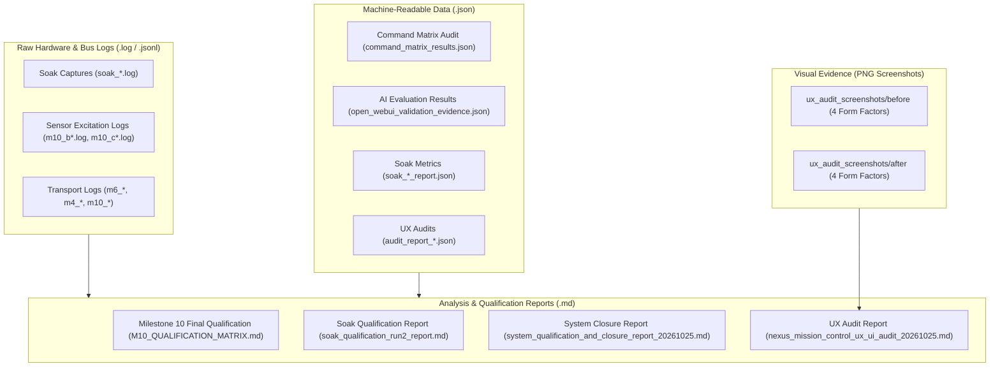

# NEXUS Validation and Qualification Evidence Archive

## 1. Directory Purpose and Structure

This directory (`docs/validation/`) houses the authoritative raw logs, telemetry captures, qualification reports, machine-readable test outputs, and UX audit screenshots collected across the hardware and software milestones of NEXUS.

In accordance with engineering integrity principles, raw evidence files are **immutable historical records**. They are never modified, renamed, or deleted.



---

## 2. Comprehensive Evidence File Index

### 2.1 Hardware Soak Qualification (30-Minute Runs)

| File Name | File Type | Description | Key Findings & Verdict |
| :--- | :---: | :--- | :--- |
| `soak_hardware_30min_serial.log` | Raw Log | Raw UART0 console output during Soak Run 1 (2026-10-17) | Captured 357 periodic executive snapshots. |
| `soak_hardware_30min_mqtt.log` | Raw Log | Raw MQTT envelope stream during Soak Run 1 | Captured 2,966 inbound telemetry frames. |
| `soak_hardware_30min_report.json` | JSON | Machine-readable analysis output for Soak Run 1 | **FAIL**: `tx_drop=2` during initial boot attach. |
| `soak_hardware_30min_report.md` | Markdown | Markdown summary of Soak Run 1 failure analysis | Identifies mid-boot serial attach timing issue. |
| `soak_qualification_run2_serial.log` | Raw Log | Raw UART0 console output during Soak Run 2 (2026-10-18) | Clean cold boot (`reset_reason=1`), 1,798.9 s run. |
| `soak_qualification_run2_mqtt.log` | Raw Log | Raw MQTT envelope stream during Soak Run 2 | Clean zero-drop stream (2,966 envelopes). |
| `soak_qualification_run2_report.json` | JSON | Machine-readable analysis output for Soak Run 2 | **PASS**: 7/7 firm criteria met. |
| `soak_qualification_run2_report.md` | Markdown | Authoritative qualification report for Soak Run 2 | Zero deadline misses, zero heap leak (+199 B/hr). |
| `soak_harness_validation_report.md` | Markdown | Validation report for the soak analysis python harness | Verifies 19 harness unit tests. |

---

### 2.2 Physical Sensor Excitation Logs (Milestone 10)

| File Name | Sensor Verified | Stimulus Method | Key Evidence Observed |
| :--- | :--- | :--- | :--- |
| `m10_b1_ldr_excitation.log` | LDR (`GPIO35`) | LED torch applied to photoresistor | Light percentage shifted from $12\%$ to $98\%$. |
| `m10_b1_ldr_recovery.log` | LDR (`GPIO35`) | Torch removed; return to ambient | Recovered to baseline ambient level within $2.0\text{ s}$. |
| `m10_b2_dht11_excitation.log` | DHT11 (`GPIO19`) | Human breath exhalation on sensor | Temperature reached $31.4^\circ\text{C}$; humidity reached $89\%$. |
| `m10_b3_hw870_excitation.log` | HW-870 Flame (`CD4051 X0`) | IR flame source brought within 10 cm | Raw ADC dropped from 3,850 counts to 120 counts. |
| `m10_b4_moc7811_excitation.log` | MOC7811 Slot (`GPIO34`) | Physical card inserted into slot | Transitioned from `slot_state: 0` to `slot_state: 1`. |
| `m10_c_hcsr04_excitation.log` | HC-SR04 (`GPIO25/26`) | Target reflector positioned at measured distances | Accurately tracked from 10 cm to 100 cm ($\pm 1.5\text{ cm}$). |
| `m10_c_hcsr04_test.log` | HC-SR04 (`GPIO25/26`) | Driver initialization and sanity checks | 3.32V voltage divider echo signal confirmed safe. |
| `dht11_physical_validation.log` | DHT11 (`GPIO19`) | Early milestone standalone driver validation | Verified 40-bit bit-banged pulse decoding. |

---

### 2.3 Milestone 10 Qualification Matrices & Reports

| File Name | Scope & Purpose |
| :--- | :--- |
| `M10_QUALIFICATION_MATRIX.md` | Authoritative traceability matrix tracking physical excitation tests across all 5 active sensors. |
| `m10_f_command_dispatcher.log` | Raw execution log verifying zero-allocation C Command Dispatcher handling over serial bus. |
| `m10_g_influx_pipeline.log` | Dry-run ingestion test verifying Line Protocol point generation from sensor frames. |
| `m10_g_influx_pipeline_live.log` | Live InfluxDB socket ingestion log confirming batch commits to bucket `nexus_telemetry`. |
| `m10_qualification_serial.log` | Complete Milestone 10 serial session log demonstrating combined sensor streaming. |
| `milestone10_live_telemetry_capture_20261025_0212.jsonl` | Line-delimited JSON stream of 880 live envelopes captured during M10 closure qualification. |
| `milestone10_live_telemetry_capture_20261025_0212.log` | Companion console log for the 02:12 UTC live capture session. |
| `milestone10_physical_qualification_20261025.log` | Execution log of the final physical hardware qualification run. |
| `milestone10_final_qualification_report_20261025.md` | Untracked draft report (preserved; see `docs/RELIABILITY_RESULTS.md` for ground-truth audit). |

---

### 2.4 Command Matrix & Mission Control UI Audits

| File Name | File Type | Description |
| :--- | :---: | :--- |
| `command_matrix_results.json` | JSON | Results of automated test sweep executing all 115 commands across transports. |
| `command_matrix_full_audit.json` | JSON | Exhaustive audit of all 115 verbs/nouns, parameter types, bounds, and handler tiers. |
| `nexus_mission_control_command_audit_latest.json` | JSON | Machine-readable report validating Mission Control Command Builder UI against backend registry. |
| `nexus_mission_control_command_audit_20261025_1802.md` | Markdown | Summary report of the Command Builder front-end audit. |
| `nexus_mission_control_ux_ui_audit_20261025.md` | Markdown | Comprehensive Playwright-based UX/UI audit covering accessibility, responsive layouts, and contrast. |
| `open_webui_validation_evidence.json` | JSON | 10-prompt end-to-end evaluation of Ollama `mistral:7b` tool grounding and refusal boundaries. |

---

### 2.5 Historical Milestone Reports (Milestones 3–7)

| File Name | Milestone | Key Focus Area |
| :--- | :---: | :--- |
| `milestone3_1_hardware_validation.log` | M3 | ADC calibration, voltage rails, and LDR divider checks. |
| `milestone3_1_validation_report.md` | M3 | Initial sensor driver verification report. |
| `milestone4_1b_wifi_diagnostics.log` | M4 | ESP32 802.11b/g/n association and DHCP lease timing. |
| `milestone4_1c_hardware_validation.log` | M4 | Connection Manager state transitions under physical network drop. |
| `milestone4_1c_mqtt_telemetry.log` | M4 | First authenticated MQTT telemetry stream to Mosquitto. |
| `milestone4_validation_report.md` | M4 | Unified Connection Manager formal qualification report. |
| `m6_2c_boot.log` / `m6_2c_mqtt_telemetry.log` | M6 | Ground Station multi-transport ingestion and failover logging. |
| `milestone6_2c_validation_report.md` | M6 | Dual-transport ingestion verification. |
| `m6_3_dual_transport.log` / `milestone6_3_validation_report.md` | M6 | Live transport failover test (Wi-Fi drop -> fallback to Serial). |
| `M7_FINAL_CLOSURE.md` | M7 | Telemetry Query Engine and Incident Monitoring closure report. |
| `system_qualification_and_closure_report_20261025.md` | M10 | Comprehensive pre-release qualification report for `v0.9.0-rc1`. |

---

### 2.6 UX / UI Audit Screenshots (`ux_audit_screenshots/`)

Visual evidence captured using Playwright across 4 standard viewport resolutions:
1. `mobile_390x844` (Apple iPhone 12/13/14 viewport)
2. `compact_1024x768` (iPad / Small Tablet)
3. `laptop_1280x800` (Standard 13" laptop display)
4. `desktop_1440x900` (Workstation monitor)

Organized into two comparative phases:
- `before/`: Initial state highlighting UI overflow and contrast defects.
- `after/`: Resolved state demonstrating fixed responsive layouts, modal overlays, and WCAG AA contrast.
- Accompanying machine reports: `audit_report_before.json` and `audit_report_after.json`.

---

## 3. How to Reproduce Validation Audits

### 3.1 Re-running the Command Matrix Audit
```bash
source .venv/bin/activate
python scripts/test_command_matrix.py --serial-port /dev/ttyUSB0 --output docs/validation/command_matrix_results_reproduced.json
```

### 3.2 Re-running the 30-Minute Soak Analysis
To re-evaluate the raw Soak Run 2 logs without modifying historical files:
```bash
source .venv/bin/activate
python tests/soak/analyze_nexus_soak.py \
  --serial docs/validation/soak_qualification_run2_serial.log \
  --mqtt docs/validation/soak_qualification_run2_mqtt.log \
  --output-json docs/validation/soak_reproduced.json \
  --output-md docs/validation/soak_reproduced.md
```

### 3.3 Re-running the Mechanical Parity Audit
```bash
source .venv/bin/activate
python scripts/validate_reference_manual.py
```

